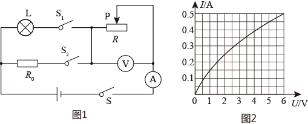

# Physics - 题目 2931

**ID**: 1195691d64bc464f8f3a4bce90adc232
**年级**: Grade 9
**难度**: Hard
**题型**: Comprehensive

## 题目
如图1所示电路，R_{0}=10 ${\rm{Ω}}$ ，滑动变阻器R的最大阻值为40 ${\rm{Ω}}$ ，电压表量程为0~3V，电流表量程为0~0.6A，灯L的I-U图像如图2所示。​​​​​​​‌①闭合S和S_{1}，断开S_{2}时，调节R，使其接入电路的阻值为10Ω，此时电流表示数为0.25A，电源电压为V；②闭合S、S_{2}，断开S_{1}，调节R，使电压表示数为2.5V，则R消耗的功率为W；③在保证电路安全的前提下，当开关S、S_{1}闭合时电路消耗的最小功率为P_{1}，当开关S、S_{2}闭合时电路消耗的最小功率为P_{2}，则P_{1}:P_{2}=。

## 解答

1. ①当闭合S和S_{1}，断开S_{2}时，调节R，使R= 10Ω，灯L与R串联，电压表测R两端电压，电流表测电路中的电流，电流表示数为0.25A，由图2知，U_{L}=2V，故R两端电压
2. U_{R}=IR=0.25A×10Ω=2.5V
3. 则电源电压为
4. U=U_{L}+U_{R}=2V+2.5V=4.5V
5. ②闭合S、S_{2}，断开S_{1}，R_{0}与R串联，电压表测R两端电压，电流表测电路中的电流，使电压表示数为2.5V，则R_{0}两端的电压
6. $U{{}_{0}}=U-U{{}_{{\rm{R}}}^{^{′}}}=4.5{\rm{V}}-2.5{\rm{V}}=2{\rm{V}}$
7. 电路中的电流
8. $I{^{^{′}}}=\frac {U{{}_{0}}}{R{{}_{0}}}=\frac {{\rm{2}}{\rm{V}}}{{\rm{1}}{\rm{0}}{\rm{Ω}}}=0.2{\rm{A}}$
9. R消耗的功率为
10. $P{{}_{{\rm{R}}}}=U{{}_{{\rm{R}}}^{^{′}}}I{^{^{′}}}=2.5{\rm{V}}\times 0.2{\rm{A}}=0.5{\rm{W}}$
11. ③当开关S、S_{1}闭合时, 灯L与R串联，调节滑片使R达到允许最大值，总电阻达到允许最大值，根据 $P{{}_{总}}=\frac {U{^{2}}}{R{{}_{总}}}$ ，总功率达到最小值P_{1}，R越大分压越大，电压表示数越大，电压表示数最大U_{R1}=3V时，R阻值达到允许最大值，此时灯泡两端电压
12. $U{{}_{{\rm{L}}}^{^{′}}}=U-U{{}_{{\rm{R}}{\rm{1}}}}=4.5{\rm{V}}-3{\rm{V}}=1.5{\rm{V}}$
13. 由图像知，电路中的电流I_{1}=0.2A，说明电流不超过电流表的量程，故
14. P_{1}=UI_{1}=4.5V×0.2A=0.9W
15. 当开关S、S_{2}闭合时，R_{0}与R串联，电压表测R两端电压，电流表测电路中的电流，R调到允许最大值，电压表示数最大U_{R1}=3V时，R_{0}两端电压
16. $U{{}_{0}^{^{′}}}=U-U{{}_{{\rm{R}}{\rm{1}}}}=4.5{\rm{V}}-3{\rm{V}}=1.5{\rm{V}}$
17. 电路中的电流
18. $I{{}_{2}}=\frac {U{{}_{0}^{^{′}}}}{R{{}_{0}}}=\frac {{\rm{1}}{\rm{.}}{\rm{5}}{\rm{V}}}{{\rm{1}}{\rm{0}}{\rm{Ω}}}=0.15{\rm{A}}$
19. 说明电流不超过电流表的量程，电路最小功率
20. P_{2}=UI_{2}=4.5V×0.15A=0.675W
21. 故
22. $\frac {P{{}_{1}}}{P{{}_{2}}}=\frac {{\rm{0}}{\rm{.}}{\rm{9}}{\rm{W}}}{{\rm{0}}{\rm{.}}{\rm{6}}{\rm{7}}{\rm{5}}{\rm{W}}}=\frac {4}{3}$

## 知识点

**中文**:
  - 欧姆定律的应用
  - 电阻的伏安特性曲线
  - 电功率的计算及应用

**English**:
  - Applications of Ohm's Law
  - I-V Characteristic Curve of Resistance
  - Calculation and Application of Electric Power

---
