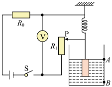

# Physics - 题目 1912

**ID**: 2eb120134792448a88c3b12fd1819175
**年级**: Grade 9
**难度**: Hard
**题型**: Comprehensive

## 题目
如图甲所示是某款水位自动测控仪的原理图，电源电压U恒为12V，定值电阻R_{0}=8Ω，R_{1}总长30cm，阻值为15Ω，其接入电路的阻值与长度成正比。​​​​​​​‌轻质弹簧的阻值为2Ω，上端固定，滑片P固定在弹簧下端且与R_{1}接触良好（摩擦忽略不计）。重60N、高50cm、底面积为80cm^{2}的圆柱体M挂在弹簧下端。当水位处于最高点A时，M刚好浸没，此时滑片P恰在R_{1}最上端；当水位将至最低点B时，M的下表面刚好离开水面。已知弹簧所受拉力F与其伸长量∆L的关系如下表所示。闭合开关S，求：（1）当水位处于位置A时，电压表的示数；（2）当水位处于位置A时，此时弹簧的伸长量为cm；（3）水位由位置A降至B时，此时电路消耗的电功率。F/N020406080∆L/cm010203040

## 解答

1. （1）[1]水位位于A点时，滑片P恰在R_{1}最上端，变阻器接入电路中的电阻为
2. R_{1}=15Ω
3. 根据串联电路电阻的规律可得，总电阻为
4. R_{总}=R_{0}+R_{弹}+R_{1}=8Ω+2Ω+15Ω=25Ω
5. 由欧姆定律可得，电路中的电流为
6. $I=\frac {U}{R{{}_{总}}}=\frac {12{\rm{V}}}{10Ω+15{\rm{Ω}}}=0.48{\rm{A}}$
7. 电压表示数为
8. U_{1}=I（R_{1}+R_{弹}）=0.48A×（15Ω+2Ω）=8.16V
9. （2）[2]当水位处于最高位置A时，M刚好浸没在水中，此时排开水的体积为
10. V_{排}=V_{物}=Sh=80cm^{2}×50cm=4000cm^{3}=4×10^{-3}m^{3}
11. 由浮力公式可得，圆柱体M受到的浮力为
12. F_{浮}=ρ_{水}gV_{排}=1×10^{3}kg/m^{3}×10N/kg×4×10^{-3}m^{3}=40N
13. 由阿基米德原理可得，弹簧所受拉力为
14. F_{拉}=G-F_{浮}=60N-40N=20N
15. 由表知，弹簧的伸长量为
16. ∆L=10cm
17. （3）[3]水位降至B时，M的下表面刚好离开水面弹簧所受拉力为
18. $F{{}_{拉}}{^{\prime }}=G=60{\rm{N}}$
19. 由图可知，弹簧的伸长量为
20. $\Delta L^{′}=30{\rm{c}}{\rm{m}}$
21. 则滑片P与上端距离
22. $L=ΔL^{′}-ΔL=30{\rm{c}}{\rm{m}}-10{\rm{c}}{\rm{m}}=20{\rm{c}}{\rm{m}}$
23. 此时变阻器接入电路中的电阻为
24. $R{{}_{1}}{^{\prime }}=\frac {30{\rm{c}}{\rm{m}}-20{\rm{c}}{\rm{m}}}{30{\rm{c}}{\rm{m}}}\times 15{\rm{Ω}}=5{\rm{Ω}}$
25. 由功率公式可得，此时电路消耗的电功率为
26. $P=\frac {U{^{2}}}{R{{}_{总}}{^{\prime }}}=\frac {U{^{2}}}{R{{}_{0}}+R{{}_{1}}{^{\prime }}}=\frac {(12{\rm{V}}){^{2}}}{10{\rm{Ω}}+5{\rm{Ω}}}=9.6{\rm{W}}$

## 知识点

**中文**:
  - 与欧姆定律有关的动态电路计算
  - 弹簧测力计原理及其使用
  - 二力及多力平衡的判断和应用
  - 阿基米德原理的应用
  - 电功率的计算及应用

**English**:
  - Calculations in Dynamic Circuits using Ohm's Law
  - Principle and Use of Spring Dynamometer
  - Judgment and Application of Equilibrium of Forces
  - Applications of Archimedes' Principle
  - Calculation and Application of Electric Power

---
