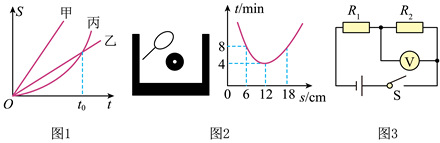
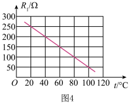

# Physics - 题目 325

**ID**: 670cccf88d8b47a484d8312ab9c4264c
**年级**: Grade 9
**难度**: Hard
**题型**: Comprehensive

## 题目
（1）如图1，甲、乙两物体都在向南做匀速直线运动，那么乙物体相对于甲物体是向运动的；在0~ $t{{}_{0}}$ 时间段内乙物体的平均速度（选填“大于”、“小于”或“等于”）丙物体的平均速度。​​​​​​​‌（2）小明想知道某块透镜的焦距，进行如图2甲操作（镜面正对着太阳光，在透镜下面放上白纸，且透镜与白纸保持平行），测出透镜与白纸间距s与对应的白纸被烤焦的时间t，绘出图像乙，可判断该透镜的焦距为cm：若某时刻白纸上的所成圆形光斑直径为透镜直径的一半，且使凸透镜稍远离白纸光斑变大，则此时透镜到白纸的距离为cm。（3）小明设计了一个用电压表的示数变化反映环境温度变化的电路。其电路原理图如图3所示，所用电源电压U=4V恒定不变，电压表的量程为0~3V，定值电阻 $R{{}_{2}}=300{\rm{Ω}}$ ， $R{{}_{1}}$ 是热敏电阻，其电阻随环境温度变化的关系如图4所示。闭合开关S后，当环境温度为40℃时，电压表的示数是V：电压表两端电压不能超过其最大测量值，则此电路所允许的最高环境温度是℃。

## 解答

1. （1）[1]甲、乙两物体都在向南做匀速直线运动，根据下图可知，通过相同的距离，乙所用时间长，根据速度公式可知，甲的速度较大，那么乙物体相对于甲物体是向北运动的。
2. 
3. [2]根据图1易知，在0～ $t{{}_{0}}$ 时间段内乙、丙通过的路程相同，根据速度公式可知，乙物体的平均速度等于丙物体的平均速度。
4. （2）[3]由已知条件，根据如图2乙可知，当透镜与白纸的距离为12 cm 时，白纸被烧焦的时间最短，则该点为凸透镜的焦点，可判断该透镜的焦距为12cm。
5. [4]若某时刻白纸上的所成圆形光斑直径为透镜直径的一半，由下图可知，圆形光斑的位置可能在1或2的位置，且使凸透镜稍远离白纸光斑变大，则圆形光斑的位置只能在2的位置，因三角形AOF与BCF相似，根据数学知识可知，对应边成正比，故
6. $\frac {OF}{CF}=\frac {2}{1}$
7. $CF=\frac {1}{2}\times 12{\rm{c}}{\rm{m}}{\rm{=}}{\rm{6}}{\rm{c}}{\rm{m}}$
8. 则此时透镜到白纸的距离为
9. s=OF+CF=12cm+6cm=18cm
10. 
11. （3）[5]由电路图可知，R_{2}与R_{1}串联，电压表测R_{2}两端的电压。由图象可知，当环境温度为40℃时，热敏电阻R_{1}的阻值为200Ω，而定值电阻为R_{2}=300Ω，根据串联电阻的和欧姆定律，电压表示数为
12. $U{{}_{V}}=IR{{}_{2}}=\frac {U}{R{{}_{2}}+R{{}_{1}}}\times R{{}_{2}}=\frac {4{\rm{V}}}{300Ω+200Ω}\times 300Ω=2.4{\rm{V}}$
13. [6]由图象可知，当环境温度越高时，热敏电阻R_{1}阻值越小，由分压原理，热敏电阻分得的电压越小，由串联电路电压的规律，电压表示数越大，电压表示数允许最大值为3V，即R_{2}两端电压的最大值为3V，此时电路能够测量的温度最高。因串联电路两端的电压等于各部分电路两端的电压之和，所以，R_{1}两端的最小电压
14. U_{1}＝U﹣U_{2}＝4V﹣3V＝1V
15. 根据串联电路中各处的电流相等和欧姆定律有
16. $\frac {U{{}_{1}}}{R^{′}{{{}_{1}}}}=\frac {U{{}_{2}}}{R{{}_{2}}}$
17. 热敏电阻的最小值为
18. $R^{′}{{{}_{1}}}=\frac {U{{}_{1}}}{U{{}_{2}}}\times R{{}_{2}}=\frac {{\rm{1}}{\rm{V}}}{{\rm{3}}{\rm{V}}}\times 300Ω=100Ω$
19. 根据图4可知，此时最高环境温度为80℃。

## 知识点

**中文**:
  - 与欧姆定律有关的动态电路计算
  - 凸透镜成像规律的应用
  - 速度的图像问题
  - 电路的动态分析

**English**:
  - Calculations in Dynamic Circuits using Ohm's Law
  - Applications of Convex Lens Imaging
  - Velocity-Time Graphs
  - Dynamic Circuit Analysis

---
