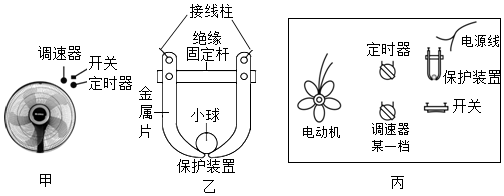

# Physics - 题目 1270

**ID**: 84a67e6b84a049978609e73f244928ad
**年级**: Grade 9
**难度**: Hard
**题型**: Comprehensive

## 题目
如图甲所示，小明家购买了一台某品牌的落地电风扇。​​​​​​​‌它的控制装置中除了开关、定时器和调速器外，在其内部还安装了保护装置，保护装置的结构如图乙所示，其原理是当风扇发生倾斜或倾倒时，小球会滚向一侧。使电路断开，对电风扇起到保护作用。（1）如图乙所示的保护装置相当于电路中的（选填“开关”、“电源”、“用电器”），保护装置中的小球不可以选用下面的哪些材料制作（）选填以下对应的字母）。

## 解答

1. （1）[1]由“当风扇发生倾斜或倾倒时，小球会滚向一侧，使电路断开，起到保护风扇的作用”可知，保护装置相当于一个开关。
2. [2]该装置中小球起到断开或闭合电路的作用，应该选用导体材料来制作；铜、铝、铁都是导体，而陶瓷、塑料、玻璃都是绝缘体，故小球不可以使用D、E、F的材料制作。
3. （2）[3]由题意可知，将保护装置、开关、调速器、定时器、风扇首尾顺次连接即可，如图所示：
4. ；
5. （3）[4]A．电风扇吹出的风加快了人体汗水表面的空气流动速度，使汗水的蒸发加快，蒸发过程要吸热，有致冷作用，所以使用电风扇人会感觉凉快，但室内温度不变，故A错误，符合题意；
6. B．风扇的扇叶转动时与空气摩擦带电，而带电体具有吸引轻小物质的性质，所以容易吸附灰尘，故B正确，不符合题意；
7. C电风扇、电视机等用电器都应能独立工作，故它们应采用并联的连接方式，故C正确，不符合题意；
8. D．为了安全使用，电风扇的金属外壳应接地，需要使用三孔插座，这样即使外壳带电，电流也能通过地线流入大地，不会对人造成伤害，故D正确，不符合题意。
9. 故选A。
10. （4）[5]扇片被卡住时，此时可以看做是纯电阻，总功率即为发热功率，电风扇消耗的电能全部转化为内能。
11. [6]它的发热功率
12. $P{{}_{热}}=P{{}_{电}}=\frac {U{^{2}}}{R}=\frac {{\rm{(}}{\rm{2}}{\rm{2}}{\rm{0}}{\rm{V}}{\rm{)}}{^{{\rm{2}}}}}{{\rm{2}}{\rm{0}}{\rm{Ω}}}{\rm{=}}{\rm{2}}{\rm{4}}{\rm{2}}{\rm{0}}{\rm{W}}$

## 知识点

**中文**:
  - 串、并联电路的设计
  - 汽化及汽化吸热的特点
  - 摩擦起电
  - 电功率的计算及应用
  - 家庭电路的连接
  - 插座和插头的接线及作用

**English**:
  - Designing Series and Parallel Circuits
  - Vaporization and Heat Absorption
  - Triboelectricity / Charging by Friction
  - Calculation and Application of Electric Power
  - Connection of Household Circuits
  - Wiring and Function of Sockets and Plugs

---
