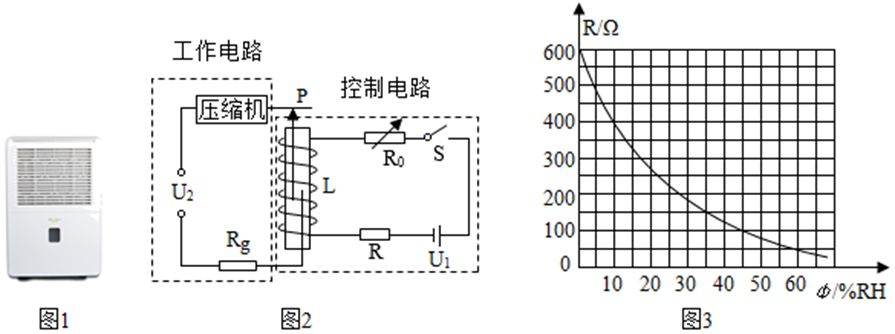

# Physics - 题目 2080

**ID**: 85a2578bf04f4354aaafae954882ddc1
**年级**: Grade 9
**难度**: Hard
**题型**: Comprehensive

## 题目
如图 1 所示为某实验室的自动除湿器，除湿器中的压缩机是整个系统的核心，除湿器的动力，全部由压缩机来提供。​​​​​​​‌除湿器内部的电路结构由控制电路和工作电路两部分组成，简化后的电路图如图2所示。控制电路中的电源电压 $U{{}_{1}}=12{\rm{V}}$ ，调控电阻 $R{{}_{0}}$ 的阻值范围为0～1000Ω，R为装在除湿器内的湿敏电阻，其阻值随相对湿度φ（空气中含有水蒸气的百分比， 单位为：%RH）变化的图象如图 3 所示，L为磁控开关，当湿敏电阻R的阻值发生变化时，控制电路中线圈的电流随之发生变化，当电流大于或等于20mA 时，L的两个磁性弹片相互吸合，工作电路的压缩机开始带动系统进行除湿。工作电路两端电压220V，R_{g}为保护电阻，磁控开关L的线圈电阻不计。问：(1)压缩机工作过程中内部的电动机主要把电能转化成能；(2)由图3可知，湿敏电阻R的阻值随着相对湿度的增加而变；若实验室内部的相对湿度为60%RH，此时湿敏电阻R的阻值为Ω；(3)因实验室内有较敏感的器件，要求相对湿度控制在45%RH以内，则调控电阻R_{0}的阻值不能超过多少？(4)若除湿过程中工作电路的总功率为1100W，工作电路的电流为多少？已知保护电阻 $R{{}_{{\rm{g}}}}=2{\rm{Ω}}$ ，如果除湿器工作时磁控开关L的磁性弹片有一半的时间是闭合的，则 1h内 $R{{}_{{\rm{g}}}}$ 消耗的电能是多少？

## 解答

1. (1)[1]压缩机工作过程中内部的电动机主要把电能转化成机械能。
2. (2)[2]由图3知，湿敏电阻R的阻值随着相对湿度的增加而变小。
3. [3]若实验室内部的相对湿度为60%RH，此时湿敏电阻R的阻值为50Ω。
4. (3)[4]由图3知相对湿度控制在45%RH时，湿每电阻的阻值为
5. $R{^{\prime }}=100{\rm{Ω}}$
6. 已知当电流
7. $I\geqslant 20{\rm{m}}{\rm{A}}=0.02{\rm{A}}$
8. 时，L的两个磁性弹片相互吸合，工作电路的压缩机开始带动系统进行除湿，则欧姆定律 $I=\frac {U}{R}$ 可得，电路中的总电阻为
9. $R{{}_{总}}=\frac {U}{I}=\frac {12{\rm{V}}}{0.02{\rm{A}}}=600{\rm{Ω}}$
10. 根据串联电路电压的特点可得调控电阻的阻值
11. $R{{}_{0}}=R{{}_{总}}-R^{′}=600{\rm{Ω}}-100{\rm{Ω}}=500{\rm{Ω}}$
12. (4)[5]根据 $P=UI$ 可得
13. $I{{}_{1}}=\frac {P}{U}=\frac {1100{\rm{W}}}{220{\rm{V}}}=5{\rm{A}}$
14. 则保护电阻 $R{{}_{{\rm{g}}}}$ 的电功率为
15. $P{{}_{{\rm{g}}}}=I{{}_{1}}{^{2}}R{{}_{{\rm{g}}}}={\left({5{\rm{A}}}\right)^{2}}\times 2{\rm{Ω}}=50{\rm{W}}$
16. [6]因磁控开关L的磁性弹片有一半的时间是闭合的，则1h内 $R{{}_{{\rm{g}}}}$ 消耗的电能为
17. $W{{}_{{\rm{g}}}}=P{{}_{{\rm{g}}}}t^{′}=P{{}_{{\rm{g}}}}\frac {1}{2}t^{′}=50{\rm{W}}\times \frac {1}{2}\times 3600{\rm{s}}=9\times 10{^{4}}{\rm{J}}$

## 知识点

**中文**:
  - 电功与电能的计算
  - 电功率的计算及应用
  - 电磁继电器的构造及原理
  - 电动机的能量转化

**English**:
  - Calculation of Electric Work and Energy
  - Calculation and Application of Electric Power
  - Structure and Principle of Electromagnetic Relays
  - Energy Transformation in Motors

---
