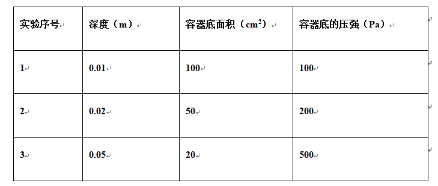
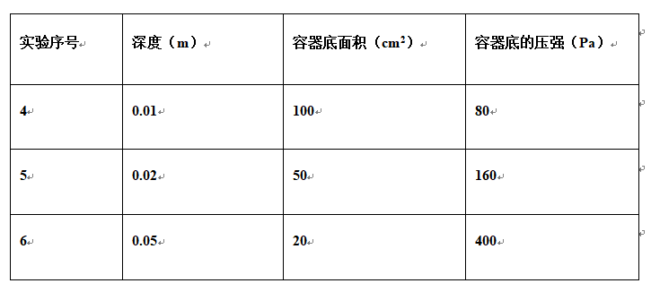
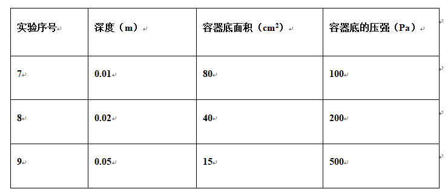
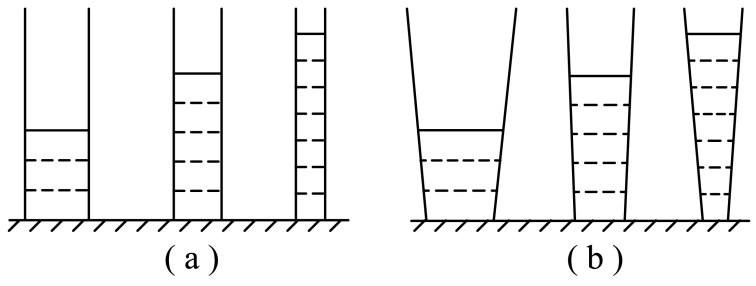

# Physics - 题目 1568

**ID**: 11af3236c3df4d29bd6f37ae6d0ca48e
**年级**: Grade 9
**难度**: Hard
**题型**: Experiment

## 题目
某小组同学做“探究容器底部受到液体压强和压力大小的规律”的实验。​​​​​​​‌先向如图（a）所示三个底面积不同的圆柱形容器中分别注入等质量的水，测得容器底部受到水的压强值记录在表1中；换用酒精重复上述实验，并将数据记录在表2中。之后，他们又在如图（b）所示三个不同底面积的口大底小容器中注入等质量的水，重复上述实验，数据记录在表3中。（ $ρ{{}_{{\rm{酒}}{\rm{精}}}}=0.8\times 10{^{3}}{\rm{k}}{\rm{g}}{\rm{/}}{\rm{m}}{^{{\rm{3}}}}$ ）表1（注入水0.1kg）表2（注入酒精0.08kg）表3（注入水0.1kg）(1)由表1和表3的实验数据，可得出的结论是：同种液体，深度相同时，液体对容器底部的压强与容器底部的面积和容器形状（选填“有关”或“无关”）；(2)分析比较实验序号1、2、3有关数据，可得出的初步结论：液体内部压强与有关；(3)分析比较实验序号有关数据，可得到的初步结论：液体深度相同，液体密度越大，液体压强越大；(4)分析实验序号1的实验数据，得出此时容器底部受到液体的压力为N。比较实验序号1、2、3可知规则容器液体对容器底部的压力液体的重力；比较实验序号7、8、9可知规则该容器中液体对容器底部的压力液体的重力；（后两空均选填“大于”、“小于”或“等于”）(5)分析实验序号9可知侧壁给水竖直向上的支持力为N；(6)该小组又将重力为5.4N的实心铝球悬挂于弹簧测力计下，并将铝球浸没在a图第一个容器的水中，此时弹簧测力计的拉力为N（水没溢出），浸入铝球后该容器对桌面的压强将增加Pa，若将该铝球浸没于某种液体中，弹簧测力计的示数为3N，则该液体的密度为kg/m^{3}。（ $ρ{{}_{{\rm{铝}}}}=2.7\times 10{^{3}}{\rm{k}}{\rm{g}}{\rm{/}}{\rm{m}}{^{{\rm{3}}}}$ ）

## 解答

1. (1)[1]分析比较实验序号1、7（或2、8或3、9）的有关数据，可以看出，同种液体的深度相同、只有容器底部的面积和容器形状不同，而最终的压强是相同的，所以液体对容器底部的压强与容器底部的面积和容器形状无关。
2. (2)[2]在实验序号1、2、3中，液体的种类是相同的，从上向下，液体深度是增大的，液体对容器底的压强也是增大的。所以结论为：同种液体，对容器底的压强随深度的增加而增大。
3. (3)[3]在实验结论中，控制的条件是液体深度相同，变化量是液体的密度，所以必须在表一和表二中寻找答案；观察表中的数据可以看出，1、4或2、5或3、6符合要求，可以得出：液体深度相同，液体密度越大，液体压强越大的结论。
4. (4)[4][5][6]在表1序号1中，水对容器底的压力为
5. $F=pS=100{\rm{P}}{\rm{a}}\times 0.01{\rm{m}}{^{{\rm{2}}}}=1{\rm{N}}$
6. 水的重力为
7. $G=mg=ρVg=1.0\times 10{^{3}}{\rm{k}}{\rm{g}}{\rm{/}}{\rm{m}}{^{{\rm{3}}}}\times 0.01\times 0.01{\rm{m}}{^{{\rm{3}}}}\times 10{\rm{N}}{\rm{/}}{\rm{k}}{\rm{g}}=1{\rm{N}}$
8. 比较结果知，水对容器底的压力等于水的重力，同理可知，序号2、3中液体对容器底产生的压力都等于液体自身的重力。所以结论为：规则容器液体对容器底部的压力等于液体的重力。
9. 在表3序号7中，水对容器底的压力为
10. $F=pS=100{\rm{P}}{\rm{a}}\times 0.008{\rm{m}}{^{{\rm{2}}}}=0.8{\rm{N}}$
11. 底面积为80cm^{2}（即0.008m^{2}）的柱形规则容器内水的重力为
12. $G=mg=ρVg=1.0\times 10{^{3}}{\rm{k}}{\rm{g}}{\rm{/}}{\rm{m}}{^{{\rm{3}}}}\times 0.008\times 0.01{\rm{m}}{^{{\rm{3}}}}\times 10{\rm{N}}{\rm{/}}{\rm{k}}{\rm{g}}=0.8{\rm{N}}$
13. 观察图可知，容器为敞口的，则容器内实际水的重力要大于0.8N，比较结果知，水对容器底的压力小于水的重力；同理，序号8、9中容器的形状都是敞口的，水对容器底的压力也小于液体的重力，所以结论为：敞口容器中，液体对容器底的压力小于液体的重力。
14. (5)[7]（b）组中的水受到向下的重力和容器底部以及侧壁对其的支持力，且
15. $G=F{{}_{{\rm{底}}}}+F{{}_{{\rm{侧}}}}$
16. 因为水对容器底部的压力为0.8N，根据相互作用力可知容器底部对水的支持力也为0.8N，故
17. $F{{}_{{\rm{侧}}}}=G-F{{}_{{\rm{底}}}}=1{\rm{N}}-0.8{\rm{N}}=0.2{\rm{N}}$
18. (6)[8][9][10]实心铝球的质量
19. $m=\frac {G}{{\rm{g}}}=\frac {5.4{\rm{N}}}{{\rm{1}}{\rm{0}}{\rm{N}}{\rm{/}}{\rm{k}}{\rm{g}}}=0.54{\rm{k}}{\rm{g}}$
20. 铝球的体积
21. $V{{}_{{\rm{球}}}}=\frac {m}{ρ{{}_{{\rm{铝}}}}}=\frac {{\rm{5}}{\rm{.}}{\rm{4}}{\rm{k}}{\rm{g}}}{2.7\times 10{^{3}}{\rm{k}}{\rm{g}}{\rm{/}}{\rm{m}}{^{{\rm{3}}}}}=2\times 10{^{{\rm{﹣}}}}{^{4}}{\rm{m}}{^{{\rm{3}}}}$
22. 排开水的体积等于铝球的体积，铝球受到的浮力
23. $F{{}_{{\rm{浮}}}}=G{{}_{{\rm{排}}{\rm{水}}}}=ρ{{}_{{\rm{水}}}}gV{{}_{{\rm{排}}}}=1.0\times 10{^{3}}{\rm{k}}{\rm{g}}{\rm{/}}{\rm{m}}{^{{\rm{3}}}}\times 10{\rm{N}}{\rm{/}}{\rm{k}}{\rm{g}}\times 2\times 10{^{{\rm{﹣}}}}{^{4}}{\rm{m}}{^{{\rm{3}}}}{\rm{＝}}2{\rm{N}}$
24. 弹簧测力计的拉力
25. $F{{}_{{\rm{拉}}}}=G-F{{}_{{\rm{浮}}}}=5.4{\rm{N}}{\rm{﹣}}2{\rm{N}}=3.4{\rm{N}}$
26. 铝球浸没在水中时，容器内相当于增加了与铝球同体积的水，容器对桌面的压力将增大，增加的压力等于增加水的重力，即增加的压力为2N，所以容器对桌面的压强增大，增大的压强为
27. ${\rm{Δ}}p=\frac {{\rm{2}}{\rm{N}}}{{\rm{1}}{\rm{0}}{\rm{0}}\times {\rm{1}}{\rm{0}}{^{-4}}{\rm{m}}{^{{\rm{2}}}}}={\rm{2}}{\rm{0}}{\rm{0}}{\rm{P}}{\rm{a}}$
28. 铝球在水中时，有阿基米德原理可知，球的体积为
29. $V=V{{}_{{\rm{排}}{\rm{液}}}}=\frac {F{{}_{{\rm{浮}}}}}{ρ{{}_{{\rm{水}}}}g}=\frac {{\rm{2}}{\rm{N}}}{1.0\times 10{^{3}}{\rm{k}}{\rm{g}}{\rm{/}}{\rm{m}}{^{{\rm{3}}}}\times {\rm{1}}{\rm{0}}{\rm{N}}{\rm{/}}{\rm{k}}{\rm{g}}}=2\times 10{^{{\rm{﹣}}}}{^{4}}{\rm{m}}{^{{\rm{3}}}}$
30. 物体受到液体的浮力
31. $F{{}_{{\rm{浮}}{\rm{液}}}}=G-F{{}_{{\rm{示}}{\rm{液}}}}=5.4{\rm{N}}-3{\rm{N}}=2.4{\rm{N}}$
32. 根据 $F{{}_{{\rm{浮}}}}=ρ{{}_{{\rm{水}}}}gV{{}_{{\rm{排}}}}$ 可得，液体的密度
33. $ρ{{}_{{\rm{液}}}}=\frac {F{{}_{{\rm{浮}}}}}{gV{{}_{{\rm{排}}}}}=\frac {{\rm{2}}{\rm{.}}{\rm{4}}{\rm{N}}}{{\rm{1}}{\rm{0}}{\rm{N}}{\rm{/}}{\rm{k}}{\rm{g}}\times 2\times 10{^{{\rm{﹣}}}}{^{4}}{\rm{m}}{^{{\rm{3}}}}}=1.2\times 10{^{3}}{\rm{k}}{\rm{g}}{\rm{/}}{\rm{m}}{^{{\rm{3}}}}$

## 知识点

**中文**:
  - 探究液体压强的特点实验

**English**:
  - Experiment: Characteristics of Liquid Pressure

---
