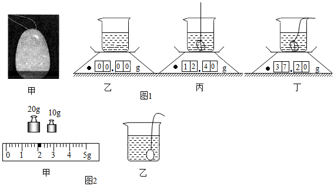

# Physics - 题目 2694

**ID**: f58a6a3a8130482f83018277438cd7bf
**年级**: Grade 9
**难度**: Hard
**题型**: Experiment

## 题目
腾冲玉器以玉石为原料，是云南著名的手工艺产品，至今有500余年历史。​​​​​​​‌通常用测密度的方法鉴别玉的种类和品质。表一为商家常用的玉石密度表；图1甲为需要鉴别的玉器。玉石种类翡翠和田玉岫玉玛瑙密度3.30～3.362.95～3.172.57～2.602.60～2.65（1）你认为密度表中数值的单位是；（2）商家常用的鉴别步骤是：①如图1乙所示，玻璃杯中装适量水置于电子秤上，调零，电子秤的示数为0。②如图1丙所示，将玉器用细线系住（细线的体积、质量忽略不计），用手拉住细线，使玉器浸没于水中（不触底），电子秤的示数为m_{1}＝12.4g。③如图1丁所示，将玉器缓慢沉入杯底、松开细线，静止时电子秤的示数为m_{2}＝37.2g。根据所测数据，计算出玉器的密度为kg/m^{3}；初步判断该玉器原料为（选填玉石种类）。④如果在图1丙所示的操作中，玉器接触到了玻璃杯底部，其余操作完全规范，则所测密度值比真实值（选填“偏大”、“偏小”或“不变”）。（3）如图2所示，仅有天平的条件下，小明设计了如下操作步骤测量石块的密度：①用调节好的天平测量石块的质量，右盘所加砝码和游码位置如图2甲所示，天平平衡，则石块的质量m_{1}＝g；②如图2乙所示，将烧杯放在水平台面上，用细线系住石块轻轻放入烧杯中，加入适量的水，使石块浸没在水中，在烧杯壁上记下水面位置。③将石块从水中取出后，用天平测出烧杯和水的总质量m_{2}为152.4g。④向烧杯中缓慢加水至标记处，再用天平测出烧杯和水的总质量m_{3}为165.2g。上述方法和测量结果，计算出石块密度ρ＝kg/m^{3}，测出的石块密度与真实值相比（选填“偏大”或“偏小”）。

## 解答

1. （1）根据生活经验可知，密度表中玉石密度的单位是g/cm^{3}；
2. （2）由①可知，玻璃杯中装适量水置于电子秤上，电子秤的示数为0，所以松开细线玉器沉底后，电子秤的示数就是该玉器的质量，所以玉器的质量
3. $m＝{\rm{3}}{\rm{7}}{\rm{.}}{\rm{2}}{\rm{g}}$
4. 由②可知，玉器浸没于水中（不触底），说明此时电子秤的示数等于玉器排开水的质量，即
5. $m{{}_{排}}＝m{{}_{1}}＝12{\rm{.}}{\rm{4}}{\rm{g}}$ ；
6. 因为玉石完全浸没在水中，所以玉石的体积
7. $V{{}_{玉石}}＝V{{}_{排}}＝\frac {m{{}_{排}}}{ρ{{}_{水}}}＝\frac {{\rm{1}}{\rm{2}}{\rm{.}}{\rm{4}}{\rm{g}}}{{\rm{1}}{\rm{g}}{\rm{/}}{\rm{c}}{\rm{m}}{^{{\rm{3}}}}}＝{\rm{1}}{\rm{2}}{\rm{.}}{\rm{4}}{\rm{c}}{\rm{m}}{^{{\rm{3}}}}$
8. 玉石的密度
9. $ρ{{}_{玉石}}＝\frac {m{{}_{玉石}}}{V{{}_{玉石}}}＝\frac {{\rm{3}}{\rm{7}}{\rm{.}}{\rm{2}}{\rm{g}}}{{\rm{1}}{\rm{2}}{\rm{.}}{\rm{4}}{\rm{g}}{\rm{/}}{\rm{c}}{\rm{m}}{^{{\rm{3}}}}}＝{\rm{3}}{\rm{g}}{\rm{/}}{\rm{c}}{\rm{m}}{^{{\rm{3}}}}＝{\rm{3}}{\rm{×}}{\rm{1}}{\rm{0}}{^{{\rm{3}}}}{\rm{k}}{\rm{g}}{\rm{/}}{\rm{m}}{^{{\rm{3}}}}$
10. 对比玉石的密度表可知，玉石的种类为和田玉。
11. 图1丙中，玉器接触到玻璃杯底部，使得测得的m_{排}偏大，V_{排}偏大，V_{玉石}偏大，所以计算得出的玉石密度小于真实值。
12. （3）“左物右码”放置时，石块的质量等于砝码的质量与游码在标尺上所对的刻度值的总和，所以石块的质量
13. $m{{}_{1}}＝32{\rm{g}}$
14. 由题意可知
15. $m^{′}{{{}_{排}}}＝m{{}_{3}}﹣m{{}_{2}}=165{\rm{.}}{\rm{2}}{\rm{g}}{\rm{-}}{\rm{1}}{\rm{5}}{\rm{2}}{\rm{.}}{\rm{4}}{\rm{g}}{\rm{=}}{\rm{1}}{\rm{2}}{\rm{.}}{\rm{8}}{\rm{g}}$
16. 则由 $ρ＝\frac {m}{V}$  可得
17. $V{{}_{排}}\prime ＝\frac {m{{}_{排}}\prime }{ρ{{}_{水}}}＝\frac {{\rm{1}}{\rm{2}}{\rm{.}}{\rm{8}}{\rm{g}}}{{\rm{1}}{\rm{g}}{\rm{/}}{\rm{c}}{\rm{m}}{^{{\rm{3}}}}}＝{\rm{1}}{\rm{2}}{\rm{.}}{\rm{8}}{\rm{c}}{\rm{m}}{^{{\rm{3}}}}$
18. 因为玉石块完全浸没在水中，所以
19. $V{{}_{石}}＝V{{}_{排}}＝12.{\rm{8}}{\rm{c}}{\rm{m}}{^{{\rm{3}}}}$
20. 所以石块的密度
21. $ρ{{}_{石}}＝\frac {m{{}_{石}}}{V{{}_{石}}}＝\frac {{\rm{3}}{\rm{2}}{\rm{g}}}{{\rm{1}}{\rm{2}}{\rm{.}}{\rm{8}}{\rm{c}}{\rm{m}}{^{{\rm{3}}}}}＝{\rm{2}}{\rm{.}}{\rm{5}}{\rm{g}}{\rm{/}}{\rm{c}}{\rm{m}}{^{{\rm{3}}}}＝{\rm{2}}{\rm{.}}{\rm{5}}{\rm{×}}{\rm{1}}{\rm{0}}{^{{\rm{3}}}}{\rm{k}}{\rm{g}}{\rm{/}}{\rm{m}}{^{{\rm{3}}}}$
22. 在步骤③中，石块从水中取出时会带走部分水，导致测得排开水的体积偏大，即石块的体积偏大，所以密度偏小。

## 知识点

**中文**:
  - 密度的应用与物质鉴别

**English**:
  - Applications of Density and Material Identification

---
