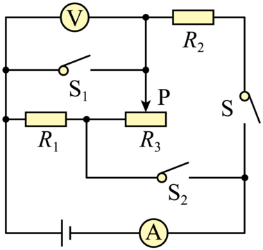

# Physics - 题目 1450

**ID**: 0ae3ace5d087495d8d71169c71fef564
**年级**: Grade 9
**难度**: Hard
**题型**: Fill-in-the-blank

## 题目
如图所示，电源电压保持不变，R_{1}、R_{2}为定值电阻，滑动变阻器最大阻值为R_{3}，当只闭合S，将滑片移至a点时，滑动变阻器阻值为R_{a}，电流表的示数为0.2A，电压表示数为U_{1}，R_{3}的功率为P_{a}，再将滑片移至b点时，滑动变阻器阻值为R_{b}，电流表的示数为0.3A，电压表示数变为U_{2}，R_{3}的功率为P_{b}，滑片从a点移至b点，电压表的示数变化了2V。​​​​​​​‌U_{1}∶U_{2}=4∶3，P_{a}∶P_{b}=4∶3，则R_{1}∶R_{b}=；只闭合S_{1}、S_{2}，并将滑片移至中点，记录电流表示数，若再断开S_{1}，电流表的示数变化了0.4A，若只闭合S，电路的最小总功率为W。

## 解答

1. 当只闭合开关S时，三个电阻串联在电路中，电压表测的是R_{1}和R_{3}的两端电压，电流表测的是电路电流，将滑片移至a点时，滑动变阻器接入电路的阻值为R_{a}，电流表的示数为0.2A，即通过三个电阻的电流都为I_{a}=0.2A，由欧姆定律可得，R_{1}和R_{3}的两端电压即电压表示数U_{1}为 $U{{}_{1}}=I{{}_{a}}{\rm{(}}R{{}_{{{1}}}}{{+}}R{{}_{a}}{\rm{)}}{\rm{=}}{{0}}{{.}}{{2}}{\rm{A}}\times {\rm{(}}R{{}_{{{1}}}}{{+}}R{{}_{a}}{\rm{)}}{\rm ，\mathit{R}_{3}}$ 的功率为 $P{{}_{a}}{\rm{=}}I{{}_{a}^{2}}R{{}_{a}}{\rm{=}}{\rm{(}}{{0}}{{.}}{{2}}{\rm{A}}{\rm{)}}{^{2}}\times R{{}_{a}}$ ，再将滑片移至b点时，滑动变阻器阻值为R_{b}，电流表的示数为0.3A，即通过三个电阻的电流都为I_{b}=0.3A，由欧姆定律可得，R_{1}和R_{3}的两端电压即电压表示数U_{2}为 $U{{}_{2}}=I{{}_{b}}{\rm{(}}R{{}_{{{1}}}}{{+}}R{{}_{b}}{\rm{)}}{\rm{=}}{{0}}{{.}}{{3}}{\rm{A}}\times {\rm{(}}R{{}_{{{1}}}}{{+}}R{{}_{b}}{\rm{)}}$   ①，此时R_{3}的功率为 $P{{}_{b}}{\rm{=}}I{{}_{b}^{2}}R{{}_{b}}{\rm{=}}{\rm{(}}{{0}}{{.}}{{3}}{\rm{A}}{\rm{)}}{^{2}}\times R{{}_{b}}$ ，又根据U_{1}∶U_{2}=4∶3，P_{a}∶P_{b}=4∶3，结合以上式子解得，R_{a}=3R_{b}，R_{1}=R_{b}，故R_{1}∶R_{b}=1∶1；滑片从a点移至b点，电路电流增大，因此R_{2}的两端电压增大，根据串联分压原理可知，R_{1}和R_{3}的两端电压减小，即电压表示数变小，因此有 $ΔU{\rm{=}}U{{}_{{{1}}}}{{-}}U{{}_{{{2}}}}{\rm{=}}{{2}}{\rm{V}}$ ，因为U_{1}∶U_{2}=4∶3，所以U_{1}=8V，U_{2}=6V，由①可得，R_{1}=10Ω，结合以上分析以及欧姆定律可得，当滑片移至a点时，电源电压为 $U=U{{}_{1}}+I{{}_{{\rm{a}}}}\times R{{}_{2}}{\rm{=}}{{8}}{\rm{V}}{{+}}{{0}}{{.}}{{2}}{\rm{A}}\times R{{}_{2}}$   ②，当滑片移至b点时，电源电压为 $U=U{{}_{2}}+I{{}_{b}}\times R{{}_{2}}{\rm{=}}{{6}}{\rm{V}}{{+}}{{0}}{{.}}{{3}}{\rm{A}}\times R{{}_{2}}$   ③，联立②③解得，U=12V，R_{2}=20Ω，只闭合S_{1}、S_{2}，R_{1}和R_{3}并联，电压表测的是电源电压，电流表测的是此时的干路电流I，再断开S_{1}，R_{3}所在的支路相当于断开，根据并联电路的电流特点可知，S_{1}从闭合到断开的过程中，电流表示数变小，电流表示数的变小量即为通过R_{3}的电流，根据并联电路的电压特点和欧姆定律可得 $U=ΔI\times \frac {1}{2}R{{}_{3}}={{0}}{{.}}{{4}}{\rm{A}}\times \frac {{{1}}}{{{2}}}R{{}_{3}}$ ，解得R_{3}=60Ω，当只闭合开关S时，三个电阻串联在电路中，当滑动变阻器接入电路的阻值最大时，电路的电功率最小，根据 $P=\frac {U{^{2}}}{R}$ 可得，电路的最小总功率为 $P{{}_{{\rm \min }}}=\frac {U{^{2}}}{R{{}_{最大}}}=\frac {{\rm{(}}{{1}}{{2}}{\rm{V}}{\rm{)}}{^{{{2}}}}}{R{{}_{1}}+R{{}_{2}}+R{{}_{3}}}{\rm{=}}\frac {{\rm{(}}{{1}}{{2}}{\rm{V}}{\rm{)}}{^{{{2}}}}}{{{1}}{{0}}{\rm{Ω}}{{+}}{{2}}{{0}}{\rm{Ω}}{{+}}{{6}}{{0}}{\rm{Ω}}}{\rm{=}}{{1}}{{.}}{{6}}{\rm{W}}$ 。

## 知识点

**中文**:
  - 与欧姆定律有关的动态电路计算
  - 电功率的计算及应用

**English**:
  - Calculations in Dynamic Circuits using Ohm's Law
  - Calculation and Application of Electric Power

---
