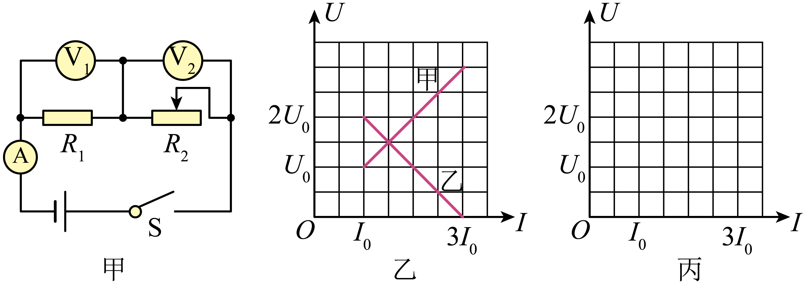

# Physics - 题目 2778

**ID**: 17cfbe9aa22e4fb89b0b7c3aa44864bf
**年级**: Grade 9
**难度**: Hard
**题型**: Fill-in-the-blank

## 题目
在如图甲所示的电路中，电源电压保持不变，R_{1}为定值电阻，R_{2}为滑动变阻器，闭合开关S，调节滑动变阻器，将其滑片P从最左端滑动到最右端，两电压表的示数随电路中电流变化的完整过程图线如图乙所示，其中U_{0}、I_{0}已知。​​​​​​​‌（1）判断图乙中图线（选填“甲”或“乙”）是电压表V_{2}示数随电流变化的图线，求出滑动变阻器的最大阻值R_{2m}；（；；）（2）若将定值电阻R_{1}的阻值换为原来的2倍，同样将滑动变阻器的滑片P从最左端滑动到最右端，请在图丙中画出两电压表的示数随电路中电流变化的完整过程图线；（3）若定值电阻R_{1}替换前后，滑动变阻器的滑片P在最右端时，定值电阻R_{1}电功率的变化量为 $\Delta P{{}_{1}}$ ，滑动变阻器R_{2m}电功率的变化量为 $\Delta P{{}_{2}}$ ，电路总功率的变化量为 $ΔP$ ，则 $(\left |{ΔP{{}_{1}}}\right |+\left |{ΔP{{}_{2}}}\right |):|ΔP|=$。（温馨提示：推导计算过程中需要的物理量，请提前设定!）

## 解答

1. （1）由图甲可知，闭合开关S后，R_{1}与R_{2}串联，电压表V_{1}测R_{1}两端电压，V_{2}测R_{2}两端电压，电流表测电路中电流。调节滑动变阻器，将其滑片P从最左端滑动到最右端，滑动变阻器接入电路的阻值变大，电路中总电阻变大，根据串联电路电压特点和分压原理可知，R_{2}两端电压变大，由欧姆定律可知，电路中电流变小。因此图线乙是电压表V_{2}示数随电流变化的图线。
2. 根据串联电路电压特点和分压原理可知，当滑动变阻器两端电压最大时，接入电路的阻值最大，由图乙可知，滑动变阻器两端最大电压为2U_{0}，对应的电流为I_{0}，因此滑动变阻器的最大阻值为 $R{{}_{2{\rm{m}}{\rm{a}}{\rm{x}}}}=\frac {2U{{}_{0}}}{I{{}_{0}}}$ 。
3. （2）由图乙可知，当滑动变阻器两端电压为2U_{0}时，定值电阻两端电压为U_{0}，根据串联电路电压特点可知，电源电压为
4. U=2U_{0}+U_{0}=3U_{0}R_{1}的阻值为 $R{{}_{1}}{\rm{=}}\frac {U{{}_{0}}}{I{{}_{0}}}$ 。若将定值电阻R_{1}的阻值换为原来的2倍，即 $\frac {2U{{}_{0}}}{I{{}_{0}}}$ ，当滑动变阻器滑片位于最左端时，接入电路的阻值为0。此时，V_{1}示数为电源电压，即3U_{0}，V2示数为0，电路中电流为
5. $I{{}_{1}}=\frac {U}{R}=\frac {3U{{}_{0}}}{\frac {2U{{}_{0}}}{I{{}_{0}}}}=\frac {3}{2}I{{}_{0}}$
6. 当滑动变阻器滑片在最右端时，滑动变阻器接入电路阻值最大，阻值为 $R{{}_{2{\rm{m}}{\rm{a}}{\rm{x}}}}=\frac {2U{{}_{0}}}{I{{}_{0}}}$ ，等于定值电阻R_{1}的电阻，根据串联电路分压原理可知，此时滑动变阻器与定值电阻两端电压相等，即
7. $U{{}_{1}}{^{\prime }}{\rm{=}}U{{}_{2}}{^{\prime }}{\rm{=}}\frac {3}{2}U{{}_{0}}{\rm{=}}1.5U{{}_{0}}$
8. 此时电路中电流为
9. $I{{}_{2}}{\rm{=}}\frac {\frac {3}{2}U{{}_{0}}}{\frac {2U{{}_{0}}}{I{{}_{0}}}}{\rm{=}}\frac {3}{4}I{{}_{0}}{\rm{=}}0.75I{{}_{0}}$
10. 图像如下图：
11. 
12. （3）定值电阻R_{1}替换前，滑动变阻器的滑片在最右端时，滑动变阻器两端电压最大，R_{1}两端电压最小，为U_{0}，电路中电流为I_{0}，R_{1}电功率为
13. $P{{}_{1}}{\rm{=}}U{{}_{1}}I{\rm{=}}U{{}_{0}}I{{}_{0}}$
14. 滑动变阻器的电功率为
15. $P{{}_{2}}{\rm{=}}U{{}_{2}}I{\rm{=}}2U{{}_{0}}I{{}_{0}}$
16. 电路总功率为
17. $P{{}_{总}}{\rm{=}}P{{}_{1}}+P{{}_{2}}{\rm{=}}U{{}_{0}}I{{}_{0}}+2U{{}_{0}}I{{}_{0}}{\rm{=}}3U{{}_{0}}I{{}_{0}}$
18. 定值电阻替换后，滑动变阻器的滑片在最右端时，R_{1}电功率为
19. $P{{}_{1}}{^{\prime }}{\rm{=}}U{{}_{1}}{^{\prime }}I{{}_{1}}{^{\prime }}{\rm{=}}{{1}}{{.}}{{5}}U{{}_{0}}\times 0.75I{{}_{0}}{\rm{=}}{{1}}{{.}}{{1}}{{2}}{{5}}U{{}_{0}}I{{}_{0}}$
20. 滑动变阻器的电功率为
21. $P{{}_{2}}{^{\prime }}{\rm{=}}U{{}_{2}}{^{\prime }}I{{}_{0}}{^{\prime }}{\rm{=}}{{1}}{{.}}{{5}}U{{}_{0}}\times 0.75I{{}_{0}}{\rm{=}}1.125U{{}_{0}}I{{}_{0}}$
22. 电路总功率为
23. $P{{}_{总}}{^{\prime }}{\rm{=}}P{{}_{1}}{^{\prime }}+P{{}_{2}}{^{\prime }}{\rm{=}}1.125U{{}_{0}}I{{}_{0}}+1.125U{{}_{0}}I{{}_{0}}{\rm{=}}2.25U{{}_{0}}I{{}_{0}}$
24. 因此
25. $\left |{ΔP{{}_{1}}}\right |{\rm{=}}P{{}_{1}}{^{\prime }}-P{{}_{1}}{\rm{=}}1.125U{{}_{0}}I{{}_{0}}-U{{}_{0}}I{{}_{0}}{\rm{=}}0.125U{{}_{0}}I{{}_{0}}$
26. $\left |{ΔP{{}_{2}}}\right |{\rm{=}}\left |{P{{}_{2}}-P{{}_{2}}{^{\prime }}}\right |{\rm{=}}{{2}}U{{}_{0}}I{{}_{0}}-1.125U{{}_{0}}I{{}_{0}}{\rm{=}}0.875U{{}_{0}}I{{}_{0}}$
27. $\left |{ΔP}\right |{\rm{=}}P{{}_{总}}-P{{}_{总}}{^{\prime }}{\rm{=}}3U{{}_{0}}I{{}_{0}}-2.25U{{}_{0}}I{{}_{0}}{\rm{=}}0.75U{{}_{0}}I{{}_{0}}$
28. $ΔP{{}_{1}}+ΔP{{}_{2}}{\rm{=}}{{0}}{{.}}{{1}}{{2}}{{5}}U{{}_{0}}I{{}_{0}}+0.875U{{}_{0}}I{{}_{0}}{\rm{=}}U{{}_{0}}I{{}_{0}}$
29. 故
30. $(\left |{ΔP{{}_{1}}}\right |+\left |{ΔP{{}_{2}}}\right |):|ΔP|=U{{}_{0}}I{{}_{0}}:0.75U{{}_{0}}I{{}_{0}}=4:3$

## 知识点

**中文**:
  - 与欧姆定律有关的动态电路计算
  - 电功率的计算及应用

**English**:
  - Calculations in Dynamic Circuits using Ohm's Law
  - Calculation and Application of Electric Power

---
