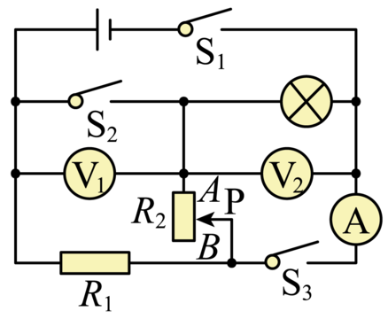

# Physics - 题目 1209

**ID**: 2fbecd5806264525be7295eff47c639f
**年级**: Grade 9
**难度**: Hard
**题型**: Fill-in-the-blank

## 题目
如图所示，小灯泡 ${\rm L}$ 的规格为“ $12{\rm{V}}24{\rm{W}}$ ”（不考虑灯丝电阻受温度的影响），则小灯泡 ${\rm L}$ 的电阻为${\rm{Ω}}$ 。​​​​​​​‌电路中电源电压保持不变，滑动变阻器的最大阻值为 $R{{}_{2}}$ ，将滑动变阻器的滑片P置于 $A$ 端，只闭合开关 ${\rm{S}}{{}_{1}}$ 时，电压表 ${\rm{V}}{{}_{1}}$ 的示数为 $U{{}_{1}}$ ，电路中的电流为 $I{{}_{1}}$ ，电压表 ${\rm{V}}{{}_{2}}$ 的示数为 $U{{}_{2}}$ ；将滑动变阻器的滑片P置于 $B$ 端，仍只闭合开关 ${\rm{S}}{{}_{1}}$ ，电压表 ${\rm{V}}{{}_{1}}$ 的示数为 $U^{′}{{{}_{1}}}$ ，电路中的电流为 $I{{}_{2}}$ ，电压表 ${\rm{V}}{{}_{2}}$ 的示数为 $U^{′}{{{}_{2}}}$ 。已知$\frac {U{{}_{1}}}{U^{′}{{{}_{1}}}}{\rm{=}}\frac {7}{15}$$\frac {U{{}_{2}}}{U^{′}{{{}_{2}}}}{\rm{=}}\frac {7}{3}$若电源电压可调，闭合开关 ${\rm{S}}{{}_{1}}$ 、 ${\rm{S}}{{}_{2}}$ 和 ${\rm{S}}{{}_{3}}$ ，电流表量程为 ${\rm{0}}{\rm{\sim }}{\rm{3}}{\rm{A}}$ 。滑动变阻器的阻值在 $2{\rm{Ω}}$ 与最大值之间变化，要求电流表最大值和最小值的差值不小于 $1{\rm{A}}$ ，则可调电源电压的最小值为V。

## 解答

1. [1]由 $P=\frac {U{^{2}}}{R}$ 可得，小灯泡 ${\rm{L}}$ 的电阻
2. $R{{}_{{\rm{L}}}}=\frac {U{{}_{{\rm{L}}}^{{\rm{2}}}}}{P{{}_{{\rm{L}}}}}{\rm{=}}\frac {\left ({{\rm{1}}{\rm{2}}{\rm{V}}}\right ){^{{\rm{2}}}}}{{\rm{2}}{\rm{4}}{\rm{W}}}{\rm{=}}{\rm{6}}{\rm{Ω}}$
3. [2]将滑动变阻器的滑片P置于A端，只闭合开关 ${\rm{S}}{{}_{1}}$ 时，等效电路图如图 $1$ 所示,将滑动变阻器的滑片P置于B端，仍只闭合开关 ${\rm{S}}{{}_{1}}$ 时，等效电路图如图 $2$ 所示：
4. 
5. 已知
6. $\frac {U{{}_{2}}}{U^{′}{{{}_{2}}}}{\rm{=}}\frac {7}{3}$
7. 由欧姆定律可得
8. $\frac {I{{}_{1}}}{I{{}_{2}}}=\frac {\frac {U{{}_{2}}}{R{{}_{{\rm{L}}}}}}{\frac {U^{′}{{{}_{2}}}}{R{{}_{{\rm{L}}}}}}=\frac {U{{}_{2}}}{U^{′}{{{}_{2}}}}=\frac {7}{3}$
9. 因电源的电压保持不变，所以根据欧姆定律和串联电路的电阻特点可得
10. $\frac {I{{}_{1}}}{I{{}_{2}}}=\frac {\frac {U}{R{{}_{1}}+R{{}_{{\rm{L}}}}}}{\frac {U}{R{{}_{1}}+R{{}_{2}}+R{{}_{{\rm{L}}}}}}=\frac {R{{}_{1}}+R{{}_{2}}+R{{}_{{\rm{L}}}}}{R{{}_{1}}+R{{}_{{\rm{L}}}}}=\frac {R{{}_{1}}+R{{}_{2}}+6Ω}{R{{}_{1}}+6Ω}=\frac {7}{3}$
11. 整理可得
12. $3R{{}_{2}}=4R{{}_{1}}+24{\rm{Ω}}$ ①
13. 因
14. $\frac {U{{}_{1}}}{U^{′}{{{}_{1}}}}{\rm{=}}\frac {7}{15}$
15. 所以
16. $\frac {U{{}_{1}}}{U{{}_{1}}{^{\prime }}}=\frac {I{{}_{1}}R{{}_{1}}}{I{{}_{2}}\left ({R{{}_{1}}+R{{}_{2}}}\right )}=\frac {I{{}_{1}}}{I{{}_{2}}}\times \frac {R{{}_{1}}}{R{{}_{1}}+R{{}_{2}}}=\frac {7}{3}\times \frac {R{{}_{1}}}{R{{}_{1}}+R{{}_{2}}}=\frac {7}{15}$
17. 整理可得
18. $R{{}_{2}}=4R{{}_{1}}$ ②
19. 由①②可得 $R{{}_{1}}=3Ω$ ， $R{{}_{2}}=12Ω$ ；
20. 闭合开关 ${\rm{S}}{{}_{1}}$ 、 ${\rm{S}}{{}_{2}}$ 和 ${\rm{S}}{{}_{3}}$ 时，等效电路图如下图所示：
21. 
22. 因滑动变阻器的阻值变化范围为 ${\rm{2}}{\rm{Ω}}{\rm{\sim }}{\rm{1}}{\rm{2}}{\rm{Ω}}$ ，且电流表量程为 ${\rm{0}}{\rm{\sim }}{\rm{3}}{\rm{A}}$ ，因并联电路中各支路独立工作、互不影响，所以滑片移动时通过 $R{{}_{1}}$ 的电流不变，要求电流表最大值和最小值的差值不小于 ${\rm{1}}{\rm{A}}$ ，因为并联电路干路电流等于各支路电流之和，所以
23. $\left ({\frac {U^{′}}{R{{}_{1}}}+\frac {U^{′}}{R^{′}{{{}_{2}}}}}\right )-\left ({\frac {U^{′}}{R{{}_{1}}}+\frac {U^{′}}{R^{′′}{{{}_{2}}}}}\right )=\frac {U^{′}}{R^{′}{{{}_{2}}}}-\frac {U^{′}}{R^{′′}{{{}_{2}}}}=\frac {U^{′}}{2Ω}-\frac {U^{′}}{12Ω}\geqslant 1{\rm{A}}$
24. 解得 $U^{′}{\geqslant }{\rm{2}}{\rm{.}}{\rm{4}}{\rm{V}}$ ，当滑动变阻器接入电路中的电阻为 $2Ω$ 时，电路中的电流
25. $\frac {U^{′}}{R{{}_{1}}}+\frac {U^{′}}{R^{′}{{{}_{2}}}}=\frac {{\rm{2}}{\rm{.}}{\rm{4}}{\rm{V}}}{{\rm{3}}{\rm{Ω}}}{\rm{+}}\frac {{\rm{2}}{\rm{.}}{\rm{4}}{\rm{V}}}{{\rm{2}}{\rm{Ω}}}{\rm{=}}{\rm{2}}{\rm{A}}$
26. 不超过 ${\rm{3}}{\rm{A}}$ ，所以可调电源电压最小值为 ${\rm{2}}{\rm{.}}{\rm{4}}{\rm{V}}$ 。

## 知识点

**中文**:
  - 与欧姆定律有关的动态电路计算
  - 电功率的计算及应用

**English**:
  - Calculations in Dynamic Circuits using Ohm's Law
  - Calculation and Application of Electric Power

---
