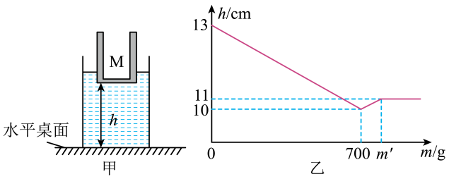

# Physics - 题目 2970

**ID**: 65ee701479c447e5907924e71733163b
**年级**: Grade 9
**难度**: Hard
**题型**: Fill-in-the-blank

## 题目
如图甲所示，将圆柱形水杯M竖直放置在具有一定高度的薄壁圆柱形容器中，容器自重为7N，且装有一定量的水。​​​​​​​‌M具有一定厚度，其质量为200g，高10cm，外底面积为 $100{\rm{c}}{\rm{m}}{^{2}}$ 。现逐渐向M中加水，M外底到容器底部的距离h与加入水的质量m的关系如图乙所示。若在加水过程中M始终保持竖直，且不计杯壁上所沾的水，则最初没有加水时，M所受浮力为N，当加水质量为 $m^{′}$ 时，容器对水平桌面的压强为Pa。

## 解答

1. 由题意和图像可知，最初未加水时，M处于漂浮状态，则M所受浮力为 $F{{}_{浮}}{\rm{=}}G{{}_{{\rm{M}}}}{\rm{=}}m{{}_{{\rm{M}}}}g{\rm{=}}200\times {{1}}{{0}}{^{{{-}}{{3}}}}{\rm{k}}{\rm{g}}\times {{1}}{{0}}{\rm{N}}{\rm{/}}{\rm{k}}{\rm{g}}{\rm{=}}2{\rm{N}}$ ，由图乙分析可知，开始时M外底到容器底部的距离h为13cm，当逐渐向M中加水时，M会逐渐下降，h会逐渐减小；当加水700g后，M内水装满，此时水会进入容器中，由于h又逐渐增加，则可知装满水的水杯M处于漂浮状态；当加水m^{′}后，h不再变化，说明此时容器中的水已加满。综上所述可知，当加水700g后，水杯受到的浮力等于M的重力和加入水的重力，即 $F{{}_{{\rm{浮}}{{1}}}}{\rm{=}}G{{}_{{\rm{M}}}}+G{{}_{{\rm{加}}{\rm{水}}1}}{\rm{=}}m{{}_{{\rm{M}}}}g+m{{}_{{\rm{加}}{\rm{水}}1}}g{\rm{=}}(200\times {{1}}{{0}}{^{{{-}}{{3}}}}{\rm{k}}{\rm{g}}+700\times {{1}}{{0}}{^{{{-}}{{3}}}}{\rm{k}}{\rm{g}})\times {{1}}{{0}}{\rm{N}}{\rm{/}}{\rm{k}}{\rm{g}}{\rm{=}}{{9}}{\rm{N}}$ ，根据F_{浮}=ρ_{液}gV_{排}可知，此时排开水的体积为 $V{{}_{排1}}=\frac {F{{}_{浮{{1}}}}}{ρ{{}_{水}}g}=\frac {{{9}}{\rm{N}}}{1.0\times {{1}}{{0}}{^{{{3}}}}{\rm{k}}{\rm{g}}{\rm{/}}{\rm{m}}{^{{{3}}}}\times {{1}}{{0}}{\rm{N}}{\rm{/}}{\rm{k}}{\rm{g}}}{\rm{=}}{{9}}\times {{1}}{{0}}{^{{{-}}{{4}}}}{\rm{m}}{^{{{3}}}}{\rm{=}}{{9}}{{0}}{{0}}{\rm{c}}{\rm{m}}{^{{{3}}}}$ ，则M浸入水中的深度为 $h{{}_{1}}{\rm{=}}\frac {V{{}_{排1}}}{S{{}_{外}}}{\rm{=}}\frac {{{9}}{{0}}{{0}}{\rm{c}}{\rm{m}}{^{{{3}}}}}{{{1}}{{0}}{{0}}{\rm{c}}{\rm{m}}{^{{{2}}}}}{\rm{=}}{{9}}{\rm{c}}{\rm{m}}$ ，因M处于漂浮状态，则加水m^{′}后，容器中水的总高度为 $h{{}_{总}}{\rm{=}}h^{′}+h{{}_{1}}{\rm{=}}{{1}}{{1}}{\rm{c}}{\rm{m}}{{+}}{{9}}{\rm{c}}{\rm{m}}{\rm{=}}{{2}}{{0}}{\rm{c}}{\rm{m}}{\rm{=}}{{0}}{{.}}{{2}}{\rm{m}}$ ，当加水700g时，增加的浮力等于加入水的重力，即 $ΔF{{}_{浮}}{\rm{=}}G{{}_{加水1}}{\rm{=}}{{7}}{{0}}{{0}}\times {{1}}{{0}}{^{{{-}}{{3}}}}{\rm{k}}{\rm{g}}\times {{1}}{{0}}{\rm{N}}{\rm{/}}{\rm{k}}{\rm{g}}{\rm{=}}{{7}}{\rm{N}}$ ，根据F_{浮}=ρ_{液}gV_{排}可知，此时增加排开水的体积为 $ΔV{{}_{排}}=\frac {ΔF{{}_{浮}}}{ρ{{}_{水}}g}{\rm{=}}\frac {{{7}}{\rm{N}}}{{{1}}{{.}}{{0}}\times {{1}}{{0}}{^{{{3}}}}{\rm{k}}{\rm{g}}{\rm{/}}{\rm{m}}{^{{{3}}}}\times {{1}}{{0}}{\rm{N}}{\rm{/}}{\rm{k}}{\rm{g}}}{\rm{=}}{{7}}\times {{1}}{{0}}{^{{{-}}{{4}}}}{\rm{m}}{^{{{3}}}}{\rm{=}}{{7}}{{0}}{{0}}{\rm{c}}{\rm{m}}{^{{{3}}}}{\rm ，M}$ 浸入水的高度增加了 $Δh{\rm{=}}\frac {ΔV{{}_{排}}}{S{{}_{外}}}{\rm{=}}\frac {{{7}}{{0}}{{0}}{\rm{m}}{^{{{3}}}}}{{{1}}{{0}}{{0}}{\rm{c}}{\rm{m}}{^{{{2}}}}}{\rm{=}}{{7}}{\rm{c}}{\rm{m}}$ ，容器中水上升的体积，等于增加排开水的体积，即 $ΔV{{}_{排}}{\rm{=}}(S{{}_{容}}{{-}}S{{}_{外}})Δh$ ，由此可知容器的底面积为 $S{{}_{容}}{\rm{=}}\frac {ΔV{{}_{排}}}{Δh}+S{{}_{外}}{\rm{=}}\frac {{{7}}{{0}}{{0}}{\rm{c}}{\rm{m}}{^{{{3}}}}}{{{7}}{\rm{c}}{\rm{m}}}{{+}}S{{}_{外}}{\rm{=}}{{1}}{{0}}{{0}}{\rm{c}}{\rm{m}}{^{{{2}}}}{{+}}{{1}}{{0}}{{0}}{\rm{c}}{\rm{m}}{^{{{2}}}}{\rm{=}}{{2}}{{0}}{{0}}{\rm{c}}{\rm{m}}{^{{{2}}}}$ ，当加水质量为m^{′}时，容器对桌面的压力等于容器的重力与加入水的总重力及M的重力；由于水杯漂浮，加入水的总重力与M的重力之和等于其排开水所受到的重力，即容器对桌面的压力为 $F{\rm{=}}G{{}_{容}}+G{{}_{水}}+G{{}_{排水}}{\rm{=}}G{{}_{容}}+G{{}_{水总}}{\rm{=}}{{7}}{\rm{N}}{{+}}{{1}}{{.}}{{0}}\times {{1}}{{0}}{^{{{3}}}}{\rm{k}}{\rm{g}}{\rm{/}}{\rm{m}}{^{{{3}}}}\times {{1}}{{0}}{\rm{N}}{\rm{/}}{\rm{k}}{\rm{g}}\times {{0}}{{.}}{{2}}{\rm{m}}\times {{2}}{{0}}{{0}}\times {{1}}{{0}}{^{{{-}}{{4}}}}{\rm{m}}{^{{{2}}}}{\rm{=}}{{4}}{{7}}{\rm{N}}$ ，容器对水平桌面的压强为 $p=\frac {F}{S{{}_{容}}}{\rm{=}}\frac {{{4}}{{7}}{\rm{N}}}{{{2}}{{0}}{{0}}\times {{1}}{{0}}{^{{{-}}{{4}}}}{\rm{m}}{^{{{2}}}}}{\rm{=}}{{2}}{{3}}{{5}}{{0}}{\rm{P}}{\rm{a}}$

## 知识点

**中文**:
  - 压强的计算
  - 阿基米德原理的应用
  - 物体的浮沉条件及其应用

**English**:
  - Calculation of Pressure
  - Applications of Archimedes' Principle
  - Floating/Sinking Conditions and Applications

---
