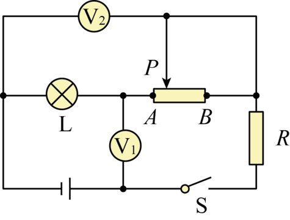

# Physics - 题目 1813

**ID**: 66d191df89ed4d2abcaa55f729e2d6d8
**年级**: Grade 9
**难度**: Hard
**题型**: Fill-in-the-blank

## 题目
如图所示，电源两端电压不变，小灯泡L的规格为“10V 20W”（不考虑灯丝电阻受温度的影响），闭合开关S，当滑动变阻器的滑片P位于A点时，电压表V_{1}的示数为10V，电压表V_{2}的示数为4V。​​​​​​​‌当滑动变阻器的滑片P位于B点时（B点位于滑动变阻器的最右端），电压表V_{1}的示数为11V，电压表V_{2}的示数为8V。则小灯泡正常工作时的电流为A，电阻R的阻值为Ω，开关S闭合后电路消耗功率的最小值为W。

## 解答

1. 由电路图可知，定值电阻、滑动变阻器和小灯泡串联，电压表V_{1}测定值电阻R_{1}与滑动变阻器两端的电压之和，电压表V_{2}测滑动变阻器与小灯泡两端的电压之和。小灯泡L的规格为“10V 20W”，小灯泡正常工作时的电流为
2. I_{额}$=\frac {P{{}_{额}}}{U{{}_{额}}}=\frac {20{\rm{W}}}{10{\rm{V}}}={\rm 2A}$
3. 小灯泡的电阻为
4. ${\rm \mathit{R}\mathit{_{L}}}=\frac {(U{{}_{额}}){^{2}}}{P{{}_{额}}}=\frac {(10{\rm{V}}){^{2}}}{20{\rm{W}}}={\rm 5Ω}$
5. 因串联电路中总电压等于各分电压之和，所以，当滑动变阻器的滑片P位于A点时
6. U=U_{V}_{1}+I_{1}R=4V+I_{1}R﹣﹣﹣①
7. U=U_{V}_{2}+I_{1}R_{L}=10V+I_{1}R_{L}﹣﹣﹣②
8. 当滑动变阻器的滑片P位于B点时，
9. U=U_{V}_{1}'+I_{2}R=8V+I_{2}R﹣﹣﹣③
10. U=U_{V}_{2}'+I_{2}R_{L}=11V+I_{2}R_{L}﹣﹣﹣④
11. 由①③两式可得
12. （I_{1}-I_{2}）R=4V﹣﹣﹣⑤
13. 由②④两式可得：
14. （I_{1}-I_{2}）R_{L}=（I_{1}-I_{2}）×5Ω=1V﹣﹣﹣⑥
15. 由⑤⑥两式可得
16. R=20Ω
17. 由③④可得，I_{2}=0.2A，电源电压U=12V。当滑动变阻器的滑片P位于B点时，此时电路中电流最小
18. I_{min}=I_{2}=0.2A
19. 消耗电功率最小为
20. P_{min}=UI_{min}=12V×0.2A=2.4W

## 知识点

**中文**:
  - 与欧姆定律有关的动态电路计算
  - 电功率的计算及应用

**English**:
  - Calculations in Dynamic Circuits using Ohm's Law
  - Calculation and Application of Electric Power

---
