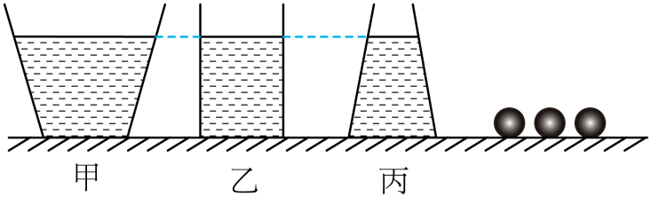

# Physics - 题目 1597

**ID**: 76e86ba85e5d40208be05afa899ce56e
**年级**: Grade 9
**难度**: Hard
**题型**: Fill-in-the-blank

## 题目
如图所示，底面积、质量均相同的甲、乙、丙三个容器置于水平桌面上，容器内的液面相平，容器对桌面的压强相等。​​​​​​​‌现将三个相同小球（球的密度与乙中液体密度相同）分别放入甲、乙、丙容器中，小球不吸液体，液体不溢出。问：放入小球前，液体对容器底部的压力关系：F_{甲}F_{乙}F_{丙}（选填“<”、“>”或“=”，下同），放入小球后，液体对容器底部的压强关系：p_{甲}p_{乙}p_{丙}。

## 解答

1. 底面积、质量均相同的甲、乙、丙三个容器置于水平桌面上，容器对桌面的压力等于总重力，因为容器对桌面的压强相等，根据 $p=\frac {F}{S}$ 可知，容器对桌面的压力相等，即容器和液体的总重力相等，根据G=mg，容器和液体的总质量相等，因为容器质量相等，则液体的质量相等，由图可知，液体的体积V_{甲}>V_{乙}>V_{丙}_{，}根据 $ρ=\frac {m}{V}$ 可得ρ_{甲}<ρ_{乙}<ρ_{丙}_{，}已知容器内的液面相平，即容器底部到液面的深度相同，根据p=ρ_{液}gh可得p'_{甲}<p'_{乙}<p'_{丙}_{，}已知容器的底面积相等，根据 $F=pS$ 可得F_{甲}<F_{乙}<F_{丙}_{，}三个小球完全相同，球的密度与乙中液体密度相同，根据物体浮沉条件可知，小球在甲液体中静止时沉底，在乙液体中悬浮，在丙液体中漂浮，根据浮沉条件可知，小球在三种液体中所受浮力大小关系为F_{浮甲}<F_{浮乙}=F_{浮丙}_{，}将三个小球分别放入液体中，甲容器中小球沉底，所受浮力小于小球的重力，由于力的作用是相互的，液体对小球向上的浮力等于小球对液体向下的压力，由于甲容器是口大底小的容器，液体向下的压力有部分压在侧壁上，使得液体对容器底的压力减小，则可得液体对容器底增加的压力小于小球的重力；乙容器中小球悬浮，所受浮力等于小球重力，由于力的作用是相互的，液体对小球向上的浮力等于小球对液体向下的压力，由于乙容器是柱形容器，液体向下的压力全部压在容器的底部，则液体对容器底增加的压力等于小球的重力；丙容器中小球漂浮，所受浮力等于小球重力，由于力的作用是相互的，液体对小球向上的浮力等于小球对液体向下的压力，由于丙容器是口小底大的容器，液体向下的压力会使得容器的侧壁增加一部分向下的压力，则液体对容器底增加的压力大于小球的重力。三个容器的底面积相等，由 $Δp=\frac {ΔF}{S}$ 可知，液体对容器底增加的压强     $Δp{{}_{甲}}<Δp{{}_{乙}}<Δp{{}_{丙}}$ ，未放入小球时液体对容器底部的压强大小关系为 $p{{}_{甲}}^{′}<p{{}_{乙}}^{′}<p{{}_{丙}}^{′}$ ，因此放入小球后，液体对容器底部的压强为未放入时液体产生的压强与增加的压强之和，则放入小球后液体对容器底的压强大小关系为 $p{{}_{甲}}<p{{}_{乙}}<p{{}_{丙}}$ 。

## 知识点

**中文**:
  - 密度、压强和浮力的综合

**English**:
  - Integrated Density, Pressure, and Buoyancy

---
