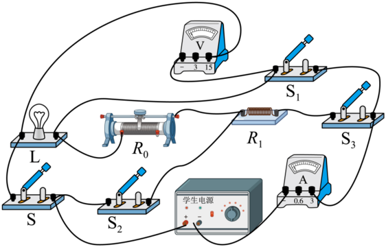

# Physics - 题目 1170

**ID**: 86718121be4c4841a7f017091a0113c3
**年级**: Grade 9
**难度**: Hard
**题型**: Fill-in-the-blank

## 题目
如图所示，电源电压和灯丝电阻不变，灯L上标有“6V  3.6W”字样。​​​​​​​‌当闭合S_{2}、S_{3}，断开S、S_{1}时，电流表示数为I_{1}；当闭合S、S_{3}，断开S_{1}、S_{2}时，滑动变阻器滑片P在最左端时，电流表示数为I_{2}，电压表示数为U_{2}，移动滑片P至最右端时，电流表示数为I_{3}，电压表示数为U_{3}。已知I_{1}∶I_{2}=2∶1，U_{2}∶U_{3}=3∶1，I_{2}-I_{3}=0.4A，则定值电阻R_{1}的阻值为Ω。当S断开，其余开关均闭合时，电路消耗的最小功率为W。

## 解答

1. 灯丝阻值不变，根据 $P=\frac {U{^{2}}}{R}$ 可得灯丝阻值 $R{{}_{{\rm{L}}}}=\frac {U{{}_{额}^{2}}}{P{{}_{额}}}=\frac {{\left({6{\rm{V}}}\right)^{2}}}{3.6{\rm{W}}}=10{\rm{Ω}}$ ，断开S、S_{1}时，电路为定值电阻R_{1}的简单电路，流表示数为I_{1}；闭合S、S_{3}，断开S_{1}、S_{2}时，滑动变阻器滑片P在最左端时，灯L与定值电阻R_{1}串联，电压表测量灯L两端电压为U_{2}，电流表示数为I_{2}；闭合S、S_{3}，断开S_{1}、S_{2}时，移动滑片P至最右端时，灯L、定值电阻R_{1}与滑动变阻器的最大值串联，电流表示数为I_{3}，电压表示数测量灯泡两端电压为U_{3}。因为I_{2}-I_{3}=0.4A
2. 则有 $I{{}_{2}}-I{{}_{3}}=\frac {U{{}_{2}}}{R{{}_{{\rm{L}}}}}-\frac {U{{}_{3}}}{R{{}_{{\rm{L}}}}}=\frac {U{{}_{2}}-U{{}_{3}}}{10{\rm{Ω}}}=0.4{\rm{A}}$ ，因为U_{2}∶U_{3}=3∶1，则 $\frac {U{{}_{2}}-U{{}_{3}}}{10{\rm{Ω}}}=\frac {3U{{}_{3}}-U{{}_{3}}}{10{\rm{Ω}}}=0.4{\rm{A}}$ ，解得U_{3}=2V，则U_{2}=6V。则 $I{{}_{3}}=\frac {U{{}_{3}}}{R{{}_{{\rm{L}}}}}=\frac {2{\rm{V}}}{10{\rm{Ω}}}=0.2{\rm{A}}$ ， $I{{}_{2}}=\frac {U{{}_{2}}}{R{{}_{{\rm{L}}}}}=\frac {6{\rm{V}}}{10{\rm{Ω}}}=0.6{\rm{A}}$ ，又因为I_{1}∶I_{2}=2∶1
3. 则I_{1}=2I_{2}=1.2A ，根据串联电路电压规律、 $I=\frac {U}{R}$ 以及电源电压不变，有I_{1}R_{1}=I_{2}(R_{1}+R_{L})
4. 代入数据解得；R_{1}=10Ω。由 $I=\frac {U}{R}$ 可得电源电压 $U=I{{}_{1}}R{{}_{1}}=1.2{\rm{A}}\times 10{\rm{Ω}}=12{\rm{V}}$ ，根据串联电路电阻规律及 $I=\frac {U}{R}$ 可得滑动变阻器的最大值 $R{{}_{0}}=\frac {U}{I{{}_{3}}}-R{{}_{1}}-R{{}_{{\rm{L}}}}=\frac {12{\rm{V}}}{0.2{\rm{A}}}-10{\rm{Ω}}-10{\rm{Ω}}=40{\rm{Ω}}$ ，当S断开，其余开关均闭合时，灯L被短路，滑动变阻器与定值电阻并联，它两电压相等，且等于电源电压为12V。电路消耗电功率等于各用电器消耗的电功率之和，故当滑动变阻器接入阻值最大时，电路消耗电功率最小，为 $P=P{{}_{0}}+P{{}_{1}}=\frac {U{^{2}}}{R{{}_{0}}}+\frac {U{^{2}}}{R{{}_{1}}}=\frac {{\left({12{\rm{V}}}\right)^{2}}}{40{\rm{Ω}}}+\frac {{\left({12{\rm{V}}}\right)^{2}}}{10{\rm{Ω}}}=18{\rm{W}}$ 。

## 知识点

**中文**:
  - 欧姆定律的应用
  - 电路的动态分析
  - 电功率的计算及应用

**English**:
  - Applications of Ohm's Law
  - Dynamic Circuit Analysis
  - Calculation and Application of Electric Power

---
