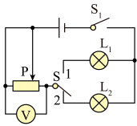

# Physics - 题目 527

**ID**: 8d2481eed81b4d32b65916d63b03a32e
**年级**: Grade 9
**难度**: Hard
**题型**: Fill-in-the-blank

## 题目
如图所示，电源电压保持不变，L_{1}上标有“1.2V”，L_{2}上标有“9V”。​​​​​​​‌闭合开关S_{1}后，当开关S接“1”，滑片P在最左端时，电压表示数为5.4V，L_{1}此时的实际功率是额定功率的 $\frac {1}{4}$ ，则电源电压为V；当开关S接2时，P在中点，电压表示数为 2V。若 L_{1}和L_{2}串联后接在该电源上时，电路中电流为0.2A，则L_{1}的额定功率为W。（灯丝电阻不随温度改变）

## 解答

1. [1]由电路图可知，闭合开关S_{1}后，当开关S接“1”，滑片P在最左端时，滑动变阻器的最大阻值和L_{1}串联，电压表测滑动变阻器两端的电压，因L_{1}此时的实际功率是额定功率的 $\frac {1}{4}$ ，且灯丝电阻不随温度改变，所以，由 $P=\frac {U{^{2}}}{R}$ 可得
2. $\frac {P{{}_{1实}}}{P{{}_{1额}}}=\frac {U{{}_{1实}}{^{2}}}{U{{}_{1额}}{^{2}}}=\frac {1}{4}$
3. 则
4. $U{{}_{1实}}=\frac {1}{2}U{{}_{1额}}=\frac {{\rm{1}}}{{\rm{2}}}\times {\rm{1}}{\rm{.}}{\rm{2}}{\rm{V}}{\rm{=}}{\rm{0}}{\rm{.}}{\rm{6}}{\rm{V}}$
5. 因串联电路中总电压等于各分电压之和，所以，电源的电压
6. $U=U{{}_{滑}}+U{{}_{1}}{{}_{实}}={\rm{5}}{\rm{.}}{\rm{4}}{\rm{V}}{\rm{+}}{\rm{0}}{\rm{.}}{\rm{6}}{\rm{V}}={\rm{6}}{\rm{V}}$
7. [2]电路中各处的电流相等，所以，由 $I=\frac {U}{R}$ 可得，变阻器与L_{1}的电压之比
8. $\frac {U{{}_{滑}}}{U{{}_{1实}}}=\frac {IR{{}_{滑}}}{IR{{}_{1}}}=\frac {R{{}_{滑}}}{R{{}_{1}}}=\frac {{\rm{5}}{\rm{.}}{\rm{4}}{\rm{V}}}{{\rm{0}}{\rm{.}}{\rm{6}}{\rm{V}}}{\rm{=}}\frac {{\rm{9}}}{{\rm{1}}}$
9. 则
10. $R{{}_{滑}}=9R{{}_{1}}$ ①
11. 当开关S 接2时，P在中点， $\frac {{\rm{1}}}{{\rm{2}}}R{{}_{滑}}$ 与L_{2}串联，电压表测滑动变阻器两端的电压，此时L_{2}两端的电压
12. $U{{}_{2}}=U{\rm{-}}U{{}_{滑}}{^{^{′}}}={\rm{6}}{\rm{V}}{\rm{-}}{\rm{2}}{\rm{V}}={\rm{4}}{\rm{V}}$
13. 则L_{2}与滑动变阻器的电压之比
14. $\frac {U{{}_{2}}}{U{{}_{滑}}{^{\prime }}}=\frac {I^{′}R{{}_{2}}}{I^{′}{\times }\frac {1}{2}R{{}_{滑}}}=\frac {R{{}_{2}}}{\frac {1}{2}R{{}_{滑}}}=\frac {{\rm{4}}{\rm{V}}}{{\rm{2}}{\rm{V}}}{\rm{=}}\frac {{\rm{2}}}{{\rm{1}}}$
15. 解得
16. $R{{}_{2}}=R{{}_{滑}}$ ②
17. 若L_{1}和L_{2}串联后接在该电源上时，电路中的总电阻
18. $R=\frac {U}{I^{′′}}=\frac {{\rm{6}}{\rm{V}}}{{\rm{0}}{\rm{.}}{\rm{2}}{\rm{A}}}{\rm{=}}{\rm{3}}{\rm{0}}{\rm{Ω}}$
19. 因串联电路中总电阻等于各分电阻之和，所以
20. $R{{}_{1}}+R{{}_{2}}=R{{}_{1}}+R{{}_{滑}}=R{{}_{1}}+9R{{}_{1}}=10R{{}_{1}}={\rm{3}}{\rm{0}}{\rm{Ω}}$
21. 解得
22. $R{{}_{1}}={\rm{3}}{\rm{Ω}}$
23. 则L_{1}的额定功率
24. $P{{}_{1额}}=\frac {U{{}_{1额}}{^{2}}}{R{{}_{1}}}=\frac {{\rm{(}}{\rm{1}}{\rm{.}}{\rm{2}}{\rm{V}}{\rm{)}}{^{{\rm{2}}}}}{{\rm{3}}{\rm{Ω}}}{\rm{=}}{\rm{0}}{\rm{.}}{\rm{4}}{\rm{8}}{\rm{W}}$

## 知识点

**中文**:
  - 欧姆定律的应用
  - 电路的动态分析
  - 电功率的计算及应用

**English**:
  - Applications of Ohm's Law
  - Dynamic Circuit Analysis
  - Calculation and Application of Electric Power

---
