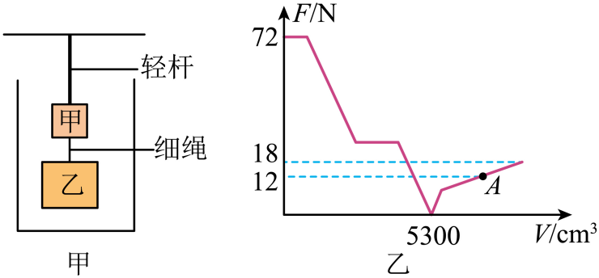

# Physics - 题目 2221

**ID**: bcffb7e7062147deb38750024cf03115
**年级**: Grade 9
**难度**: Hard
**题型**: Fill-in-the-blank

## 题目
如图甲所示，圆柱形容器重力为2N，底面积为 ${{5}}{{0}}{{0}}{\rm{c}}{\rm{m}}{^{2}}$ ，正方体甲与圆柱体乙用长为5cm的细绳相连，并用轻杆将其整体固定在力传感器上，甲边长为10cm，初始乙距离容器底部为2cm。​​​​​​​‌现向容器中注水直至甲完全浸没，当甲浸没后，其所受浮力大小为N；注水过程中，轻杆的受力与注水体积关系如图乙所示，则在A点时容器对桌面的压强为Pa。

## 解答

1. 甲的体积为 $V{{}_{甲}}=\left ({{{1}}{{0}}{\rm{c}}{\rm{m}}}\right ){^{{{3}}}}{\rm{=}}{{1}}{{0}}{{0}}{{0}}{\rm{c}}{\rm{m}}{^{{{3}}}}$ ，即当甲浸没后，其所受浮力大小为 $F{{}_{浮甲}}=ρ{{}_{水}}gV{{}_{甲}}=1\times 10{^{3}}{\rm{k}}{\rm{g}}{\rm{/}}{\rm{m}}{^{{{3}}}}\times 10{\rm{N}}{\rm{/}}{\rm{k}}{\rm{g}}\times 1000\times 10{^{-6}}{\rm{m}}{^{{{3}}}}{\rm{=}}{{1}}{{0}}{\rm{N}}$ ，分析可知，当加水量为0时，传感器受到的拉力为 $F{{}_{大}}=G{{}_{甲}}+G{{}_{乙}}=7{{2}}{\rm{N}}$ ，当甲刚好完全浸没时，传感器受到向上的压力为18N，此时对甲乙的整体受力分析可得 $F{{}_{浮最大}}=F{{}_{压}}+G{{}_{甲}}+G{{}_{乙}}=18{\rm{N}}{{+}}{{7}}{{2}}{\rm{N}}{\rm{=}}{{9}}{{0}}{\rm{N}}$ ，甲乙整体的体积为 $V{{}_{总}}=\frac {F{{}_{浮最大}}}{ρ{{}_{水}}g}=\frac {{{9}}{{0}}{\rm{N}}}{{{1}}{{.}}{{0}}\times {{1}}{{0}}{^{{{3}}}}{\rm{k}}{\rm{g}}{\rm{/}}{\rm{m}}{^{{{3}}}}\times {{1}}{{0}}{\rm{N}}{\rm{/}}{\rm{k}}{\rm{g}}}{\rm{=}}{{9}}\times {{1}}{{0}}{^{{{-}}{{3}}}}{\rm{m}}{^{{{3}}}}{\rm{=}}{{9}}{{0}}{{0}}{{0}}{\rm{c}}{\rm{m}}{^{{{3}}}}$ ，乙的体积为 $V{{}_{乙}}=V{{}_{总}}-V{{}_{甲}}=9000{\rm{c}}{\rm{m}}{^{{{3}}}}{{-}}{{1}}{{0}}{{0}}{{0}}{\rm{c}}{\rm{m}}{^{{{3}}}}{\rm{=}}{{8}}{{0}}{{0}}{{0}}{\rm{c}}{\rm{m}}{^{{{3}}}}$ ，乙浸没后，其所受浮力大小为 $F{{}_{浮乙}}=F{{}_{浮最大}}-F{{}_{浮甲}}=90{\rm{N}}{{-}}{{1}}{{0}}{\rm{N}}{\rm{=}}{{8}}{{0}}{\rm{N}}$ ，当加水量为5300cm^{3}时，甲乙整体受到的浮力和总重力二力平衡，此时传感器受力为0，此时 $F{{}_{浮}}=G{{}_{甲}}+G{{}_{乙}}=72{\rm{N}}$ ，此时乙物体排开水的体积为 $V{{}_{排乙}}=\frac {F{{}_{浮}}}{ρ{{}_{水}}g}=\frac {{{7}}{{2}}{\rm{N}}}{{{1}}{{.}}{{0}}\times {{1}}{{0}}{^{{{3}}}}{\rm{k}}{\rm{g}}{\rm{/}}{\rm{m}}{^{{{3}}}}\times {{1}}{{0}}{\rm{N}}{\rm{/}}{\rm{k}}{\rm{g}}}{\rm{=}}{{7}}{{2}}\times {{1}}{{0}}{^{{{-}}{{3}}}}{\rm{m}}{^{{{3}}}}{\rm{=}}{{7}}{{2}}{{0}}{{0}}{\rm{c}}{\rm{m}}{^{{{3}}}}$ ，此时水深为 $h{{}_{水深}}=\frac {{{5}}{{3}}{{0}}{{0}}{\rm{c}}{\rm{m}}{^{{{3}}}}{{+}}{{7}}{{2}}{{0}}{{0}}{\rm{c}}{\rm{m}}{^{{{3}}}}}{{{5}}{{0}}{{0}}{\rm{c}}{\rm{m}}{^{{{2}}}}}{\rm{=}}{{2}}{{5}}{\rm{c}}{\rm{m}}$ ，此时乙浸入的深度为 $h{{}_{乙浸}}=h{{}_{水深}}-L{{}_{绳子}}-h{{}_{0}}={{2}}{{5}}{\rm{c}}{\rm{m}}{{-}}{{5}}{\rm{c}}{\rm{m}}{{-}}{{2}}{\rm{c}}{\rm{m}}{\rm{=}}{{1}}{{8}}{\rm{c}}{\rm{m}}$ ，乙的底面积为 $S{{}_{乙}}=\frac {V{{}_{排乙}}}{h{{}_{乙浸}}}=\frac {{{7}}{{2}}{{0}}{{0}}{\rm{c}}{\rm{m}}{^{{{3}}}}}{{{1}}{{8}}{\rm{c}}{\rm{m}}}{\rm{=}}{{4}}{{0}}{{0}}{\rm{c}}{\rm{m}}{^{{{2}}}}$ ，乙的高度为 $h{{}_{乙}}=\frac {V{{}_{乙}}}{S{{}_{乙}}}=\frac {{{8}}{{0}}{{0}}{{0}}{\rm{c}}{\rm{m}}{^{{{3}}}}}{{{4}}{{0}}{{0}}{\rm{c}}{\rm{m}}{^{{{2}}}}}{\rm{=}}{{2}}{{0}}{\rm{c}}{\rm{m}}$ ，当传感器受到的压力从12N变到18N时，甲物体排开水的体积变化量为 ${\rm{Δ}}V{{}_{排甲}}=\frac {{\rm{Δ}}F{{}_{浮甲}}}{ρ{{}_{水}}g}=\frac {{\rm{Δ}}F{{}_{压}}}{ρ{{}_{水}}g}=\frac {{{1}}{{8}}{\rm{N}}{{-}}{{1}}{{2}}{\rm{N}}}{{{1}}{{.}}{{0}}\times {{1}}{{0}}{^{{{3}}}}{\rm{k}}{\rm{g}}{\rm{/}}{\rm{m}}{^{{{3}}}}\times {{1}}{{0}}{\rm{N}}{\rm{/}}{\rm{k}}{\rm{g}}}{\rm{=}}{{0}}{{.}}{{6}}\times {{1}}{{0}}{^{{{-}}{{3}}}}{\rm{m}}{^{{{3}}}}{\rm{=}}{{6}}{{0}}{{0}}{\rm{c}}{\rm{m}}{^{{{3}}}}$ ，这段时间加水的深度为从加水5300cm^{3}之后，再加水至A点时，所加水的体积为 ${\rm{Δ}}V{{}_{加水}}=S{{}_{容器}}\times \left [(h{{}_{乙}}-h{{}_{乙浸}})+(L{{}_{甲}}-{\rm{Δ}}h{{}_{水}})\right ]-\left [(V{{}_{乙}}-V{{}_{排乙}})+(V{{}_{甲}}-{\rm{Δ}}V{{}_{排甲}})\right ]$ ，代数据可得
2. ${\rm{Δ}}V{{}_{加水}}{~}={{5}}{{0}}{{0}}{\rm{c}}{\rm{m}}{^{{{2}}}}\times \left [{\rm{(}}{{2}}{{0}}{\rm{c}}{\rm{m}}{{-}}{{1}}{{8}}{\rm{c}}{\rm{m}}{\rm{)}}{{+}}{\rm{(}}{{1}}{{0}}{\rm{c}}{\rm{m}}{{-}}{{6}}{\rm{c}}{\rm{m}}{\rm{)}}\right ]{{-}}\left [{\rm{(}}{{8}}{{0}}{{0}}{{0}}{\rm{c}}{\rm{m}}{^{{{3}}}}{{-}}{{7}}{{2}}{{0}}{{0}}{\rm{c}}{\rm{m}}{^{{{3}}}}{\rm{)}}{{+}}{\rm{(}}{{1}}{{0}}{{0}}{{0}}{\rm{c}}{\rm{m}}{^{{{3}}}}{{-}}{{6}}{{0}}{{0}}{\rm{c}}{\rm{m}}{^{{{3}}}}{\rm{)}}\right ]{\rm{=}}{{1}}{{8}}{\rm{c}}{\rm{m}}{^{{{3}}}}$ 所以加水总体积为 $V{{}_{加水总}}=530{{0}}{\rm{c}}{\rm{m}}{^{{{3}}}}{{+}}{{1}}{{8}}{{0}}{{0}}{\rm{c}}{\rm{m}}{^{{{3}}}}{\rm{=}}{{7}}{{1}}{{0}}{{0}}{\rm{c}}{\rm{m}}{^{{{3}}}}$ ，加水总重力为 $G{{}_{加水}}=ρ{{}_{水}}gV{{}_{加水总}}=1\times 10{^{3}}{\rm{k}}{\rm{g}}{\rm{/}}{\rm{m}}{^{{{3}}}}\times {{1}}{{0}}{\rm{N}}{\rm{/}}{\rm{k}}{\rm{g}}\times {{7}}{{1}}{{0}}{{0}}\times {{1}}{{0}}{^{{{-}}{{6}}}}{\rm{m}}{^{{{3}}}}{\rm{=}}{{7}}{{1}}{\rm{N}}$ ，在A点时容器对桌面的压力为
3. $F{{}_{桌}}=G{{}_{容器}}+G{{}_{加水}}+G{{}_{甲}}+G{{}_{乙}}+F{{}_{A}}=2{\rm{N}}{{+}}{{7}}{{1}}{\rm{N}}{{+}}{{7}}{{2}}{\rm{N}}{{+}}{{1}}{{2}}{\rm{N}}{\rm{=}}{{1}}{{5}}{{7}}{\rm{N}}$ ，在A点时容器对桌面的压强为
4. $p{{}_{桌}}=\frac {F{{}_{桌}}}{S{{}_{容器}}}=\frac {{{1}}{{5}}{{7}}{\rm{N}}}{{{5}}{{0}}{{0}}\times {{1}}{{0}}{^{{{-}}{{4}}}}{\rm{m}}{^{{{2}}}}}{\rm{=}}{{3}}{{1}}{{4}}{{0}}{\rm{P}}{\rm{a}}$

## 知识点

**中文**:
  - 二力及多力平衡的判断和应用
  - 压强的计算
  - 阿基米德原理的应用
  - 物体的浮沉条件及其应用

**English**:
  - Judgment and Application of Equilibrium of Forces
  - Calculation of Pressure
  - Applications of Archimedes' Principle
  - Floating/Sinking Conditions and Applications

---
