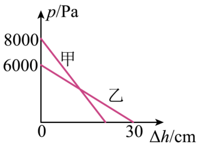

# Physics - 题目 2757

**ID**: bd34de4a6f124f63b3e55433880cf39d
**年级**: Grade 9
**难度**: Hard
**题型**: Fill-in-the-blank

## 题目
甲、乙为两个质量分布均匀的实心圆柱体，放置在水平桌面上，沿水平方向切去上部分，剩余部分对桌面的压强p与切去部分高度h的关系如图所示，已知甲的密度为4.0×10^{3}kg/m^{3}，则圆柱体甲的高度为cm。​​​​​​​‌当切去的高度为12cm，将各自切去部分放置在另一个圆柱体的剩余部分的上表面时，甲剩余部分和乙切去部分的组合体对桌面的压强为p_{1}，乙剩余部分和甲切去部分的组合体对桌面的压强为p_{2}，且p_{1}:p_{2}=3:2，则甲乙圆柱体的底面积之比为。

## 解答

1. 由题意可知，甲、乙为两个质量分布均匀的实心圆柱体，所以甲对水平桌面的压强
2. $p{{}_{甲}}=\frac {F{{}_{甲}}}{S{{}_{甲}}}=\frac {G{{}_{甲}}}{S{{}_{甲}}}=\frac {m{{}_{甲}}g}{S{{}_{甲}}}=\frac {ρ{{}_{甲}}V{{}_{甲}}g}{S{{}_{甲}}}=\frac {ρ{{}_{甲}}S{{}_{甲}}h{{}_{甲}}g}{S{{}_{甲}}}=ρ{{}_{甲}}gh{{}_{甲}}$ ，由图可知，当甲切去的高度为零时，甲对水平桌面的压强为 ${\rm{8}}{\rm{0}}{\rm{0}}{\rm{0}}{\rm{P}}{\rm{a}}$ ，由 $p=ρgh$ 得，圆柱体甲的高度为 $h{{}_{甲}}=\frac {p{{}_{甲}}}{ρ{{}_{甲}}g}=\frac {8000{\rm{P}}{\rm{a}}}{4.0\times 10{^{3}}{\rm{k}}{\rm{g}}{\rm{/}}{\rm{m}}{^{{\rm{3}}}}\times 10{\rm{N}}{\rm{/}}{\rm{k}}{\rm{g}}}=0.2{\rm{m}}={\rm{2}}{\rm{0}}{\rm{c}}{\rm{m}}$ ，由图可知，乙切去30cm后对水平桌面的压强为零，可知圆柱体乙的高度为30cm；当甲和乙切去的高度为零时，甲和乙对水平桌面的压强分别为 $8000{\rm{P}}{\rm{a}}$ 和 ${\rm{6}}000{\rm{P}}{\rm{a}}$ ，则有 $\frac {p{{}_{甲}}}{p{{}_{乙}}}=\frac {ρ{{}_{甲}}gh{{}_{甲}}}{ρ{{}_{乙}}gh{{}_{乙}}}=\frac {ρ{{}_{甲}}\times {\rm{0}}{\rm{.}}{\rm{2}}{\rm{m}}}{ρ{{}_{乙}}\times {\rm{0}}{\rm{.}}{\rm{3}}{\rm{m}}}=\frac {{\rm{8}}{\rm{0}}{\rm{0}}{\rm{0}}{\rm{P}}{\rm{a}}}{{\rm{6}}{\rm{0}}{\rm{0}}{\rm{0}}{\rm{P}}{\rm{a}}}$ ，解得 $ρ{{}_{乙}}={\rm{2}}\times 10{^{3}}{\rm{k}}{\rm{g}}{\rm{/}}{\rm{m}}{^{{\rm{3}}}}$ ，当切去的高度为 $1{\rm{2}}{\rm{c}}{\rm{m}}$ ，将各自切去部分放置在另一个圆柱体的剩余部分的上表面时 $p{{}_{1}}=\frac {F{{}_{1}}}{S{{}_{甲}}}=\frac {G{{}_{甲剩}}+G{{}_{乙切}}}{S{{}_{甲}}}=\frac {m{{}_{甲剩}}g+m{{}_{乙切}}g}{S{{}_{甲}}}=\frac {ρ{{}_{甲}}g\times ({\rm{0}}{\rm{.}}{\rm{2}}{\rm{m}}-{\rm{0}}{\rm{.}}12{\rm{m}})\times S{{}_{甲}}+ρ{{}_{乙}}g\times {\rm{0}}{\rm{.}}{\rm{1}}{\rm{2}}{\rm{m}}\times S{{}_{乙}}}{S{{}_{甲}}}$ ， $p{{}_{2}}=\frac {F{{}_{2}}}{S{{}_{乙}}}=\frac {G{{}_{乙剩}}+G{{}_{甲切}}}{S{{}_{乙}}}=\frac {m{{}_{乙剩}}g+m{{}_{甲切}}g}{S{{}_{乙}}}=\frac {ρ{{}_{乙}}g\times ({\rm{0}}{\rm{.}}{\rm{3}}{\rm{m}}-{\rm{0}}{\rm{.}}{\rm{1}}{\rm{2}}{\rm{m}})\times S{{}_{乙}}+ρ{{}_{甲}}g\times {\rm{0}}{\rm{.}}{\rm{1}}{\rm{2}}{\rm{m}}\times S{{}_{甲}}}{S{{}_{乙}}}$ ，
3. 由题意 $p{{}_{1}}:p{{}_{2}}=3:2$ ，则有 $\frac {p{{}_{1}}}{p{{}_{{\rm{2}}}}}=\frac {\frac {ρ{{}_{甲}}g\times ({\rm{0}}{\rm{.}}{\rm{2}}{\rm{m}}-{\rm{0}}{\rm{.}}{\rm{1}}{\rm{2}}{\rm{m}})\times S{{}_{甲}}+ρ{{}_{乙}}g\times {\rm{0}}{\rm{.}}{\rm{1}}{\rm{2}}{\rm{m}}\times S{{}_{乙}}}{S{{}_{甲}}}}{\frac {ρ{{}_{乙}}g\times ({\rm{0}}{\rm{.}}{\rm{3}}{\rm{m}}-{\rm{0}}{\rm{.}}{\rm{1}}{\rm{2}}{\rm{m}})\times S{{}_{乙}}+ρ{{}_{甲}}g\times {\rm{0}}{\rm{.}}{\rm{1}}{\rm{2}}{\rm{m}}\times S{{}_{甲}}}{S{{}_{乙}}}}=\frac {{\rm{3}}}{{\rm{2}}}$ ，设 $\frac {S{{}_{甲}}}{S{{}_{乙}}}=a$ ，化简得 $(4a+3)\times (9a-4)=0$  解得 $a=-\frac {3}{4}$ （舍去）或 $a=\frac {4}{9}$ ，即甲乙圆柱体的底面积之比为 $4:9$ 。

## 知识点

**中文**:
  - 压强的计算

**English**:
  - Calculation of Pressure

---
