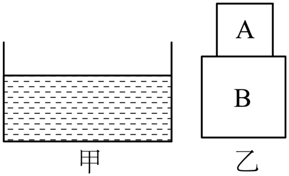

# Physics - 题目 243

**ID**: eae2234fade14bd4ad76503746f0d1bf
**年级**: Grade 9
**难度**: Hard
**题型**: Fill-in-the-blank

## 题目
如图甲有一底面积为200cm^{2}的容器放置在水平地面上，里面装有3cm深的水，另一侧有边长分别为5cm、10cm的正方体A、B叠放，如图乙，此时A对B的压强为Pa；将叠加体A、B按现有状态竖直放入到容器中（图中未画出），待稳定后，同时沿竖直方向切去A、B各自总体积相同比例，B对容器底部的压强变为未切去时的2倍，则切去部分的体积与未切去之前的总体积之比为。​​​​​​​‌（已知ρ_{A}=2×10^{3}kg/m^{3}，ρ_{B}=0.6×10^{3}kg/m^{3}）

## 解答

1. [1]由题意可知A的体积
2. V_{A}=a^{3}=(a)^{3}=(5cm)^{3}=125cm^{3}=1.25×10^{-4}m^{3}
3. A的重力
4. G_{A}=m_{A}g=ρ_{A}V_{A}g=2×10^{3}kg/m^{3}×1.25×^{-4}m^{3}×10N/kg=2.5N
5. A压在B上时，B的受力面积
6. S_{A}=a^{2}=(5cm)^{2}=25cm^{2}=2.5×10^{-3}m^{2}
7. A对B的压强
8. ${\rm p{{}_{{\rm{A}}}}=\frac {F{{}_{{\rm{A}}}}}{S{{}_{{\rm{A}}}}}=\frac {G{{}_{{\rm{A}}}}}{S{{}_{{\rm{A}}}}}=\frac {2.5{\rm{N}}}{2.5\times 10{^{-3}}{\rm{m}}{^{2}}}=1\times 10{^{3}}{\rm{P}}{\rm{a}}}$
9. [2]B的底面积
10. S_{B}=(10cm)^{2}=100cm^{2}=1×10^{-2}m^{2}
11. 容器的底面积
12. S_{容}=200cm^{2}=2×10^{-2}m^{2}
13. 因B的底面积刚好是容器底面积的二分之一，所以将叠加体A、B按现有状态竖直放入到容器中时，水的深度为原来的两倍，即
14. h=6cm<10cm
15. 故放入水中的A和B不会浸没，此时进入液体的体积
16. V_{排}=S_{B}h=1×10^{-2}m^{2}×0.06m=6×10^{-4}m^{3}
17. B受到的浮力
18. F_{浮}=ρ_{水}V_{排}g=1.0×10^{3}kg/m^{3}×6×10^{-4}m^{3}×10N/kg=6N
19. A和B的总重力
20. G_{总}=ρ_{A}V_{A}g+ρ_{B}V_{B}g=2×10^{3}kg/m^{3}×1.25×10^{-4}m^{3}×10N/kg+0.6×10^{3}kg/m^{3}×1000×10^{-6}m^{3}×10N/kg=8.5N
21. 可知A和B对容器底的压强为
22. ${\rm p=\frac {F}{S{{}_{{\rm{B}}}}}=\frac {G{{}_{总}}-F{{}_{浮}}}{S{{}_{{\rm{B}}}}}=\frac {8.5{\rm{N}}-6{\rm{N}}}{100\times 10{^{-4}}{\rm{m}}{^{2}}}=250{\rm{P}}{\rm{a}}}$
23. 沿竖直方向切去A、B各自总体积相同比例，B对容器底部的压强变为未切去时的2倍，则此时B对容器底的压强
24. p′=2p=2×250Pa=500Pa
25. 容器中的水的体积
26. V_{水}=S_{容}h_{0}=200cm^{2}×3cm=600cm^{3}
27. 设竖直切去部分后，剩余部分的A和B的体积分别为kV_{A}和kV_{B}，设此时B浸入水中高度变为h′，因B切去一部分后排开的水的体积减少，则水面会下降，此时水的体积
28. ${\rm V{{}_{水}}=\left ({S{{}_{容}}-\frac {kV{{}_{{\rm{B}}}}}{h{{}_{{\rm{B}}}}}}\right )\times h^{′}}$
29. 两种情况下容器中水的体积不变，代入数据得
30. $\left ({200cm{^{2}}-\frac {k\times 1000cm{^{3}}}{10cm}}\right )\times h^{′}=600cm{^{3}}$
31. 化简得
32. $h^{′}=\frac {600}{200-100k}cm=\frac {0.06}{2-k}{\rm{m}}$
33. 此时B受到的浮力
34. ${\rm F{{}_{浮}}{^{^{′}}}=ρ{{}_{水}}kS{{}_{{\rm{B}}}}h^{′}g=ρ{{}_{水}}kS{{}_{{\rm{B}}}}\cdot \frac {6}{2-{\rm{k}}}g}$
35. 此时B对容器底部的压强
36. ${\rm p^{′}=\frac {kG{{}_{{\rm{A}}}}+kG{{}_{{\rm{B}}}}-ρ{{}_{水}}k{\rm{S}}{{}_{{\rm{B}}}}\cdot \frac {6}{2-k}g}{kS{{}_{{\rm{B}}}}}=\frac {k\times 2.5{\rm{N}}+{\rm{k}}\times 6{\rm{N}}-1\times 10{^{3}}{\rm{k}}{\rm{g}}{\rm{/}}{\rm{m}}{^{3}}\times k\times 1\times 10{^{-2}}{\rm{m}}{^{2}}\times \frac {0.06}{2-k}{\rm{m}}\times 10{\rm{N}}{\rm{/}}{\rm{k}}{\rm{g}}}{k\times 1\times 10{^{-2}}{\rm{m}}{^{2}}}=500{\rm{P}}{\rm{a}}}$
37. 解得
38. $k=\frac {2}{7}$
39. 则切去部分与总体积的比值
40. ${\rm \frac {\left ({1-k}\right )V{{}_{总}}}{V{{}_{总}}}=\frac {\left ({1-\frac {2}{7}}\right )V{{}_{总}}}{V{{}_{总}}}=\frac {5}{7}}$

## 知识点

**中文**:
  - 固体压强的判断与计算
  - 阿基米德原理的应用
  - 物体的浮沉条件及其应用

**English**:
  - Determination and Calculation of Solid Pressure
  - Applications of Archimedes' Principle
  - Floating/Sinking Conditions and Applications

---
