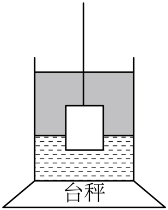

# Physics - 题目 41

**ID**: f0a3819ddc574f368242d562fc3374b0
**年级**: Grade 9
**难度**: Hard
**题型**: Fill-in-the-blank

## 题目
六一儿童节，同学送给小明一个透明密闭容器做的礼物。​​​​​​​‌容器中盛有两种分层的液体，一只小熊悬浮在两种液体的交界处。热爱物理的小明同学找来一个正方体木块A、一个电子台秤、刻度尺、底面积为 $200{\rm{c}}{\rm{m}}{^{2}}$ 的薄壁容器等对两种液体进行了以下探究：将密闭容器顶部打开，将液体全部倒入柱形容器中，并将柱形容器放在台秤上，记下容器和液体的总质量；用刻度尺测出A木块边长为 $10{\rm{c}}{\rm{m}}$ ，并用一根不计质量和体积的细杆固定在A的顶部正中央，再将木块放入容器中，如图所示，此时杆的作用力为0。放入物体A后，台秤的读数增加了 $1200{\rm{g}}$ ，则物体A的密度为${\rm{g}}/{\rm{c}}{\rm{m}}{^{3}}$ 。此时，甲液体的深度为 $10{\rm{c}}{\rm{m}}$ ，乙液体的深度为 $6{\rm{c}}{\rm{m}}$ ，A浸入乙液体的深度为 $4{\rm{c}}{\rm{m}}$ ；现将A提升，使A全部浸入甲液体中，发现台秤读数减小 $400{\rm{g}}$ ，将物体A上下移动，在保证物体A浸没的情况下，A处在最高点和最低点时杆的作用力之比为（A与容器可接触但不挤压）。

## 解答

1. [1]木块放入容器后，杆的作用力为0，台秤的读数增加了1200g，则物体A的质量为 $m{{}_{{\rm{A}}}}={\rm{1}}{\rm{2}}{\rm{0}}{\rm{0}}{\rm{g}}$ ，物体A的体积为
2. $V{{}_{{\rm{A}}}}=L{{}_{{\rm{A}}}^{{\rm{3}}}}=（{\rm{1}}{\rm{0}}{\rm{c}}{\rm{m}}）{^{{\rm{3}}}}=1\times 10{^{3}}{\rm{c}}{\rm{m}}{^{3}}$
3. 物体A的密度为
4. $ρ{{}_{{\rm{A}}}}=\frac {m{{}_{{\rm{A}}}}}{V{{}_{{\rm{A}}}}}=\frac {1200{\rm{g}}}{1\times 10{^{3}}{\rm{c}}{\rm{m}}{^{3}}}=1.2{\rm{g}}{\rm{/}}{\rm{c}}{\rm{m}}{^{{\rm{3}}}}$
5. [2]将物体A提升，使其全部浸入甲液体中，发现台秤读数减小了
6. $\Delta m={\rm{4}}{\rm{0}}{\rm{0}}{\rm{g}}={\rm{0}}{\rm{.}}{\rm{4}}{\rm{k}}{\rm{g}}$
7. 即台秤受到的压力减小了
8. $\Delta F{{}_{压}}=Δmg={\rm{0}}{\rm{.}}{\rm{4}}{\rm{k}}{\rm{g}}\times {\rm{1}}{\rm{0}}{\rm{N}}{\rm{/}}{\rm{k}}{\rm{g}}={\rm{4}}{\rm{N}}$
9. 将物体A与容器及液体看成整体进行受力分析可知，杆的拉力增加了
10. $ΔF{{}_{杆}}=ΔF{{}_{压}}=4{\rm{N}}$
11. 因为提升前杆的作用力为0，所以将物体A提升，使其全部浸入甲液体中时，杆的拉力
12. $F{{}_{杆}}=0+ΔF{{}_{压}}=4{\rm{N}}$
13. 当物体A全部进入甲液体后，物体A在甲液体中的任一位置受到的浮力都不变，故杆的拉力也不变，所以在物体A在最高点时，杆的作用力为
14. $F{{}_{最高}}=F{{}_{杆}}=4{\rm{N}}$
15. 由[1]可知
16. $m{{}_{{\rm{A}}}}={\rm{1}}{\rm{2}}{\rm{0}}{\rm{0}}{\rm{g}}={\rm{1}}{\rm{.}}{\rm{2}}{\rm{k}}{\rm{g}}$
17. $V{{}_{{\rm{A}}}}=1\times 10{^{3}}{\rm{c}}{\rm{m}}{^{3}}=1\times 10{^{-3}}{\rm{m}}{^{3}}$
18. 则物体A的重力为
19. $G{{}_{{\rm{A}}}}=m{{}_{{\rm{A}}}}g=1.2{\rm{k}}{\rm{g}}\times 10{\rm{N}}/{\rm{k}}{\rm{g}}={\rm{1}}{\rm{2}}{\rm{N}}$
20. 当物体A全部进入甲液体时，受到的浮力为
21. $F{{}_{浮}}=G-F{{}_{杆}}=12{\rm{N}}-4{\rm{N}}=8{\rm{N}}$
22. 则液体甲的密度为
23. $ρ{{}_{甲液}}=\frac {F{{}_{浮}}}{gV{{}_{{\rm{A}}}}}=\frac {8{\rm{N}}}{10{\rm{N}}{\rm{/}}{\rm{k}}{\rm{g}}\times 1\times 10{^{-3}}{\rm{m}}{^{{\rm{3}}}}}=0.8\times 10{^{3}}{\rm{k}}{\rm{g}}{\rm{/}}{\rm{m}}{^{{\rm{3}}}}$
24. 由题可知，当杆的作用力为0时，排开乙液体的体积为
25. $V{{}_{排乙}}={\rm{1}}{\rm{0}}{\rm{c}}{\rm{m}}\times {\rm{1}}{\rm{0}}{\rm{c}}{\rm{m}}\times {\rm{4}}{\rm{c}}{\rm{m}}={\rm{4}}{\rm{0}}{\rm{0}}{\rm{c}}{\rm{m}}{^{3}}=4\times 10{^{-4}}{\rm{m}}{^{3}}$
26. 排开甲液体的体积为
27. $V{{}_{排甲}}=V{{}_{{\rm{A}}}}-V{{}_{排乙}}=1000{\rm{c}}{\rm{m}}{^{3}}-400{\rm{c}}{\rm{m}}{^{3}}=600{\rm{c}}{\rm{m}}{^{3}}=6\times 10{^{-4}}{\rm{m}}{^{3}}$
28. 物体A因浸入甲液体而受到的浮力为
29. $F{{}_{甲浮}}=ρ{{}_{甲液}}gV{{}_{排甲}}=0.8\times 10{^{3}}{\rm{k}}{\rm{g}}{\rm{/}}{\rm{m}}{^{{\rm{3}}}}\times {\rm{1}}{\rm{0}}{\rm{N}}{\rm{/}}{\rm{k}}{\rm{g}}\times 6\times 10{^{-4}}{\rm{m}}{^{{\rm{3}}}}=4.8{\rm{N}}$
30. 物体A因浸入乙液体而受到的浮力为
31. $F{{}_{乙浮}}=G{{}_{{\rm{A}}}}-F{{}_{甲浮}}=12{\rm{N}}-4.8{\rm{N}}=7.2{\rm{N}}$
32. 则乙液体的密度为
33. $ρ{{}_{乙液}}=\frac {F{{}_{乙浮}}}{gV{{}_{排乙}}}=\frac {7.2{\rm{N}}}{{\rm{1}}{\rm{0}}{\rm{N}}{\rm{/}}{\rm{k}}{\rm{g}}\times 4\times {\rm{1}}{\rm{0}}{^{-4}}{\rm{m}}{^{3}}}=1.8\times 10{^{3}}{\rm{k}}{\rm{g}}{\rm{/}}{\rm{m}}{^{{\rm{3}}}}$
34. 乙液体的总体积为
35. $V{{}_{乙液}}=6{\rm{c}}{\rm{m}}\times 200{\rm{c}}{\rm{m}}{^{{\rm{2}}}}-（{\rm{1}}{\rm{0}}{\rm{c}}{\rm{m}}）{^{{\rm{2}}}}\times 4{\rm{c}}{\rm{m}}=800{\rm{c}}{\rm{m}}{^{3}}$
36. 当物体A下降到最低点时，乙液体的深度为
37. $h{{}_{乙}}=\frac {V{{}_{乙液}}}{S{{}_{容}}-S{{}_{{\rm{A}}}}}=\frac {800{\rm{c}}{\rm{m}}{^{3}}}{200{\rm{c}}{\rm{m}}{^{2}}-10{\rm{c}}{\rm{m}}\times 10{\rm{c}}{\rm{m}}}=8{\rm{c}}{\rm{m}}$
38. 浸入乙液体的体积为
39. $V{{}_{排乙}}{^{\prime }}=S{{}_{{\rm{A}}}}\times h{{}_{乙}}=(10{\rm{c}}{\rm{m}}{\rm{)}}{^{2}}\times {\rm{8}}{\rm{c}}{\rm{m}}=800{\rm{c}}{\rm{m}}{^{3}}=8\times 10{^{-4}}{\rm{m}}{^{3}}$
40. 此时物体A仍有一部分在甲液体中，浸入甲液体的体积为
41. $V{{}_{排甲}}{^{\prime }}=V{{}_{{\rm{A}}}}-V{{}_{排乙}}{^{\prime }}=1000{\rm{c}}{\rm{m}}{^{3}}-800{\rm{c}}{\rm{m}}{^{3}}=200{\rm{c}}{\rm{m}}{^{3}}=2\times 10{^{-4}}{\rm{m}}{^{3}}$
42. 此时物体A因浸入甲液体而受到的浮力为
43. $F{{}_{甲浮}}{^{\prime }}=ρ{{}_{甲液}}gV{{}_{排甲}}{^{\prime }}=0.8\times 10{^{3}}{\rm{k}}{\rm{g}}{\rm{/}}{\rm{m}}{^{{\rm{3}}}}\times {\rm{1}}{\rm{0}}{\rm{N}}{\rm{/}}{\rm{k}}{\rm{g}}\times 2\times 10{^{-4}}{\rm{m}}{^{3}}=1.6{\rm{N}}$
44. 物体A因浸入乙液体而受到的浮力为
45. $F{{}_{乙浮}}{^{\prime }}=ρ{{}_{乙液}}gV{{}_{排乙}}{^{\prime }}=1.8\times 10{^{3}}{\rm{k}}{\rm{g}}{\rm{/}}{\rm{m}}{^{{\rm{3}}}}\times {\rm{1}}{\rm{0}}{\rm{N}}{\rm{/}}{\rm{k}}{\rm{g}}\times 8\times 10{^{-4}}{\rm{m}}{^{3}}=14.4{\rm{N}}$
46. 故物体A下降到最低点时，受到的浮力为
47. $F{{}_{浮}}{^{\prime }}=F{{}_{甲浮}}{^{\prime }}+F{{}_{乙浮}}{^{\prime }}=1.6{\rm{N}}+14.4{\rm{N}}=16{\rm{N}}$
48. 此时物体A与容器底部接触但不挤压时，受到的浮力最大，此时杆的作用力为向下的压力，则物体A下降到最低点时，杆对物体A的压力为
49. $F{{}_{最低}}=F{{}_{浮}}{^{\prime }}-G{{}_{{\rm{A}}}}=16{\rm{N}}-12{\rm{N}}=4{\rm{N}}$
50. 所以，物体A处在最高点和最低点时杆的作用力之比为
51. $F{{}_{最高}}:F{{}_{最低}}={\rm{4}}{\rm{N}}:{\rm{4}}{\rm{N}}={\rm{1}}:{\rm{1}}$

## 知识点

**中文**:
  - 二力及多力平衡的判断和应用
  - 密度的简单计算
  - 阿基米德原理的应用

**English**:
  - Judgment and Application of Equilibrium of Forces
  - Simple Calculation of Density
  - Applications of Archimedes' Principle

---
