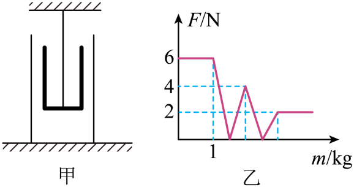

# Physics - 题目 1493

**ID**: f2f0e6ca16f448ed98b84d8b4f6e90a8
**年级**: Grade 9
**难度**: Hard
**题型**: Fill-in-the-blank

## 题目
如图甲，足够高的柱形容器置于水平地面上，底面积为200cm^{2}。​​​​​​​‌高为10cm空杯（厚度不可忽略）用轻质细杆固定悬于容器内某处。现沿着容器边缘缓慢向容器内注水，细杆对杯子的作用力F与所加水的质量的关系如图乙。则杯子的质量为kg；若在加入2.2kg水时，轻轻取走细杆，待液面重新静止后，水对容器底部的压强为Pa。

## 解答

1. [1]水面到达杯子底部前，杆的弹力等于杯子的重力，即 $G{{}_{杯}}=F{{}_{1}}=6{\rm{N}}$ ，杯子的质量
2. $m{{}_{杯}}=\frac {G{{}_{杯}}}{g}=\frac {{{6}}{\rm{N}}}{{{1}}{{0}}{\rm{N}}{\rm{/}}{\rm{k}}{\rm{g}}}=0.6{\rm{k}}{\rm{g}}{\rm ，[2]}$ 由图乙可知，第一阶段，当水面刚好到达杯子底部时，加入水的质量为 $m{{}_{水1}}=1{\rm{k}}{\rm{g}}$ ，此时加入水的体积为 $V{{}_{水1}}=\frac {m{{}_{水1}}}{ρ{{}_{水}}}=\frac {1{\rm{k}}{\rm{g}}}{1.0\times 10{^{3}}{\rm{k}}{\rm{g}}/{\rm{m}}{^{3}}}=1\times 10{^{-3}}{\rm{m}}{^{3}}{\rm ，1kg}$ 水的深度为 $h{{}_{水1}}=\frac {V{{}_{水1}}}{S{{}_{容}}}=\frac {1\times 10{^{-3}}{\rm{m}}{^{3}}}{200\times 10{^{-4}}{\rm{m}}{^{2}}}=0.05{\rm{m}}$ ，第二阶段，水面到达杯子底部后，随着水的加入，杯子排开水的体积增大，浮力越来越大，在某个位置浮力等于杯子的重力，此时细杆受力为0；继续加水，当水面到达杯口时，杯子受到水竖直向上的浮力，自身竖直向下的重力6N和细杆竖直向下4N的弹力，三个力合力为0，此时杯子受到的浮力为 $F{{}_{浮}}=G{{}_{杯}}+F{{}_{2}}=6{\rm{N}}+4{\rm{N}}=10{\rm{N}}$ ，杯子排开水的体积为 $V{{}_{排}}=\frac {F{{}_{浮}}}{ρ{{}_{水}}g}=\frac {10{\rm{N}}}{1.0\times 10{^{3}}{\rm{k}}{\rm{g}}{\rm{/}}{\rm{m}}{^{3}}\times 10{\rm{N}}{\rm{/}}{\rm{k}}{\rm{g}}}=1\times 10{^{-3}}{\rm{m}}{^{3}}$ ，则杯子的底面积为 $S{{}_{杯}}=\frac {V{{}_{排}}}{h{{}_{杯}}}=\frac {1\times 10{^{-3}}{\rm{m}}{^{3}}}{10\times 10{^{-2}}{\rm{m}}}=0.01{\rm{m}}{^{2}}$ ，容器底面积与杯子底部下面的面积之差为 $ΔS=S{{}_{容}}-S{{}_{杯}}=200\times 10{^{-4}}{\rm{m}}{^{2}}-0.01{\rm{m}}{^{2}}=0.01{\rm{m}}{^{2}}$ ，则从水面到达杯底至达到杯口过程中，加入水的体积为 $V{{}_{2}}=ΔSh{{}_{杯}}=0.01{\rm{m}}{^{2}}\times 10\times 10{^{-2}}{\rm{m}}=1\times 10{^{-3}}{\rm{m}}{^{3}}$ ，加入水的质量为 $m{{}_{水2}}=ρ{{}_{水}}V{{}_{2}}=1\times 10{^{3}}{\rm{k}}{\rm{g}}{\rm{/}}{\rm{m}}{^{3}}\times 1\times 10{^{-3}}{\rm{m}}{^{3}}=1{\rm{k}}{\rm{g}}$ ，即加入水的总质量为2kg时，杯外侧的水面与杯口齐平。第三阶段，继续加水，水进入杯子中，杯子受到的浮力不变，杯子的总重力增大，则杯子对细杆向上的支持力减小，直至为0时，杯子受到的浮力恰好等于杯子的总重力，此时杯中进入的水的重力为 $G{{}_{杯中水}}=F{{}_{浮}}-G{{}_{杯}}=10{\rm{N}}-6{\rm{N}}=4{\rm{N}}$ ，杯中进入的水的质量为
3. $m{{}_{杯中水}}=\frac {G{{}_{杯中水}}}{g}=\frac {4{\rm{N}}}{10{\rm{N}}/{\rm{k}}{\rm{g}}}=0.4{\rm{k}}{\rm{g}}$ ，第四阶段，继续加水，直至杯中的水面与杯口齐平，杯子受到的浮力不变，杯子的总重力继续变大，大于杯子受到的浮力，此时杯子对细杆有向下的拉力，大小等于2N；杯中的水面与杯口齐平时杯中加入水的总体积等于杯子的体积，则第三阶段和第四阶段加入水的总质量为 $m{{}_{水3}}=ρ{{}_{水}}V{{}_{杯}}=1\times 10{^{3}}{\rm{k}}{\rm{g}}{\rm{/}}{\rm{m}}{^{3}}\times 1\times 10{^{-3}}{\rm{m}}{^{3}}=1{\rm{k}}{\rm{g}}$ ，此时容器内加入水的总质量为 $m{{}_{总}}=m{{}_{水1}}+m{{}_{水2}}+m{{}_{水3}}=1{\rm{k}}{\rm{g}}+1{\rm{k}}{\rm{g}}{{+}}{{1}}{\rm{k}}{\rm{g}}=3{\rm{k}}{\rm{g}}$ ，第五阶段，再加水时，水面杯子浸没在水中，受到的浮力和杯子的总重力不再改变，因此细杆受到的拉力也不再改变，大小保持在2N。综上所述，若加入2.2kg水，处于第三阶段，即2.2kg水中，2kg在杯外，0.2kg在杯中，此时杯子的总重力为 $G{{}_{杯总}}=G{{}_{杯}}+G^{′}{{{}_{杯中水}}}=6{\rm{N}}+0.2{\rm{k}}{\rm{g}}\times 10{\rm{N}}/{\rm{k}}{\rm{g}}{\rm{=}}{{8}}{\rm{N}}$ ，杯子受到的浮力为10N，浮力大于总重力，若取下细杆，待稳定后杯子会处于漂浮状态，水面会下降，则稳定后杯子受到的浮力为 $F^{′}{{{}_{浮}}}=G{{}_{杯总}}=8{\rm{N}}$ ，杯子排开水的体积为 $V^{′}{{{}_{排}}}=\frac {F^{′}{{{}_{浮}}}}{ρ{{}_{水}}g}=\frac {8{\rm{N}}}{1.0\times 10{^{3}}{\rm{k}}{\rm{g}}/{\rm{m}}{^{3}}\times 10{\rm{N}}/{\rm{k}}{\rm{g}}}=8\times 10{^{-4}}{\rm{m}}{^{3}}$ ，排开水的体积变化量为 $\Delta V{{}_{排}}=V{{}_{排}}-V^{′}{{{}_{排}}}=1\times 10{^{-3}}{\rm{m}}{^{3}}-8\times 10{^{-4}}{\rm{m}}{^{3}}=2\times 10{^{-4}}{\rm{m}}{^{3}}$ ，水面下降的高度为
4. $Δh=\frac {ΔV{{}_{排}}}{S{{}_{容}}}=\frac {2\times 10{^{-4}}{\rm{m}}{^{3}}}{200\times 10{^{-4}}{\rm{m}}{^{2}}}=0.01{\rm{m}}$ ，此时水面的深度为 $h{{}_{稳定}}=h{{}_{水1}}+h{{}_{杯}}-\Delta h=0.05{\rm{m}}+0.1{\rm{m}}{{-}}{{0}}{{.}}{{0}}{{1}}{\rm{m}}{\rm{=}}{{0}}{{.}}{{1}}{{4}}{\rm{m}}$ ，水对容器底部的压强为 $p=ρ{{}_{水}}gh{{}_{稳定}}=1.0\times 10{^{3}}{\rm{k}}{\rm{g}}/{\rm{m}}{^{3}}\times 10{\rm{N}}/{\rm{k}}{\rm{g}}\times 0.14{\rm{m}}=1400{\rm{P}}{\rm{a}}$

## 知识点

**中文**:
  - 二力及多力平衡的判断和应用
  - 密度公式的应用
  - 液体压强计算公式的应用
  - 阿基米德原理的应用

**English**:
  - Judgment and Application of Equilibrium of Forces
  - Application of Density Formula
  - Application of Liquid Pressure Formula
  - Applications of Archimedes' Principle

---
