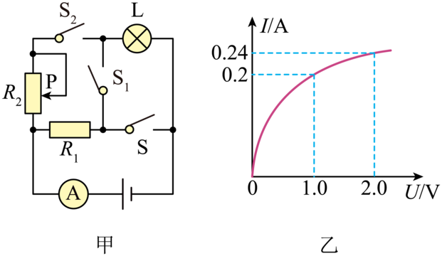

# Physics - 题目 241

**ID**: fc544d61446844329530cea0b41aff71
**年级**: Grade 9
**难度**: Hard
**题型**: Fill-in-the-blank

## 题目
如图甲所示电路，电源电压恒定，电流表量程为 $0\sim 0.6{\rm{A}}$ ，滑动变阻器R_{2}允许通过的最大电流为1A。​​​​​​​‌小灯泡L标有“2.5V　0.25A”字样，其 $I-U$ 图像如图乙所示，则灯泡正常发光时消耗的功率为W。当滑片P移到R_{2}的最上端，且所有开关都闭合时，电流表示数为 $I{{}_{1}}=0.5{\rm{A}}$ ，电阻R_{1}消耗的功率为P_{1}；当只闭合S_{1}时，电流表示数为 $I{{}_{2}}=0.2{\rm{A}}$ ，电阻R_{1}消耗的功率为P_{1}'，且P_{1}：P_{1}'=25:16。若只闭合S_{2}时，在保证电路元件都安全的情况下，R_{2}接入电路的阻值变化范围是Ω。

## 解答

1. 灯泡正常发光时消耗的功率为 $P=UI=2.5{\rm{V}}\times 0.25{\rm{A}}=0.625{\rm{W}}$ ，
2. 当滑片P移到R_{2}的最上端，且所有开关都闭合时，R_{1}、R_{2}并联，电流表测干路中的电流，电流表示数为 $I{{}_{1}}=0.5{\rm{A}}$ ，电阻R_{1}消耗的功率为 ${\rm \mathit{P}_{1}}P{{}_{1}}=\frac {U{^{2}}}{R{{}_{1}}}$     ①， $\frac {U}{R1}+\frac {U}{R{{}_{2}}}=0.5{\rm{A}}$    ②，当只闭合S_{1}时，R1与灯泡串联，电流表测电路中的电流，电流表示数为 $I{{}_{2}}=0.2{\rm{A}}$ ，电阻R_{1}消耗的功率为 ${\rm \mathit{P}_{1}'，}P{{}_{1}}{^{^{′}}}=\frac {{\left({U-1{\rm{V}}}\right)^{2}}}{R{{}_{1}}}$  ③， $U=1{\rm{V}}+0.2R{{}_{{{1}}}}$     ④， $\frac {P{{}_{1}}}{P{{}_{1}}{^{\prime }}}=\frac {16}{25}$     ⑤，联立①③⑤可得 $\frac {P{{}_{1}}}{P{{}_{1}}{^{\prime }}}=\frac {(U-1{\rm{V}}){^{2}}}{U{^{2}}}=\frac {16}{25}$ ，解得电源电压 $U=5{\rm V}$ ，把 $U=5{\rm V}$ 带入④解得 $R{{}_{1}}=20Ω$ ，把 $U=5{\rm V}$ ， $R{{}_{1}}=20Ω$ 带入②解得 $R{{}_{2}}=20Ω$ ，若只闭合S_{2}时，滑动变阻器与灯泡串联，在保证电路元件都安全的情况下，电路中的最大电流为0.25A，此时灯泡正常发光，变阻器接入电路的电阻最小 $R{{}_{2{\rm \min }}}=\frac {5{\rm{V}}-2.5{\rm{V}}}{0.25{\rm{A}}}=10\Omega $ ，滑动变阻器的电阻值越大电路中的电流越小，电路越安全，变阻器接入电路的电阻最大值为20Ω，因此R_{2}接入电路的阻值变化范围是 $10\sim 20\Omega $ 。

## 知识点

**中文**:
  - 与欧姆定律有关的动态电路计算
  - 电功率的计算及应用

**English**:
  - Calculations in Dynamic Circuits using Ohm's Law
  - Calculation and Application of Electric Power

---
