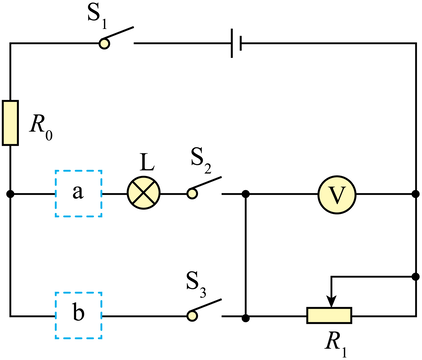

# Physics - 题目 1414

**ID**: 17b7639cf4da491ea863cf9452ed94ab
**年级**: Grade 9
**难度**: Hard
**题型**: Multiple-choice

## 题目
如图所示的电路，电源电压不变，滑动变阻器 $R{{}_{1}}$ 标有“100Ω；0.75A”，灯泡标有“ ${{1}}{{2}}{\rm{V}}$ ； ${{6}}{\rm{W}}$ ”，电压表量程“0~15V”，虚线框 ${\rm{a}}、{\rm{b}}$ 内为电流表（量程 $0\sim 0.6{\rm{A}}$ ）和导线其中之一，且不相同。​​​​​​​‌在保证电路安全的前提下，已知：①闭合S_{1}、S_{3}，调节滑动变阻器，电路中的最小电流为 ${{0}}{{.}}{{3}}{\rm{A}}$ ；②闭合所有开关，滑动变阻器允许接入电路的最小阻值为 $6Ω$ ；③将b内的元件与电压表互换，闭合所有开关，灯泡恰能正常发光，且无论怎样移动滑片，灯泡亮度都不变。则下列说法正确的是（      ）

## 解答

1. 由 $P=UI$ 得，灯泡的额定电流为 $I{{}_{{\rm{L}}}}=\frac {P{{}_{{\rm{L}}}}}{U{{}_{{\rm{L}}}}}=\frac {{{6}}{\rm{W}}}{{{1}}{{2}}{\rm{V}}}{\rm{=}}{{0}}{{.}}{{5}}{\rm{A}}$ ，将b内的元件与电压表互换，闭合所有开关，灯泡恰能正常发光，此时灯泡定值电阻R_{0}串联，电压表被短路，由串联电路电压特点得，电源电压为 $U=U{{}_{0}}+U{{}_{{\rm{L}}}}={{0}}{{.}}{{5}}{\rm{A}}\times R{{}_{0}}+12{\rm{V}}$ ，闭合S_{1}、S_{3}，定值电阻R_{0}、变阻器R_{1}串联，电压表测量变阻器的电压，当电压表的示数最大为15V时，变阻器接入电路中电阻最大，电路电阻最大，电路电流最小，当闭合所有开关，定值电阻R_{0}与变阻器R_{1}串联，变阻器接入电路中电阻最小时，电路电流最大。若a为导线，b为电流表，由于电流表的量程为0~0.6A，则电路的最大电流为0.6A。由串联电路电压特点得，电源电压为 $U=U{{}_{02}}+U{{}_{1}}={{0}}{{.}}{{6}}{\rm{A}}\times R{{}_{0}}+{{0}}{{.}}{{6}}{\rm{A}}\times 6Ω$ ，由（1）（2）得，电源电压为 $U=54{\rm{V}}$ ，定值电阻R_{0}的阻值 $R{{}_{0}}=84Ω$ ，闭合S_{1}、S_{3}，电路最小电流为 $I{{}_{{\rm{m}}{\rm{i}}{\rm{n}}}}=I{{}_{0}}=\frac {U{{}_{0}}{^{\prime }}}{R{{}_{0}}}=\frac {U-U{{}_{1}}}{R{{}_{0}}}=\frac {54{\rm{V}}-15{\rm{V}}}{84Ω}=0.46{\rm{A}}\ne 0.3{\rm{A}}$ ，不符合题意；若a为电流表，b为导线，则闭合所有开关，电路的最大电流为0.75A，由串联电路电压特点得，电源电压为 $U=U{{}_{03}}+U{{}_{1}}{^{\prime }}={{0}}{{.}}{{7}}{{5}}{\rm{A}}\times R{{}_{0}}+{{0}}{{.}}{{7}}{{5}}{\rm{A}}\times 6Ω$ ，由（1）（3）得，电源电压为 $U=27{\rm{V}}$ ，定值电阻R_{0}的阻值 $R{{}_{0}}=30Ω$ ，闭合S_{1}、S_{3}，电路最小电流为 $I{{}_{{\rm{m}}{\rm{i}}{\rm{n}}}}=I{{}_{0}}=\frac {U{{}_{0}}{^{\prime }}}{R{{}_{0}}}=\frac {U-U{{}_{1}}}{R{{}_{0}}}=\frac {{{2}}{{7}}{\rm{V}}-15{\rm{V}}}{30Ω}=0.3{\rm{A}}$ ，符合题意，故a为电流表，b为导线，故AB错误；②中，闭合所有开关，定值电阻R_{0}、变阻器R_{1}串联，滑动变阻器允许接入电路的最小阻值为6Ω，此时电路的总功率最大为 $P=\frac {U{^{2}}}{R{{}_{总{{}_{{\rm{m}}{\rm{i}}{\rm{n}}}}}}}=\frac {\left ({{{2}}{{7}}{\rm{V}}}\right ){^{{{2}}}}}{{{3}}{{0}}{\rm{Ω}}{{+}}{{6}}{\rm{Ω}}}{\rm{=}}{{2}}{{0}}{{.}}{{2}}{{5}}{\rm{W}}{\rm ，C}$ 正确；③中，R_{0}工作10s产生的热量为 $Q{{}_{0}}=I{{}_{{\rm{L}}}}{^{2}}R{{}_{0}}t={\left({{{0}}{{.}}{{5}}{\rm{A}}}\right)^{2}}\times 3{{0}}{\rm{Ω}}\times 10{\rm{s}}{\rm{=}}{{7}}{{5}}{\rm{J}}{\rm ，D}$ 错误。

## 知识点

**中文**:
  - 与欧姆定律有关的动态电路计算
  - 电功率的计算及应用
  - 焦耳定律的计算公式及其应用

**English**:
  - Calculations in Dynamic Circuits using Ohm's Law
  - Calculation and Application of Electric Power
  - Formula and Application of Joule's Law

---
