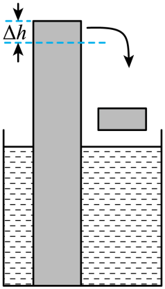

# Physics - 题目 2836

**ID**: 1ae551ad5ecc499a8d9367686944e80b
**年级**: Grade 9
**难度**: Hard
**题型**: Multiple-choice

## 题目
如图所示，质量为600g、高为11cm、底面积为300cm^{2}的柱形容器放在水平桌面，容器中装有质量为2kg的水，将一个高度为20cm，底面积为100cm^{2}的长方体实心物块放入柱形容器中，此时长方体实心物块浸入水中的体积为1000cm^{3}，对容器底的压力为6N；若从长方体物块上方沿水平方向切去一定厚度∆h，再将切去部分竖直放回柱形容器中，则下列说法中正确是的是（      ）①水平切割物块前，柱形容器中水的深度h_{液}=10cm②水平切割物块前，柱形容器对水平桌面的压强P=1400Pa③若切去的厚度∆h=2cm时，剩下的物块对容器底的压力F=3.​​​​​​​‌6N④若切去的厚度∆h=8cm时，柱形容器中剩下水的体积V=1700cm^{3}

## 解答

1. ①切割前，柱形容器中水的深度为 $h{{}_{液}}=\frac {V{{}_{浸}}}{S{{}_{物}}}=\frac {1000cm{^{3}}}{100cm{^{2}}}=10cm$ ，故①正确；②水平切割物块前，长方体受到的浮力为 $F{{}_{浮1}}=ρ{{}_{水}}gV{{}_{排1}}=ρ{{}_{水}}gV{{}_{浸}}=1.0\times 10{^{3}}kg/{\rm{m}}{^{3}}\times 10{\rm{N}}/kg\times 1000\times 10{^{-6}}{\rm{m}}{^{3}}=10{\rm{N}}$ ，此时长方体对容器底的压力为6N，则长方体的重力为 $G{{}_{物}}=F{{}_{1}}+F{{}_{浮1}}=6{\rm{N}}+10{\rm{N}}=16{\rm{N}}$ ，此时容器对桌面的压力为 $F{{}_{2}}=G{{}_{物}}+G{{}_{水}}+G{{}_{容}}=16{\rm{N}}+2kg\times 10{\rm{N}}/kg+0.6kg\times 10{\rm{N}}/kg=42{\rm{N}}$ ，所以水平切割物块前，柱形容器对水平桌面的压强为 $p=\frac {F{{}_{2}}}{S{{}_{容}}}=\frac {42{\rm{N}}}{300\times 10{^{-4}}{\rm{m}}{^{2}}}=1400Pa$ ，故②正确；
2. ③若切去的厚度Δh=2cm，则剩下部分长方体的重力为 $G{{}_{1}}=\frac {20cm-2cm}{20cm}\times 16{\rm{N}}=14.4{\rm{N}}$ ，切去部分的重力为 $G{{}_{2}}=G{{}_{物}}-G{{}_{1}}=16{\rm{N}}-14.4{\rm{N}}=1.6{\rm{N}}$ ，假设切去部分浸没在水中，则切去部分受到的浮力为 $F{{}_{浮2}}=ρ{{}_{水}}gV{{}_{排3}}=1.0\times 10{^{3}}kg/{\rm{m}}{^{3}}\times 10{\rm{N}}/kg\times 100\times 2\times 10{^{-6}}{\rm{m}}{^{3}}=2{\rm{N}}>1.6{\rm{N}}$ ，则切去部分放入水中将漂浮且浮力等于F_{浮3}=1.6N，切去部分排开水的体积为 $V{{}_{排3}}=\frac {F{{}_{浮3}}}{ρ{{}_{水}}g}=\frac {1.6{\rm{N}}}{1.0\times 10{^{3}}kg/{\rm{m}}{^{3}}\times 10{\rm{N}}/kg}=1.6\times 10{^{-4}}{\rm{m}}{^{3}}=160cm{^{3}}$ ，若剩余部分仍沉水底，则水面上升的高度为 $Δh^{′}=\frac {V{{}_{排3}}}{S{{}_{容}}-S{{}_{物}}}=\frac {160cm{^{3}}}{300cm{^{2}}-100cm{^{2}}}=0.8cm$ ，则剩余部分排开水的体积为 $V{{}_{排4}}=S{{}_{物}}\left ({Δh^{′}+h{{}_{液}}}\right )=100cm{^{2}}\times \left ({0.8cm+10cm}\right )=1080cm{^{3}}=1.08\times 10{^{-3}}{\rm{m}}{^{3}}$ ，则剩余部分受到的浮力为 $F{{}_{浮4}}=ρ{{}_{水}}gV{{}_{排4}}=1.0\times 10{^{3}}kg/{\rm{m}}{^{3}}\times 10{\rm{N}}/kg\times 1.08\times 10{^{-3}}{\rm{m}}{^{3}}=10.8{\rm{N}}<14.4{\rm{N}}$ ，即剩余部分仍沉水底且对容器的压力为 $F{{}_{3}}=G{{}_{1}}-F{{}_{浮1}}=14.4{\rm{N}}-10.8{\rm{N}}=3.6{\rm{N}}$ ， 故③正确；
3. ④若切去的厚度，∆h´´=8cm， 则剩下部分长方体的重力为 $G{{}_{3}}=\frac {20cm-8cm}{20cm}\times 16{\rm{N}}=9.6{\rm{N}}<10{\rm{N}}$ ，故剩余部分将漂浮，切去部分的重力为 $G{{}_{4}}=G{{}_{物}}-G{{}_{3}}=16{\rm{N}}-9.6{\rm{N}}=6.4{\rm{N}}$ ，假设切去部分浸没在水中，则切去部分受到的浮力为 $F{{}_{浮5}}=ρ{{}_{水}}gV{{}_{排5}}=1.0\times 10{^{3}}kg/{\rm{m}}{^{3}}\times 10{\rm{N}}/kg\times 100\times 8\times 10{^{-6}}{\rm{m}}{^{3}}=8{\rm{N}}>6.4{\rm{N}}$ ，则切去部分放入水中也将漂浮，即可视为长方体整体漂浮在水中，此时排开水的体积为 $V{{}_{排6}}=\frac {F{{}_{浮5}}}{ρ{{}_{水}}g}=\frac {G{{}_{物}}}{ρ{{}_{水}}g}=\frac {16{\rm{N}}}{1.0\times 10{^{3}}kg/{\rm{m}}{^{3}}\times 10{\rm{N}}/kg}=1.6\times 10{^{-3}}{\rm{m}}{^{3}}=1600cm{^{3}}$ ，而容器内原来水的体积为 $V{{}_{水}}=\frac {m{{}_{水}}}{ρ{{}_{水}}}=\frac {2000{\rm{g}}}{1.0{\rm{g}}/cm{^{3}}}=2000cm{^{3}}$ ，则总体积 $V{{}_{总}}=V{{}_{水}}+V{{}_{排6}}=2000cm{^{3}}+1600cm{^{3}}=3600cm{^{3}}>V{{}_{容}}=300cm{^{2}}\times 11cm=3300cm{^{3}}$ ，则水会溢出，故容器内剩下水的体积为 $V{{}_{水}^{^{′}}}=V{{}_{容}}-V{{}_{排6}}=3300cm{^{3}}-1600cm{^{3}}=1700cm{^{3}}$ ，故④正确。故A正确，BCD错误。

## 知识点

**中文**:
  - 密度、压强和浮力的综合

**English**:
  - Integrated Density, Pressure, and Buoyancy

---
