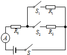

# Physics - 题目 2463

**ID**: 222051177edb497c879f9709bb47a965
**年级**: Grade 9
**难度**: Hard
**题型**: Multiple-choice

## 题目
如图所示，电源电压不变，电阻 $R{{}_{{\rm{1}}}}={\rm{1}}{\rm{5}}{\rm{Ω}}$ ， $R{{}_{{\rm{2}}}}={\rm{1}}{\rm{0}}{\rm{Ω}}$ ，开关S、S_{1}闭合，S_{2}断开，电流表读数为0.​​​​​​​‌4A，则开关S、S_{2}闭合，S_{1}断开时，电流表读数可能为（      ）

## 解答

1. 当开关S、S_{1}闭合，S_{2}断开时，电阻R_{0}与R_{1}的串联，电流表测电路中的电流，根据欧姆定律可得，R_{1}两端的电压是
2. $U{{}_{{\rm{1}}}}=I{{}_{{\rm{1}}}}R{{}_{{\rm{1}}}}={\rm{0}}{\rm{.}}{\rm{4}}{\rm{A}}\times {\rm{1}}{\rm{5}}{\rm{Ω}}={\rm{6}}{\rm{V}}$
3. 因为串联电路的总电阻等于各分电阻之和，所以
4. $R{{}_{总{\rm{1}}}}=R{{}_{{\rm{0}}}}+R{{}_{{\rm{1}}}}$
5. 当开关S、S_{2}闭合，S_{1}断开时，电阻R_{0}与R_{2}串联，同理
6. $R{{}_{总{\rm{2}}}}=R{{}_{{\rm{0}}}}+R{{}_{{\rm{2}}}}$
7. 因为 $R{{}_{{\rm{1}}}}>R{{}_{2}}$ ，所以 $R{{}_{总{\rm{1}}}}>R{{}_{总{\rm{2}}}}$ ，因为电源电压不变，所以根据欧姆定律可得
8. $I{{}_{{\rm{2}}}}>I{{}_{1}}={\rm{0}}{\rm{.}}{\rm{4}}{\rm{A}}$
9. 因为开关S、S_{2}闭合，S_{1}断开时，电路中的电流变大，那么R_{0}的电压变大，由于电源电压不变，根据串联电路的电压规律可知，R_{2}两端的电压变小，即
10. $U{{}_{2}}<U{{}_{1}}={\rm{6}}{\rm{V}}$
11. 所以
12. $I{{}_{2}}<\frac {U{{}_{1}}}{R{{}_{2}}}=\frac {{\rm{6}}{\rm{V}}}{{\rm{1}}{\rm{0}}{\rm{Ω}}}={\rm{0}}{\rm{.}}{\rm{6}}{\rm{A}}$
13. 则可知电流表的读数在0.4~0.6A之间。
14. 故选B。

## 知识点

**中文**:
  - 串联电路的电压规律
  - 欧姆定律的应用
  - 电路的动态分析

**English**:
  - Voltage Law in Series Circuits
  - Applications of Ohm's Law
  - Dynamic Circuit Analysis

---
