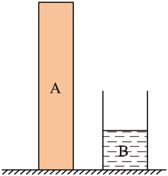

# Physics - 题目 1320

**ID**: 24acf435f9e54a4d9736d1d5b406a289
**年级**: Grade 9
**难度**: Hard
**题型**: Multiple-choice

## 题目
如图所示，A是高12cm、底面积为 $50{\rm{c}}{\rm{m}}{^{2}}$ 的长方体物体，A的质量为300g。​​​​​​​‌B是质量为100g、底面积为 $100{\rm{c}}{\rm{m}}{^{2}}$ 、高为5cm的柱形水杯，装有3cm深的水，都置于水平桌面上。将A或A的截取部分从接触水面开始，竖直缓慢放入水中后松手，直至水面稳定。以下说法正确的是（      ）①将A竖直浸入水中，最终A向下移动的距离是水面上升高度的1.5倍②水平截去A的 $\frac {1}{6}$ 并将截去部分放入水中，最终容器对桌面的压强与A剩余部分压强相等③竖直截去A的 $\frac {1}{2}$ 并将截去部分竖直浸入水中，最终水对容器底部压强为400Pa④水平截去A的 $\frac {3}{4}$ 并将截去部分竖直浸入水中，最终容器对桌面的压强600Pa

## 解答

1. ①由题意可知，根据 $ρ=\frac {m}{V}$ 可得，A的密度为
2. $ρ{{}_{{\rm{A}}}}=\frac {m{{}_{{\rm{A}}}}}{V{{}_{{\rm{A}}}}}=\frac {m{{}_{{\rm{A}}}}}{S{{}_{{\rm{A}}}}h{{}_{{\rm{A}}}}}=\frac {300{\rm{g}}}{50{\rm{c}}{\rm{m}}{^{2}}\times 12{\rm{c}}{\rm{m}}}{\rm{=}}{{0}}{{.}}{{5}}{\rm{g}}{\rm{/}}{\rm{c}}{\rm{m}}{^{{{3}}}}$
3. 可知，A密度小于水的密度，故由物体的浮沉条件可知，A的截去部分放入水中后会上浮，其中杯子高5cm，装有的水深3cm深，则杯子剩余容积为
4. $V{{}_{B剩}}=S{{}_{{\rm{B}}}}h{{}_{杯}}=100{\rm{c}}{\rm{m}}{^{2}}\times 2{\rm{c}}{\rm{m}}{\rm{=}}{{2}}{{0}}{{0}}{\rm{c}}{\rm{m}}{^{{{3}}}}$
5. 由G=mg可得，A受到的重力为
6. $G{{}_{{\rm{A}}}}=m{{}_{{\rm{A}}}}g=0.3{\rm{k}}{\rm{g}}\times 10{\rm{N}}/{\rm{k}}{\rm{g}}{\rm{=}}{{3}}{\rm{N}}$
7. 设A放入水中后漂浮，则其受到的浮力等于其自身重力，即
8. $F{{}_{浮A}}=G{{}_{{\rm{A}}}}=3{\rm{N}}$
9. 由阿基米德原理可得，此时其排开水的体积为
10. $V{{}_{A排}}=\frac {F{{}_{浮A}}}{ρ{{}_{水}}g}=\frac {3{\rm{N}}}{1\times 10{^{3}}{\rm{k}}{\rm{g}}/{\rm{m}}{^{3}}\times 10{\rm{N}}/{\rm{k}}{\rm{g}}}=3\times 10{^{-4}}{\rm{m}}{^{3}}=3{{0}}{{0}}{\rm{c}}{\rm{m}}{^{{{3}}}}＞{{2}}{{0}}{{0}}{\rm{c}}{\rm{m}}{^{{{3}}}}$
11. 则A浸入水中后，其排开水的体积等于水杯内水的体积，则水上升的深度为
12. $Δh{{}_{水}}=\frac {V{{}_{水}}}{S{{}_{容}}}=\frac {{{3}}{{0}}{{0}}{\rm{c}}{\rm{m}}{^{{{3}}}}}{{{1}}{{0}}{{0}}{\rm{c}}{\rm{m}}{^{{{2}}}}}{\rm{=}}{{3}}{\rm{c}}{\rm{m}}$
13. 由阿基米德原理知
14. $ρ{{}_{水}}gV{{}_{排}}=ρ{{}_{{\rm{A}}}}gV{{}_{{\rm{A}}}}$
15. 可得，A浸入水体积等于A体积的一半
16. $V{{}_{浸}}=\frac {1}{2}V{{}_{{\rm{A}}}}=\frac {1}{2}\times 600{\rm{c}}{\rm{m}}{^{{{3}}}}{\rm{=}}{{3}}{{0}}{{0}}{\rm{c}}{\rm{m}}{^{{{3}}}}$
17. 即A浸入水中的深度为
18. $h{{}_{A浸}}=\frac {V{{}_{A浸}}}{S{{}_{{\rm{A}}}}}=\frac {{{3}}{{0}}{{0}}{\rm{c}}{\rm{m}}{^{{{3}}}}}{{{5}}{{0}}{\rm{c}}{\rm{m}}{^{{{2}}}}}{\rm{=}}{{6}}{\rm{c}}{\rm{m}}$
19. 则水会溢出杯子，由此可知，A向下移动的距离为3cm，杯中水上升的高度为2cm；则最终A向下移动的距离是水面上升高度的1.5倍，故①正确；
20. ②水平截去A的 $\frac {1}{6}$ ，截去的部分的质量为
21. $m{{}_{A截}}=\frac {1}{6}m{{}_{{\rm{A}}}}=\frac {1}{6}\times 300{\rm{g}}=50{\rm{g}}=0.0{{5}}{\rm{k}}{\rm{g}}$
22. 则剩余部分的质量为0.25kg，由G=mg可得，A剩余部分的重力为
23. $G{{}_{A剩}}=m{{}_{A剩}}g=0.25{\rm{k}}{\rm{g}}\times 10{\rm{N}}{\rm{/}}{\rm{k}}{\rm{g}}=2.5{\rm{N}}$
24. 则截去部分的重力为0.5N，则剩余部分对地面的压力为2.5N，由 $p=\frac {F}{S}$ 可得，A剩余部分对桌面的压强为
25. $p{{}_{A剩}}=\frac {F{{}_{A剩}}}{S{{}_{{\rm{A}}}}}=\frac {2.5{\rm{N}}}{50\times 10{^{-4}}{\rm{m}}{^{2}}}=500{\rm{P}}{\rm{a}}$
26. 将截去部分放入水中后，假设物体A漂浮在水面，则其受到浮力等于其重力，即
27. $F{{}_{浮A截}}=G{{}_{A截}}=0.5{\rm{N}}$
28. 由阿基米德原理可得，此时其排开水的体积为
29. $V{{}_{A截排}}=\frac {F{{}_{浮A截}}}{ρ{{}_{水}}g}=\frac {0.5{\rm{N}}}{1\times 10{^{3}}{\rm{k}}{\rm{g}}/{\rm{m}}{^{3}}\times 10{\rm{N}}/{\rm{k}}{\rm{g}}}=5\times 10{^{-5}}{\rm{m}}{^{3}}=50{\rm{c}}{\rm{m}}{^{{{3}}}}$
30. 则此时水面上升的高度为
31. $Δh{{}_{水}}=\frac {V{{}_{A截排}}}{S{{}_{{\rm{B}}}}}=\frac {{{5}}{{0}}{\rm{c}}{\rm{m}}{^{{{3}}}}}{{{1}}{{0}}{{0}}{\rm{c}}{\rm{m}}{^{{{2}}}}}{\rm{=}}{{0}}{{.}}{{5}}{\rm{c}}{\rm{m}}$
32. 则水不会溢出，由
33. G=mg=ρVg
34. 可得，B中水受到的重力为
35. $G{{}_{水}}=m{{}_{水}}g=ρ{{}_{水}}V{{}_{水}}g=1\times 10{^{3}}{\rm{k}}{\rm{g}}/{\rm{m}}{^{3}}\times 100{\rm{c}}{\rm{m}}{^{2}}\times 10{^{-4}}{\rm{m}}{^{2}}\times 0.03{\rm{m}}\times 10{\rm{N}}/{\rm{k}}{\rm{g}}=3{\rm{N}}$
36. B受到的重力为
37. $G{{}_{杯}}=m{{}_{杯}}g=0.1{\rm{k}}{\rm{g}}\times 10{\rm{N}}/{\rm{k}}{\rm{g}}=1{\rm{N}}$
38. 则将截去部分放入水中，容器对桌面的压力等于截去部分和水以及水杯受到的重力之和，即
39. $F{{}_{{\rm{B}}}}=G{{}_{A截}}+G{{}_{水}}+G{{}_{杯}}=0.5{\rm{N}}+3{\rm{N}}+1{\rm{N}}=4.5{\rm{N}}$
40. 则容器对桌面的压强为
41. $p{{}_{{\rm{B}}}}=\frac {F{{}_{{\rm{B}}}}}{S{{}_{{\rm{B}}}}}=\frac {4.5{\rm{N}}}{100\times 10{^{-4}}{\rm{m}}{^{2}}}=450Pa$
42. 可知容器对桌面的压强小于A剩余部分压强，故②错误；
43. ④水平截去A的 $\frac {3}{4}$ ，截去的部分的质量为
44. $m{{}_{A截}}´=\frac {3}{4}m{{}_{{\rm{A}}}}=\frac {3}{4}\times 300{\rm{g}}=225{\rm{g}}=0.225kg$
45. 该部分受到的重力为
46. $G{{}_{A截}}´=m{{}_{A截}}´g=0.225{\rm{k}}{\rm{g}}\times 10{\rm{N}}/{\rm{k}}{\rm{g}}=2.25{\rm{N}}$
47. 将截去部分放入水中后，假设物体A漂浮在水面，则其受到浮力等于其重力，即
48. $F{{}_{浮A截}}´=G{{}_{A截}}´=2.25{\rm{N}}$
49. 由阿基米德原理可得，此时其排开水的体积为
50. $V{{}_{A截排}}´=\frac {F{{}_{浮A截}}´}{ρ{{}_{水}}g}=\frac {2.25{\rm{N}}}{1\times 10{^{3}}{\rm{k}}{\rm{g}}/{\rm{m}}{^{3}}\times 10{\rm{N}}/{\rm{k}}{\rm{g}}}=2.25\times 10{^{-4}}{\rm{m}}{^{3}}=225{\rm{c}}{\rm{m}}{^{3}}$
51. 则此时水面上升的高度为
52. $Δh{{}_{水}}´=\frac {V{{}_{A截排}}´}{S{{}_{{\rm{B}}}}}=\frac {{{2}}{{2}}{{5}}{\rm{c}}{\rm{m}}{^{{{3}}}}}{{{1}}{{0}}{{0}}{\rm{c}}{\rm{m}}{^{{{2}}}}}{\rm{=}}{{2}}{{.}}{{2}}{{5}}{\rm{c}}{\rm{m}}$ 由于柱形水杯高为5cm，装的水的深度为3cm，可知水会溢出，由题意知，水杯容积为
53. $V{{}_{{\rm{B}}}}=S{{}_{{\rm{B}}}}\times h{{}_{{\rm{B}}}}=100{\rm{c}}{\rm{m}}{^{2}}\times 5{\rm{c}}{\rm{m}}{\rm{=}}{{5}}{{0}}{{0}}{\rm{c}}{\rm{m}}{^{{{3}}}}$
54. 最终容器内剩余水的体积为
55. $V{{}_{水剩}}=V{{}_{{\rm{B}}}}-{\rm{V}}{{}_{A截排}}=500{\rm{c}}{\rm{m}}{^{3}}-22{{5}}{\rm{c}}{\rm{m}}{^{{{3}}}}{\rm{=}}{{2}}{{7}}{{5}}{\rm{c}}{\rm{m}}{^{{{3}}}}$
56. 由
57. G=mg=ρVg
58. 可得，容器内剩余水受到的重力为
59. $G{{}_{水剩}}=0.275{\rm{k}}{\rm{g}}\times 10{\rm{N}}/{\rm{k}}{\rm{g}}=2.75{\rm{N}}$ 此时，容器对桌面的压力为
60. $F{{}_{{\rm{B}}}}´=G{{}_{A截}}´+G{{}_{水剩}}+G{{}_{杯}}=\frac {3}{4}\times 3{\rm{N}}+2.75{\rm{N}}+1{\rm{N}}=6{\rm{N}}$
61. 则容器对桌面的压强为
62. $p{{}_{{\rm{B}}}}´=\frac {F{{}_{{\rm{B}}}}´}{S{{}_{{\rm{B}}}}}=\frac {6{\rm{N}}}{100\times 10{^{-4}}{\rm{m}}{^{2}}}=600{\rm{P}}{\rm{a}}$
63. 故④正确；
64. ③竖直截去A的 $\frac {1}{2}$ 后，截去的部分的底面积为
65. $S{{}_{A截}}´´=\frac {1}{2}S{{}_{{\rm{A}}}}=\frac {1}{2}\times 50{\rm{c}}{\rm{m}}{^{{{2}}}}{\rm{=}}{{2}}{{5}}{\rm{c}}{\rm{m}}{^{{{2}}}}$ 截去的部分的质量为
66. $m{{}_{A截}}´´=\frac {1}{2}m{{}_{{\rm{A}}}}=\frac {1}{2}\times 300{\rm{g}}=150{\rm{g}}=0.15kg$
67. 该部分受到的重力为
68. $G{{}_{A截}}´´=m{{}_{A截}}´´g=0.15{\rm{k}}{\rm{g}}\times 10{\rm{N}}/{\rm{k}}{\rm{g}}=1.5{\rm{N}}$
69. 假设此时A截取的部分能漂浮在水面，则
70. $F{{}_{浮A截}}´´=G{{}_{A截}}´´=1.5{\rm{N}}$
71. 由阿基米德原理可得，此时其排开水的体积为
72. $V{{}_{A截排}}´´=\frac {F{{}_{浮A截}}´´}{ρ{{}_{水}}g}=\frac {1.5{\rm{N}}}{1\times 10{^{3}}{\rm{k}}{\rm{g}}/{\rm{m}}{^{3}}\times 10{\rm{N}}/{\rm{k}}{\rm{g}}}=1.5\times 10{^{-4}}{\rm{m}}{^{3}}=15{{0}}{\rm{c}}{\rm{m}}{^{{{3}}}}＜{{2}}{{0}}{{0}}{\rm{c}}{\rm{m}}{^{{{3}}}}$
73. 则水不会溢出，由阿基米德原理知
74. $ρ{{}_{水}}gV{{}_{A截排}}´´=ρ{{}_{{\rm{A}}}}gV{{}_{A截}}´´$
75. 可得，此时A截取的部分浸入水体积为
76. $V{{}_{A截浸}}´´=2V{{}_{A截}}´´=2\times 150{\rm{c}}{\rm{m}}{^{{{3}}}}{\rm{=}}{{3}}{{0}}{{0}}{\rm{c}}{\rm{m}}{^{{{3}}}}$
77. 则A截取的部分浸入水深度为
78. $h{{}_{A}}´´=\frac {V{{}_{A截排}}´´}{S{{}_{A截}}´´}=\frac {{{3}}{{0}}{{0}}{\rm{c}}{\rm{m}}{^{{{3}}}}}{{{2}}{{5}}{\rm{c}}{\rm{m}}{^{{{2}}}}}{\rm{=}}{{1}}{{2}}{\rm{c}}{\rm{m}}$
79. 由此可知，放入截去部分后，截取的部分不会漂浮，会沉底，假设不成立。因放入截去部分后，容器中的水体积不变，故可得放入截去部分后，水面的高度为
80. $h{{}_{1}}=\frac {V{{}_{水}}}{S{{}_{容}}-{{}_{A截}}´´}=\frac {{{3}}{{0}}{{0}}{\rm{c}}{\rm{m}}{^{{{3}}}}}{{{1}}{{0}}{{0}}{\rm{c}}{\rm{m}}{^{{{2}}}}{{-}}{{2}}{{5}}{\rm{c}}{\rm{m}}{^{{{2}}}}}{\rm{=}}{{4}}{\rm{c}}{\rm{m}}{\rm{=}}{{0}}{{.}}{{0}}{{4}}{\rm{m}}$ 因容器的高为5cm，故可知此时水未溢出，最终水对容器底部的压强为
81. $p{{}_{水}}=ρ{{}_{水}}gh{{}_{1}}=1\times 10{^{3}}{\rm{k}}{\rm{g}}/{\rm{m}}{^{3}}\times 10{\rm{N}}/{\rm{k}}{\rm{g}}\times 0.04{\rm{m}}=400{\rm{P}}{\rm{a}}$ 故③正确；综上可知①③④正确，②错误。

## 知识点

**中文**:
  - 密度、压强和浮力的综合

**English**:
  - Integrated Density, Pressure, and Buoyancy

---
