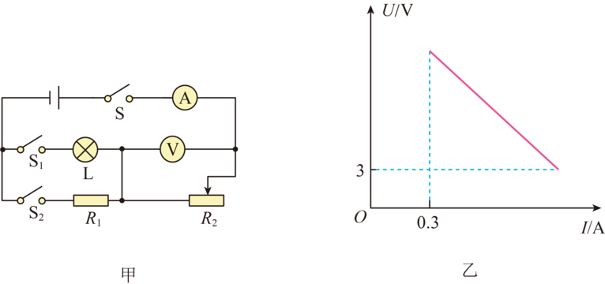

# Physics - 题目 2686

**ID**: 3ac0dd5697b44d178e07b41bc89e4cf9
**年级**: Grade 9
**难度**: Hard
**题型**: Multiple-choice

## 题目
如图甲所示电路，电源电压不变，定值电阻R_{1}=10Ω，灯泡L上标有“30V　30W”（忽略灯丝电阻的变化），滑动变阻器R_{2}的铭牌未知，电流表量程0~3A，电压表量程0~15V。​​​​​​​‌当开关S、S_{1}闭合，S_{2}断开，滑动变阻器的滑片在某一端时，电流表示数为0.2A，保持滑动变阻器的滑片不动，当开关S、S_{2}闭合，S_{1}断开，在保证电路安全情况下，将滑片最大范围的向另一端移动，电压表和电流表示数变化如图乙所示。在保证电路安全的情况下，以下说法正确的是（      ）①滑动变阻器R_{2}的铭牌为“30Ω　1A”②只闭合开关S、S_{2}，滑动变阻器R_{2}的最大功率是3.6W③只闭合开关S、S_{1}，灯泡L的最小功率是1.2W④任意闭合开关并调节滑片，整个电路的最大电功率是19.2W

## 解答

1. 由灯泡的铭牌可知，灯泡的额定电流为 $I{{}_{额}}=\frac {P{{}_{额}}}{U{{}_{额}}}=\frac {30{\rm{W}}}{30{\rm{V}}}=1{\rm{A}}$ ，灯泡的电阻为 $R{{}_{{\rm{L}}}}=\frac {U{{}_{额}}{^{2}}}{P{{}_{额}}}=\frac {（30{\rm{V}}）{^{{{2}}}}}{30{\rm{W}}}=30Ω$ ，当S、S_{2}闭合，S_{1}断开，该电路为R_{1}和R_{2}的串联电路，电流表测电路中的电流，电压表测R_{2}两端的电压，由图乙可知，电压表示数不能达到0V，即变阻器滑片不能滑到最左端。由此分析可知，当S、S_{1}闭合，S_{2}断开，滑动变阻器的滑片在最右端，变阻器接入电路的阻值最大，此时电路为灯泡L和R_{2}的串联电路，电压表测R_{2}两端的电压，电流表测电路中的电流，此时电流表的示数为0.2A，即电路中的电流为I_{1}=0.2A，由欧姆定律可得，灯泡L两端的电压为U_{L}=I_{1}R_{L}=0.2A×30Ω=6V，由欧姆定律和串联电路的电阻特点可知电源电压为U=I_{1}R=I_{1}（R_{L}+R_{2}），代入数据得U=0.2A×（30Ω+R_{2}）……①，当S、S_{2}闭合，S_{1}断开，该电路为R_{1}和R_{2}的串联电路，电流表测电路中的电流，电压表测R_{2}两端的电压。当滑动变阻器的滑片在最右端时，变阻器接入电路阻值最大时，由图乙可知此时电路中电流应为I_{2}=0.3A，同理可得电源电压为U=I_{2}R_{总}=I_{2}（R_{1}+R_{2}），代入数据得U=0.3A×（10Ω+R_{2}）……②，联立①②解得R_{2}=30Ω，U=12V，滑动变阻器的最大电阻为30Ω，但不能判断滑动变阻器的最大电流，故①错误；
2. 只闭合开关S、S_{2}，R_{1}和R_{2}串联，电压表测R_{2}两端的电压，电流表测电路中的电流。滑动变阻器R_{2}的功率为 $P{{}_{2}}=（\frac {U}{R{{}_{2}}+R{{}_{1}}}）{^{2}}R{{}_{2}}=\frac {U{^{2}}}{\frac {{\left({R{{}_{2}}+R{{}_{1}}}\right)^{2}}}{R{{}_{2}}}}=\frac {U{^{2}}}{\frac {{\left({R{{}_{2}}-R{{}_{1}}}\right)^{2}}}{R{{}_{2}}}+4R{{}_{1}}}$ ，当R_{2}=R_{1}=10Ω时，P_{2}有最大值，最大值为 $P{{}_{2}}=\frac {U{^{2}}}{4R{{}_{1}}}=\frac {（12{\rm{V}}）{^{2}}}{4\times 10{\rm{Ω}}}=3.6{\rm{W}}$ ，故②正确；
3. 只闭合开关S、S_{1}时，R_{2}与灯泡L串联，当滑动变阻器接入阻值最大为30Ω时，电路中电流最小，由①分析可得，最小电流为0.2A，所以灯泡L的最小功率为P_{小}=I_{1}^{2}R_{L}=（0.2A）^{2}×30Ω=1.2W，故③正确；
4. 由乙图可知，当电压表示数为3V时，电路中的电流最大，由于R_{1}<R_{L}，所以当滑动变阻器和R_{1}串联时，电路有最大功率，最大功率为 $P{{}_{大}}=UI{{}_{大}}=12{\rm{V}}\times \frac {12{\rm{V}}-3{\rm{V}}}{10Ω}=10.8{\rm{W}}$ ，故④错误。故B正确，ACD错误。

## 知识点

**中文**:
  - 与欧姆定律有关的动态电路计算
  - 电功率的计算及应用

**English**:
  - Calculations in Dynamic Circuits using Ohm's Law
  - Calculation and Application of Electric Power

---
