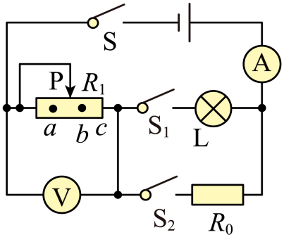

# Physics - 题目 1544

**ID**: 45bb763c9d89499399c82815d2c6442c
**年级**: Grade 9
**难度**: Hard
**题型**: Multiple-choice

## 题目
如图所示的电路，电源电压12V不变，定值电阻 $R{{}_{0}}=10Ω$ ，灯泡L上标有“6V  0.6A”字样（灯泡电阻不随温度变化），电流表量程为“0~0.6A”或“0~3A”，电压表量程为“0~3V”或“0~15V”。​​​​​​​‌已知滑动变阻器 $R{{}_{1}}$ 上标有“？Ω  1A”字样，a与b分别是 $R{{}_{1}}$ 上某两点，c是 $R{{}_{1}}$ 的右端点，且ac间电阻为R_{1}总电阻的 $\frac {2}{3}$ 。当只闭合开关S和 ${\rm{S}}{{}_{1}}$ ， $R{{}_{1}}$ 的滑片P在b点时，灯泡L恰好正常发光；当只闭合开关S和 ${\rm{S}}{{}_{2}}$ ，滑片P分别在a点和b点时，电压表的示数之比 $U{{}_{ac}}∶U{{}_{bc}}=4∶3$ ，则下列说法中（      ）① $R{{}_{1}}$ 的ac间电阻为20Ω；② $R{{}_{1}}$ 的最大阻值与bc间电阻的比值为3∶2；③电压表选大量程，电流表选小量程，闭合S和 ${\rm{S}}{{}_{2}}$ ，在电路安全的前提下，R_{1}的最大电阻与最小电阻的和为40Ω；④将L更换为 ${\rm{L}}^{′}$ “12V  0.4A”后，不计温度对 ${\rm{L}}^{′}$ 电阻的影响，断开或闭合任意开关，电流表、电压表任意选择量程，保证电路安全时，电路消耗的最大功率和最小功率的比值为8∶1。

## 解答

1. ①②③已知灯泡的额定电压U_{L}=6V，额定电流为0.6A，由欧姆定律可知，灯丝阻值 $R{{}_{{\rm{L}}}}=\frac {U{{}_{{\rm{L}}}}}{I{{}_{{\rm{L}}}}}=\frac {6{\rm{V}}}{0.6{\rm{A}}}=10{\rm{Ω}}$ ，当只闭合开关S和S_{1}，滑动变阻器与灯泡串联，电压表测量变阻器两端电压，电流表测量电路中电流，滑动变阻器滑片P在b点时，灯泡L恰好正常发光，电路中的电流等于灯泡的额定电流，由欧姆定律可知，此时电路的总电阻 $R{{}_{总}}=\frac {U}{I{{}_{{\rm{L}}}}}=\frac {12{\rm{V}}}{0.6{\rm{A}}}=20{\rm{Ω}}$ ，则滑动变阻器接入电路的阻值R_{bc}=R_{总}-R_{L}=20Ω-10Ω=10Ω，当只闭合开关S和S_{2}，滑片P在b点时，滑动变阻器R_{bc}与R_{0}串联，定值电阻R_{0}=10Ω，则U_{bc}= $U{{}_{bc}}=\frac {U}{R{{}_{bc}}+R{{}_{0}}}\times R{{}_{bc}}=\frac {12{\rm{V}}}{10{\rm{Ω}}+10{\rm{Ω}}}\times 10{\rm{Ω}}=6{\rm{V}}$ ，滑片P分别在a点和b点时，电压表的示数之比U_{ac}∶U_{bc}=4∶3，则U_{ac}=8V，则滑片P在a点时，通过R_{0}的电流 $I{{}_{0}}=\frac {U{{}_{0}}}{R{{}_{0}}}=\frac {U-U{{}_{ac}}}{R{{}_{0}}}=\frac {12{\rm{V}}-8{\rm{V}}}{10{\rm{Ω}}}=0.4{\rm{A}}$ ，滑动变阻器R_{ac}的阻值 $R{{}_{ac}}=\frac {U{{}_{ac}}}{I{{}_{0}}}=\frac {8{\rm{V}}}{0.4{\rm{A}}}=20{\rm{Ω}}$ ，由于ac间电阻为R_{1}总电阻的 $\frac {2}{3}$ ，则R_{1}的总电阻R_{1}=30Ω，则R_{1}的最大阻值与bc间电阻的比值
2. $\frac {30{\rm{Ω}}}{10{\rm{Ω}}}=\frac {3}{1}$ 电流表选0~0.6A量程，在电路安全的前提下，电路中电流不能大于0.6A，则R_{1}的电阻为10Ω；电压表选0~15V量程，由于电源电压为12V，所以R_{1}的电阻可以达到最大30Ω，所以在电路安全的前提下，R_{1}的最大电阻与最小电阻的和为40Ω，故①③正确，②错误；
3. ④将L更换为L′“12V 0.4A”后，不计温度对L′电阻的影响，断开或闭合任意开关，电流表、电压表任意选择量程，保证电路安全时，由 $P=\frac {U{^{2}}}{R}$ 可知，电路中最小电阻为灯L与R_{0}并联后与R_{1}串联，灯泡正常发光时，电路消耗的功率最大，灯泡的电流为0.4A，通过R_{0}的电流也为1.2A，则电路消耗的最大功率
4. $P{{}_{大}}=UI{{}_{大}}=12{\rm{V}}\times \left ({0.4{\rm{A}}+1.2{\rm{A}}}\right )=19.2{\rm{W}}$
5. 当滑动变阻器最大值与L'串联时，电路总功率最小
6. $P{{}_{小}}=\frac {U{^{2}}}{R{{}_{大}}}=\frac {{\left({12{\rm{V}}}\right)^{2}}}{\left ({30{\rm{Ω}}+30{\rm{Ω}}}\right )}=2.4{\rm{W}}$ 所以电路消耗的最大功率和最小功率的比值为8∶1，故④正确；
7. 综上所述，正确的有①③④，故A符合题意，BCD不符合题意。

## 知识点

**中文**:
  - 与欧姆定律有关的动态电路计算
  - 电功率的计算及应用

**English**:
  - Calculations in Dynamic Circuits using Ohm's Law
  - Calculation and Application of Electric Power

---
