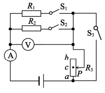

# Physics - 题目 2113

**ID**: 4f8585e5641741e6b3a1de4e3df0b4b8
**年级**: Grade 9
**难度**: Hard
**题型**: Multiple-choice

## 题目
如图所示电路中，电源电压保持不变。​​​​​​​‌只闭合开关 ${\rm{S}}{{}_{1}}$ ，移动滑动变阻器的滑片，使电路中电流达到最小值，此时电流表示数为 ${\rm{0}}{\rm{.}}{\rm{1}}{\rm{5}}{\rm{A}}$ ，电压表的示数为 ${\rm{3}}{\rm{V}}$ ；只闭合开关 ${\rm{S}}{{}_{2}}$ ，移动滑片至滑动变阻器的中点 $c$ 处时，电压表的示数为 ${\rm{5}}{\rm{V}}$ ，此时电阻 $R{{}_{2}}$ 的电功率为 ${\rm{0}}{\rm{.}}{\rm{5}}{\rm{W}}$ 。下列说法中（      ）①电阻 $R{{}_{1}}$ 的阻值是 $20Ω$②电源电压是 ${\rm{9}}{\rm{V}}$③滑动变阻器 $R{{}_{3}}$ 的最大阻值是 $10Ω$④当开关 ${\rm{S}}{{}_{1}}$ 、 ${\rm{S}}{{}_{2}}$ 、 ${\rm{S}}{{}_{3}}$ 都闭合时，电路消耗的总功率是 ${\rm{2}}{\rm{.}}{\rm{5}}{\rm{2}}{\rm{W}}$

## 解答

1. 只闭合开关S_{1}，滑动变阻器与R_{1}串联，电压表测量R_{1}两端的电压，当滑片在b点时，接入电路的电阻最大，使电路中电流达到最小值，由欧姆定律最大此时的电流
2. $I{{}_{1}}=\frac {U{{}_{1}}}{R{{}_{1}}}=0.15{\rm{A}}$ ①
3. 由于只闭合开关S_{2}时，滑动变阻器与R_{2}串联，电压表测量R_{2}两端的电压，且移动滑片至滑动变阻器的中点c处时，接入电路的电阻是 $\frac {1}{2}R{{}_{3}}$  ，电压表的示数为 ${\rm{5}}{\rm{V}}$ ，由于此时电阻 $R{{}_{2}}$ 的电功率为 ${\rm{0}}{\rm{.}}{\rm{5}}{\rm{W}}$ ，由 $P=\frac {U{^{2}}}{R}$ 知道，R_{2}的阻值
4. $R{{}_{2}}=\frac {U{{}_{2}}{^{2}}}{P}{\rm{=}}\frac {{\left({{\rm{5}}{\rm{V}}}\right)^{2}}}{{\rm{0}}{\rm{.}}{\rm{5}}{\rm{W}}}=50{\rm{Ω}}$
5. 由欧姆定律知道，此时电路的电流
6. $I{{}_{2}}=\frac {U{{}_{2}}}{R{{}_{2}}}=\frac {{\rm{5}}{\rm{V}}}{{\rm{5}}{\rm{0}}{\rm{Ω}}}=0.1{\rm{A}}$ ②
7. 电源电压
8. $U=I{{}_{1}}R{{}_{3}}+{\rm{3}}{\rm{V}}=\frac {1}{2}I{{}_{2}}R{{}_{3}}+5{\rm{V}}$  ③
9. 由①②③解得
10. $U={\rm{6}}{\rm{V}}$ ， $R{{}_{1}}=20{\rm{Ω}}$  ， $R{{}_{3}}=20{\rm{Ω}}$
11. 当开关S_{1}、S_{2}、S_{3}都闭合时，滑动变阻器短路，R_{1}与R_{1}并联，由 $\frac {1}{R{{}_{并}}}{\rm{=}}\frac {1}{R}+\frac {1}{R^{′}}$ 知道，电路的总电阻
12. $R{{}_{总}}=\frac {R{{}_{1}}R{{}_{2}}}{R{{}_{1}}+R{{}_{2}}}=\frac {20{\rm{Ω}}\times {\rm{5}}{\rm{0}}{\rm{Ω}}}{2{\rm{0}}{\rm{Ω}}{\rm{+}}{\rm{5}}{\rm{0}}{\rm{Ω}}}{\rm{=}}\frac {100}{7}{\rm{Ω}}$
13. 由 $P=\frac {U{^{2}}}{R}$ 知道，电路消耗的总功率是
14. $P{{}_{总}}=\frac {U{^{2}}}{R{{}_{总}}}{\rm{=}}\frac {{\left({{\rm{6}}{\rm{V}}}\right)^{2}}}{\frac {100}{7}{\rm{Ω}}}{\rm{=}}2.52{\rm{W}}$
15. 综上所述只有①④正确。
16. 故选D。

## 知识点

**中文**:
  - 与欧姆定律有关的动态电路计算
  - 电功率的计算及应用

**English**:
  - Calculations in Dynamic Circuits using Ohm's Law
  - Calculation and Application of Electric Power

---
