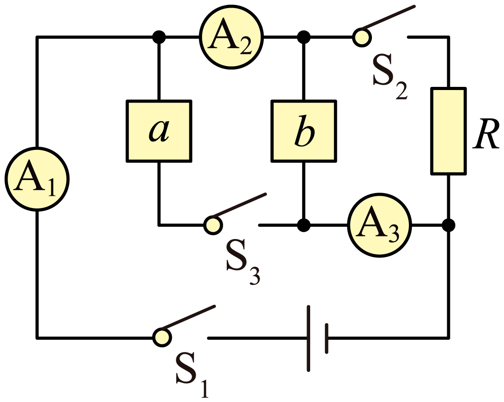

# Physics - 题目 397

**ID**: 7678f0a3d75447a99d8600e942679ed8
**年级**: Grade 9
**难度**: Hard
**题型**: Multiple-choice

## 题目
如图所示电路，电源电压不变，a、b为电压表或定值电阻，若为定值电阻，其阻值与R相同均为R_{0}。​​​​​​​‌当S_{1}和S_{2}闭合、S_{3}断开时，电流表A_{1}的示数为I_{0}；再闭合S_{3}，电流表A_{1}的示数为2I_{0}。下列说法正确的是（      ）

## 解答

1. A．当S_{1}和S_{2}闭合、S_{3}断开时，R与b并联，电流表A_{1}测干路的电流，其示数为I_{0}；再闭合S_{3}，a、b、R并联，电流表A_{1}测干路电流，其示数为2I_{0}，若a为电压表，由电压表相当于开路可知，电流表A_{1}的示数应为I_{0}不变，不可能为2I_{0}，因此a应为定值电阻，由并联电路的电流特点可知，通过a的电流和通过R的电流相等，则b应为电压表，故A错误；
2. B．当S_{1}和S_{2}闭合、S_{3}断开时，电路为R的简单电路，电流表A_{1}测电路中的电流，如下图所示：
3. 
4. 由 $I=\frac {U}{R}$ 可得，电源的电压U＝I_{0}R_{0}，故B错误；
5. C．开关均闭合后，R_{a}与R并联，电流表A_{2}测R支路的电流，如下图所示：
6. 
7. 由题意可知，通过R的电流为I_{0}，即电流表A_{2}的示数为I_{0}，a、b互换后，R_{a}与R并联，如下图所示
8. 
9. 此时电流表A_{2}测干路电流，其示数为2I_{0}，所以，a、b互换前后A_{2}的示数之比为
10. I_{0}：2I_{0}＝1：2
11. 故C正确；
12. D．将最大阻值为R_{0}的滑动变阻器与R串联，只闭合S_{1}、S_{2}时，R_{滑}与R串联，等效电路图如下图所示
13. 
14. 因为串联电路中总电阻等于各分电阻之和，所以，P从中点移到阻值最大端，电流的变化量
15. ${\rm{Δ}}I=I{{}_{中}}﹣I{{}_{小}}=\frac {U}{R{{}_{0}}+\frac {R{{}_{0}}}{2}}-\frac {U}{R{{}_{0}}+R{{}_{0}}}=\frac {U}{6R{{}_{0}}}=\frac {1}{6}I{{}_{0}}$
16. 故D错误。

## 知识点

**中文**:
  - 欧姆定律的应用
  - 电路的动态分析

**English**:
  - Applications of Ohm's Law
  - Dynamic Circuit Analysis

---
