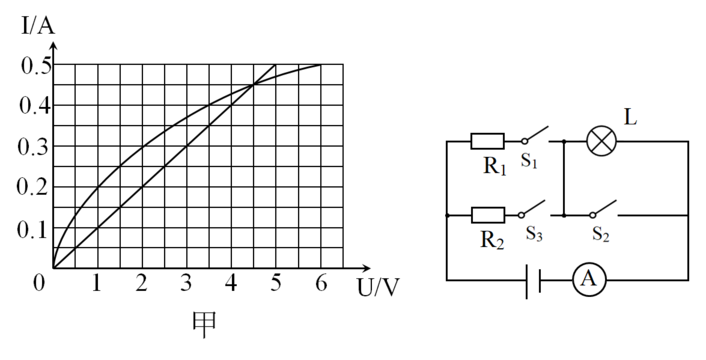

# Physics - 题目 140

**ID**: 8e9c65f52d6943b29c484e784f15e9b8
**年级**: Grade 9
**难度**: Hard
**题型**: Multiple-choice

## 题目
如图甲是小灯泡L和电阻R_{2}的I-U图像。​​​​​​​‌将小灯泡L、电阻R_{1}和电阻R_{2}接入图乙所示电路中，电源电压恒定不变。只闭合开关S_{1}时，小灯泡L的实际功率为0.2W；只闭合开关S_{3}时，电路的总功率为1W。下列说法正确的是（      ）

## 解答

1. AB．只闭合开关S_{3}时，小灯泡L和电阻R_{2}串联，电路的总功率为1W，由图像可知此时电路中的电流是0.25A，灯泡两端电压是1.5V，R_{2}两端电压为2.5V，R_{2}的电阻
2. $R{{}_{2}}=\frac {U{{}_{2}}}{I}=\frac {{\rm{2}}{\rm{.}}{\rm{5}}{\rm{V}}}{{\rm{0}}{\rm{.}}{\rm{2}}{\rm{5}}{\rm{A}}}{\rm{=}}{\rm{1}}{\rm{0}}{\rm{Ω}}$
3. 由串联分压可知电源电压为4V。只闭合开关S_{1}时，R_{1}和小灯泡串联，L的实际功率为0.2W，由图像可知此时电路中电流为0.2A，小灯泡两端电压为1V，由串联分压可知R_{1}两端电压为3V，R_{1}的电阻为
4. $R{{}_{1}}=\frac {U{{}_{1}}}{I^{′}}=\frac {{\rm{3}}{\rm{V}}}{{\rm{0}}{\rm{.}}{\rm{2}}{\rm{A}}}{\rm{=}}{\rm{1}}{\rm{5}}{\rm{Ω}}$
5. 故AB两项错误；
6. C．所有开关都闭合，电阻R_{1}和电阻R_{2}并联，此时的总电阻为
7. $R{{}_{总}}=\frac {R{{}_{1}}R{{}_{2}}}{R{{}_{1}}+R{{}_{2}}}=\frac {{\rm{1}}{\rm{5}}{\rm{Ω}}\times {\rm{1}}{\rm{0}}{\rm{Ω}}}{{\rm{1}}{\rm{5}}{\rm{Ω}}{\rm{+}}{\rm{1}}{\rm{0}}{\rm{Ω}}}{\rm{=}}{\rm{6}}{\rm{Ω}}$
8. 在15min内电路中产生的总热量为
9. $Q=\frac {U{^{2}}}{R{{}_{总}}}t=\frac {\left ({{\rm{4}}{\rm{V}}}\right ){^{{\rm{2}}}}}{{\rm{6}}{\rm{Ω}}}\times {\rm{1}}{\rm{5}}\times {\rm{6}}{\rm{0}}{\rm{s}}{\rm{=}}{\rm{2}}{\rm{4}}{\rm{0}}{\rm{0}}{\rm{J}}$
10. 故C项正确；
11. D．若将L和R_{1}并联在4.5V的电源两端，由图像可知L的电流为0.45A，R_{1}的电流为
12. $I{{}_{1}}=\frac {U^{′}}{R{{}_{1}}}=\frac {{\rm{4}}{\rm{.}}{\rm{5}}{\rm{V}}}{{\rm{1}}{\rm{5}}{\rm{Ω}}}{\rm{=}}{\rm{0}}{\rm{.}}{\rm{3}}{\rm{A}}$
13. 此时的功率之比
14. $\frac {P{{}_{L}}}{P{{}_{1}}}=\frac {U^{′}I{{}_{L}}}{U^{′}I{{}_{1}}}=\frac {I{{}_{L}}}{I{{}_{1}}}=\frac {0.45A}{0.3A}=\frac {3}{2}$
15. 故D项错误。
16. 故选C。

## 知识点

**中文**:
  - 欧姆定律的变形公式
  - 欧姆定律的应用
  - 电阻的伏安特性曲线
  - 电功率的计算及应用
  - 焦耳定律的计算公式及其应用

**English**:
  - Transformed Formulas of Ohm's Law
  - Applications of Ohm's Law
  - I-V Characteristic Curve of Resistance
  - Calculation and Application of Electric Power
  - Formula and Application of Joule's Law

---
