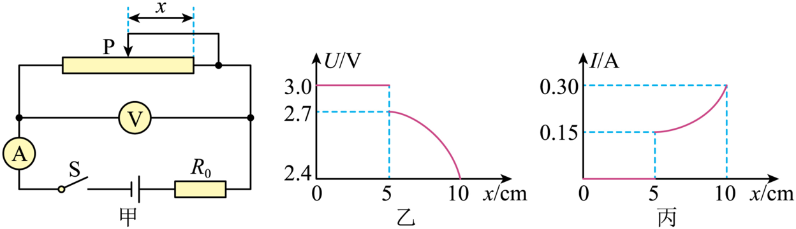

# Physics - 题目 1778

**ID**: 90c6d9bd540247dc8c866783b1d6433e
**年级**: Grade 9
**难度**: Hard
**题型**: Multiple-choice

## 题目
物理兴趣小组的同学，为了探究滑动变阻器的电流、电压关系，按照如图甲的电路进行实验。​​​​​​​‌闭合开关S，让滑片P从最右端开始向左滑动，测量滑片到最右端的距离x，同时观察电压表、电流表的示数，记录数据并绘制电压表读数U与x的关系图象如图乙所示，电流表读数I与x的关系图象如图丙所示。根据题目信息，下列说法中正确的是（      ）①由图乙可知，电源电压3.0V，滑动变阻器出现了断路故障，且断点位置x=5cm②滑动变阻器滑片P每滑动1cm的阻值变化2Ω③滑动变阻器电阻丝没有断路时的总电阻值是20Ω④若电流表的量程为 $0\sim 3{\rm A}$ ，则此电路的最大功率可达4.5W

## 解答

1. ①由图甲可知：滑动变阻器与R_{0}串联，电压表测量滑动变阻器两端的电压，电流表测量电路中电流；当滑动变阻器的电阻丝有断点时，电压表测量电源电压，由图乙可知，当   $x<5{\rm cm}$  时，电压表示数保持3.0V不变，则电源电压为3.0V；断点处离变阻器最右端5cm，故①正确；
2. ②由 $I=\frac {U}{R}$ 可得，当 $x=5{\rm cm}$ 时，电压表示数U_{1}=2.7V，电流表示数I_{1=}0.15A，滑动变阻器接入电路中的电阻
3. $R{{}_{1}}=\frac {U{{}_{1}}}{I{{}_{1}}}=\frac {2.7{\rm V}}{0.15{\rm A}}=18\Omega $
4. 当x=10cm时，电压表示数U_{2}=2.4V，电流表示数I_{2}=0.3A，则滑动变阻器接入电路中的电阻
5. $R{{}_{2}}=\frac {U{{}_{2}}}{I{{}_{2}}}=\frac {2.4{\rm V}}{0.3{\rm A}}=8\Omega $
6. 故滑动变阻器滑动5cm电阻的改变量是
7. $\Delta R=R{{}_{1}}-R{{}_{2}}=18Ω-8Ω=10Ω$
8. 所以从断点处滑片P向左滑动的过程中，该滑动变阻器滑片P每滑动1cm的阻值变化是2Ω，故②正确；
9. ③该滑动变阻器没有断路时的总电阻值
10. $R=R{{}_{1}}+5{\rm cm}\times 2Ω/{\rm cm}=18Ω+10Ω=28\Omega $
11. 故③错误；
12. ④当x=5cm时，由乙、丙图可知，电压表示数U_{1}=2.7V，电流表示数1_{1}=015A，因串联电路中总电压等于各分电压之和，所以，R_{0}两端的电压
13. $U{{}_{0}}=U-U{{}_{1}}=3.0{\rm V}-2.7{\rm V}=0.3{\rm V}$
14. 电阻R_{0}的阻值
15. $R{{}_{0}}=\frac {U{{}_{0}}}{I{{}_{1}}}=\frac {0.3{\rm V}}{0.15{\rm A}}=2\Omega $
16. 当滑动变阻器滑片P在最左端，接入电路的电阻为零，电路中只有R_{0}连入电路，此时电路中的电流最大，功率最大，电路中的最大电流
17. $I{{}_{最大}}=\frac {U}{R{{}_{0}}}{\rm{=}}\frac {3{\rm{V}}}{2{\rm{Ω}}}=1.5{\rm{A}}<3{\rm{A}}$
18. 没有超过电流表的量程；则此电路的最大功率
19. $P{{}_{最大}}=UI{{}_{最大}}=3{\rm V}\times 1.5{\rm A}=4.5{\rm W}$
20. 故④正确。
21. 由以上分析可知，①②④正确，故D正确，ABC错误。
22. 故选D。

## 知识点

**中文**:
  - 与欧姆定律有关的动态电路计算
  - 应用欧姆定律进行电路故障分析
  - 电功率的计算及应用

**English**:
  - Calculations in Dynamic Circuits using Ohm's Law
  - Circuit Fault Analysis using Ohm's Law
  - Calculation and Application of Electric Power

---
