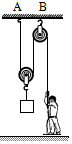

# Physics - 题目 2874

**ID**: a23ef0dd7afd4f53bab3757ced1138c6
**年级**: Grade 9
**难度**: Hard
**题型**: Multiple-choice

## 题目
体重为700N的工人用图所示的滑轮组将建材运送到高处。​​​​​​​‌在某次运送中，工人在20s内将质量为40kg的建材竖直向上匀速提升了5m，滑轮组的机械效率为80%。若两个滑轮的质量相等，不计绳重及摩擦，g取10N/kg。下列说法中正确的是（      ）

## 解答

1. B．建材受到的重力
2. $G=mg={{4}}{{0}}{\rm{k}}{\rm{g}}\times {{1}}{{0}}{\rm{N}}{\rm{/}}{\rm{k}}{\rm{g}}{\rm{=}}{{4}}{{0}}{{0}}{\rm{N}}$
3. 工作对建材做的有用功
4. $W{{}_{有用}}=Gh={{4}}{{0}}{{0}}{\rm{N}}\times {{5}}{\rm{m}}{\rm{=}}{{2}}{{0}}{{0}}{{0}}{\rm{J}}$
5. 工作做的总功
6. $W{{}_{总}}=\frac {W{{}_{有用}}}{η}=\frac {{{2}}{{0}}{{0}}{{0}}{\rm{J}}}{{{8}}{{0}}{\rm{\%}}}{\rm{=}}{{2}}{{5}}{{0}}{{0}}{\rm{J}}$
7. 拉力做功的功率
8. $P=\frac {W{{}_{总}}}{t}=\frac {{{2}}{{5}}{{0}}{{0}}{\rm{J}}}{{{2}}{{0}}{\rm{s}}}{\rm{=}}{{1}}{{2}}{{5}}{\rm{W}}$
9. 故B错误；
10. A．工人做的额外功
11. $W{{}_{额外}}=W{{}_{总}}-W{{}_{有用}}={{2}}{{5}}{{0}}{{0}}{\rm{J}}{{-}}{{2}}{{0}}{{0}}{{0}}{\rm{J}}{\rm{=}}{{5}}{{0}}{{0}}{\rm{J}}$
12. 动滑轮重
13. $G{{}_{动}}=\frac {W{{}_{额外}}}{h}=\frac {{{5}}{{0}}{{0}}{\rm{J}}}{{{5}}{\rm{m}}}{\rm{=}}{{1}}{{0}}{{0}}{\rm{N}}$
14. 故A错误；
15. C．定滑轮重
16. $G{{}_{定}}=G{{}_{动}}={{1}}{{0}}{{0}}{\rm{N}}$
17. 绳子自由端拉力
18. $F=\frac {G{{+}}G{{}_{动}}}{n}=\frac {{{4}}{{0}}{{0}}{\rm{N}}{{+}}{{1}}{{0}}{{0}}{\rm{N}}}{{{2}}}{\rm{=}}{{2}}{{5}}{{0}}{\rm{N}}$
19. 此过程中B处挂钩受到天花板的拉力
20. $F{{}_{B}}=2F{{+}}G{{}_{定}}={{2}}{\rm{×}}{{2}}{{5}}{{0}}{\rm{N}}{{+}}{{1}}{{0}}{{0}}{\rm{N}}{\rm{=}}{{6}}{{0}}{{0}}{\rm{N}}$
21. 故C正确；
22. D．此过程中地面对该工人的支持力的大小
23. $F{{}_{支}}=G{{}_{人}}-F={{7}}{{0}}{{0}}{\rm{N}}{{-}}{{2}}{{5}}{{0}}{\rm{N}}{\rm{=}}{{4}}{{5}}{{0}}{\rm{N}}$
24. 此过程中，该工人对地面的压力和地面对该工人的支持力是一对相互作用力，故压力的大小
25. $F{{}_{压}}=F{{}_{支}}=450{\rm{N}}$
26. 故D错误。

## 知识点

**中文**:
  - 二力平衡的条件及其应用
  - 功、功率、机械效率的综合计算

**English**:
  - Conditions and Applications of Two-Force Equilibrium
  - Comprehensive Calculation of Work, Power, and Efficiency

---
