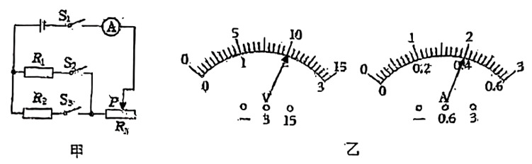

# Physics - 题目 1911

**ID**: b2098eabc83f43019fe9e8e9891975dd
**年级**: Grade 9
**难度**: Hard
**题型**: Multiple-choice

## 题目
如图甲所示的电路中，电源电压保持不变，R_{1}的阻值不变，R_{2}的阻值可能为10Ω、15Ω或20Ω，滑动变阻器R_{3}上标有“10Ω  1A”字样。​​​​​​​‌只闭合开关S_{1}、S_{2}，移动滑动变阻器的滑片，电流表示数的变化范围为0.5A~1A； 当只闭合开关S_{1}、S_{3}，将一电压表并联在电路中，两电表选择合适的量程，移动变阻器滑片P 到某位置，电路正常工作，电压表、电流表示数如图乙所示。下列说法正确的是（      ）

## 解答

1. AC．只闭合开关S_{1}、S_{2}，定值电阻R_{1}、变阻器R_{3}串联，移动滑动变阻器的滑片，电流表示数的变化范围为0.5~1A，当变阻器接入电路中电阻为0时，电路电流最大为1A，由欧姆定律得，电源电压为 $U=I{{}_{大}}R{{}_{1}}=1{\rm{A}}\times R{{}_{1}}\ldots \ldots ①$ ，当变阻器R_{3}接入电路中电阻最大为10Ω时，电路电流最小为0.5A，由欧姆定律与串联电路特点得，电源电压为 $U=I{{}_{小}}\left ({R{{}_{1}}+R{{}_{3大}}}\right )=0.5{\rm{A}}\times \left ({R{{}_{1}}+10{\rm{Ω}}}\right )\ldots \ldots ②$ ，解①②得 $U=10{\rm{V}}$ ， $R{{}_{1}}=10{\rm{Ω}}$ ，故AC错误；
2. BD．当只闭合开关S_{1}、S_{3}，R_{2}与变阻器R_{3}串联，电流表测量电路电流，由图乙得，电流表的量程选用0~3A时，分度值为0.1A，示数为2A，由欧姆定律得，电路中电阻为 $R=\frac {U}{I}=\frac {10{\rm{V}}}{2{\rm{A}}}=5{\rm{Ω}}$ ，而当变阻器接入电路中电阻为0时，电路中电阻最小为10Ω，故电流表的量程应选用0~0.6A，分度值为0.02A，示数为0.4A，由欧姆定律得，此时电路中电阻为 $R^{′}=\frac {U}{I^{′}}=\frac {10{\rm{V}}}{0.4{\rm{A}}}=25{\rm{Ω}}$ ，当变阻器接入电路中电阻最大为10Ω时，R_{2}接入电路中电阻最小为 $R{{}_{2小}}=R^{′}-R{{}_{3}}=25{\rm{Ω}}-10{\rm{Ω}}=15{\rm{Ω}}$ ，则R_{2}的阻值可能为15Ω或20Ω。电压表的量程为0~15V时，分度值为0.5V，示数为10V，则电压表可能测量电源电压；电压表的量程应选用0~3V时，分度值为0.1V，示数为2V，若此时电压表测量R_{2}电压，则电压表示数可能为 $U{{}_{2}}=I^{′}R{{}_{2大}}=0.4{\rm{A}}\times 20{\rm{Ω}}=8{\rm{V}}>2{\rm{V}}$ ，或 $U{{}_{2}}=I^{′}R{{}_{2小}}=0.4{\rm{A}}\times 15{\rm{Ω}}=6{\rm{V}}>2{\rm{V}}$ ，故电压表不可能测量R_{2 }两端电压，故B错误，D正确。

## 知识点

**中文**:
  - 与欧姆定律有关的动态电路计算

**English**:
  - Calculations in Dynamic Circuits using Ohm's Law

---
