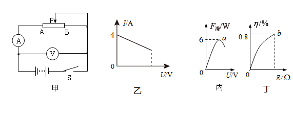

# Physics - 题目 371

**ID**: b5dee59856f648dbad7e7def6c19bcba
**年级**: Grade 9
**难度**: Hard
**题型**: Multiple-choice

## 题目
在实际生活中电池本身是有电阻的，因此，实际的电池可以等效为一个没有电阻的理想电池和一个阻值一定的电阻串联而成。​​​​​​​‌在如图甲所示电路中，电源由几个相同的铅蓄电池组成（每节电压为2V）。合上开关S，变阻器的滑片从A端滑到B端的过程中，电路中的一些物理量的变化，如图乙、丙、丁所示，图乙表示电压表示数与电流表示数的关系；图丙表示滑动变阻器的功率跟电压表示数的关系；图丁表示铅蓄电池输出电能的效率η与变阻器接入电路电阻大小的关系，b点时η最大。不计电表、导线对电路的影响，则下列结论错误的是（      ）

## 解答

1. A．由图知道，当滑动变阻器接入电路中的电阻为0时，电路中的电流最大，由图乙知道，电路中的最大电流为I_{大}=4A；由图丙知道，变阻器消耗的最大电功率P_{滑大}=6W，故A正确，不符合题意；
2. B．当滑动变阻器接入电路中的电阻为0时，由 $I=\frac {U}{R}$ 知道，电源的电压
3. U=I_{大}r_{总}=4A×r_{总}①
4. 由于串联电路中总电阻等于各分电阻之和，所以，电路中的电流
5. $I=\frac {U}{R+r{{}_{总}}}$
6. 滑动变阻器消耗的电功率
7. $P=I{^{2}}R={\left({\frac {U}{R+r{{}_{总}}}}\right)^{2}}R=\frac {U{^{2}}}{\frac {{\left({R+r{{}_{总}}}\right)^{2}}}{R}}=\frac {U{^{2}}}{\frac {R{^{2}}+r{{}_{总}}{^{2}}+2Rr{{}_{总}}}{R}}=\frac {U{^{2}}}{\frac {{\left({R-r{{}_{总}}}\right)^{2}}}{R}+4Rr{{}_{总}}}$
8. 当R=r_{总}时，变阻器消耗的电功率最大，即
9. $P{{}_{滑大}}=\frac {U{^{2}}}{4r{{}_{总}}}{\rm{=}}6{\rm{W}}$  ②
10. 由①②两式解得，U=6V，r_{总}=1.5Ω，由于每节蓄电池的电压为2V，所以，电池的节数
11. $n=\frac {U}{2{\rm{V}}}=\frac {{\rm{6}}{\rm{V}}}{{\rm{2}}{\rm{V}}}=3节$
12. 每节铅蓄电池的阻值
13. $r=\frac {r{{}_{总}}}{n}{\rm{=}}\frac {{\rm{1}}{\rm{.}}{\rm{5}}{\rm{Ω}}}{{\rm{3}}}{\rm{=}}{\rm{0}}{\rm{.}}{\rm{5}}{\rm{Ω}}$
14. 故B正确，不符合题意；
15. C．由图丁知道，铅蓄电池输出电能的最大效率为80%，则
16. $η=\frac {W{{}_{输出}}}{W{{}_{总}}}{\rm{=}}\frac {P{{}_{输出}}}{P{{}_{总}}}=\frac {I{^{2}}R}{I{^{2}}\left ({R+r{{}_{总}}}\right )}{\rm{=}}\frac {R}{R+r{{}_{总}}}\times 100\%=80\%$
17. 解得，滑动变阻器的最大阻值
18. R=4r_{总}=4×1.5Ω=6Ω
19. 故C错误，符合题意；
20. D．当R=r_{总}时，变阻器消耗的电功率最大是6W，由 $P=\frac {U{^{2}}}{R}$ 知道， $P{{}_{最大}}=\frac {U^{′}{{^{2}}}}{r{{}_{总}}}$ 此时变阻器两端的电压
21. $U^{′}=3{\rm{V}}$
22. 即图丙中a点对应的横坐标为3V，故D正确，不符合题意。
23. 故选C。

## 知识点

**中文**:
  - 欧姆定律的应用
  - 电功率的计算及应用

**English**:
  - Applications of Ohm's Law
  - Calculation and Application of Electric Power

---
