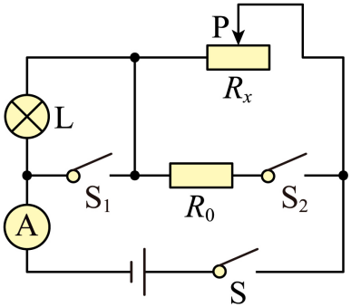

# Physics - 题目 1167

**ID**: bcc6a725acb741f38a0a6cc7d693c655
**年级**: Grade 9
**难度**: Hard
**题型**: Multiple-choice

## 题目
如图所示，电源电压U恒定， $R{{}_{0}}=30Ω$ ，滑动变阻器 $R{{}_{x}}$ 的规格为“18Ω，1A”，电流表的量程为“0~0.6A”，小灯泡上标有“3V，1.5W”字样（灯丝电阻不变）。​​​​​​​‌当S闭合， ${\rm{S}}{{}_{{\rm{1}}}}$ 、 ${\rm{S}}{{}_{{\rm{2}}}}$ 都断开，滑片滑至中点时，电流表的示数为0.4A，在不损坏电路元件的前提下，若移动滑动变阻器至某一阻值时，此时电路消耗的最大功率为 $P{{}_{1}}$ ；当S、 ${\rm{S}}{{}_{1}}$ 、 ${\rm{S}}{{}_{{\rm{2}}}}$ 都闭合时，为保证电路元件安全，滑动变阻器接入电路的最小阻值为 $R{{}_{2}}$ ，此时接着移动滑片，使电路消耗总功率最小为 $P{{}_{2}}$ 。则下列说法中正确的是（      ）① $U=6{\rm{V}}$   ② $P{{}_{1}}=3.6{\rm{W}}$   ③ $R{{}_{2}}=15Ω$   ④ $P{{}_{2}}=3.2{\rm{W}}$

## 解答

1. ①当S闭合， ${\rm{S}}{{}_{{\rm{1}}}}$ 、 ${\rm{S}}{{}_{{\rm{2}}}}$ 都断开，滑动变阻器与灯泡串联工作，滑片滑至中点时，滑动变阻器的阻值为 $R{{}_{x}}^{′}=\frac {1}{2}\times 18{\rm{Ω}}=9{\rm{Ω}}$ ，灯泡的电阻为 $R{{}_{{\rm{L}}}}=\frac {U{{}_{额}}{^{2}}}{P{{}_{额}}}=\frac {{\left({3{\rm{V}}}\right)^{2}}}{1.5{\rm{W}}}=6{\rm{Ω}}$ ，根据串联电路电流处处相等的特点，结合欧姆定律 $R=\frac {U}{I}$ 可知 $U=IR=I\left ({R{{}_{x}}^{′}+R{{}_{{\rm{L}}}}}\right )=0.4{\rm{A}}\times \left ({9{\rm{Ω}}+6{\rm{Ω}}}\right )=6{\rm{V}}$ ，故①正确；
2. ②在不损坏电路元件的前提下，若移动滑动变阻器至某一阻值时，不能使电流表的电流大于0.6A，滑动变阻器的电流大于1A，小灯泡的电流不大于额定电流 $I{{}_{{\rm{L}}额}}=\frac {P{{}_{额}}}{U{{}_{额}}}=\frac {1.5{\rm{W}}}{3{\rm{V}}}=0.5{\rm{A}}$ ，综上所述，电路中最大的电流为0.5A，此时电路消耗的最大功率为 $P{{}_{1}}=UI{{}_{{\rm{L}}额}}=6{\rm{V}}\times 0.5{\rm{A}}=3{\rm{W}}$ ，故②错误；
3. ③当S、 ${\rm{S}}{{}_{1}}$ 、 ${\rm{S}}{{}_{{\rm{2}}}}$ 都闭合时，灯泡被短路，此时滑动变阻器 $R{{}_{x}}$ 与电阻 $R{{}_{0}}$ 并联，此时通过 $R{{}_{0}}$ 的电流为 $I{{}_{0}}=\frac {U}{R{{}_{0}}}=\frac {6{\rm{V}}}{30Ω}=0.2{\rm{A}}$ ，根据并联电路干路电流等于各支路电流之和，以及并联电路各个用电器两端的电压都相等，电流表最大电流0.6A可知，滑动变阻器接入电路的最小阻值为 $R{{}_{2}}=\frac {U}{I^{′}}=\frac {U}{I-I{{}_{0}}}=\frac {{\rm{6}}{\rm{V}}}{{\rm{0}}{\rm{.}}{\rm{6}}{\rm{A}}{\rm{-}}{\rm{0}}{\rm{.}}{\rm{2}}{\rm{A}}}=15{\rm{Ω}}$ ，故③正确；
4. ④根据并联电路相互独立，互不影响的特点，当滑动变阻器的电功率最小时电路的电功率最小，根据 $P=\frac {U{^{2}}}{R}$ 可知，滑动变阻器阻值最大时电功率最小为 $P{{}_{滑}}=\frac {U{^{2}}}{R{{}_{滑最大}}}=\frac {{\left({6{\rm{V}}}\right)^{2}}}{18{\rm{Ω}}}=2{\rm{W}}$ ，电路消耗总功率最小为 $P{{}_{2}}=P{{}_{0}}+P{{}_{滑}}=UI{{}_{0}}+P{{}_{滑}}=6{\rm{V}}\times 0.2{\rm{A}}+2{\rm{W}}=3.2{\rm{W}}$ ，故④正确。
5. 综上所述，故ABC错误，D正确。

## 知识点

**中文**:
  - 与欧姆定律有关的动态电路计算
  - 电功率的计算及应用

**English**:
  - Calculations in Dynamic Circuits using Ohm's Law
  - Calculation and Application of Electric Power

---
