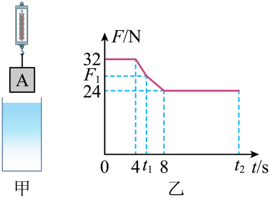

# Physics - 题目 659

**ID**: c5a5f14b63f942368f068cd73f57a1df
**年级**: Grade 9
**难度**: Hard
**题型**: Multiple-choice

## 题目
某同学将底面积为 $200{\rm cm}{^{2}}$ 、高 $30{\rm cm}$ 的柱形薄壁水桶放置在水平地面上，水桶中盛有 $28{\rm cm}$ 深的水，如图甲所示。​​​​​​​‌他将底面积为 $80{\rm cm}{^{2}}$ 的圆柱体A从离水面一定高度处缓慢浸入水中，直到A刚接触水桶底部为止，然后撤去绳子及弹簧测力计。整个过程中弹簧测力计的示数随时间变化的图象如图乙所示。不计绳重及绳子体积，下列说法正确的是（      ）

## 解答

1. A．由乙图知道，圆柱体A的重力为G=32N；圆柱体A全部浸入水中时，圆柱体A受到的浮力大小不再改变，弹簧测力计的示数也不再变化；当t_{2}=8s时，圆柱体A完全浸入水受到的弹簧测力计拉力为F=24N，所以圆柱体A受到的浮力大小为 $F{{}_{浮}}=G-F={{3}}{{2}}{\rm{N}}{{-}}{{2}}{{4}}{\rm{N}}{\rm{=}}{{8}}{\rm{N}}$ ，由此可得，圆柱体A的高度为 $h=\frac {V{{}_{排}}}{S{{}_{A}}}=\frac {F{{}_{浮}}}{ρgS{{}_{A}}}{\rm{=}}\frac {{{8}}{\rm{N}}}{1.0\times 10{^{3}}{\rm{k}}{\rm{g}}{\rm{/}}{\rm{m}}{^{3}}\times 10{\rm{N}}{\rm{/}}{\rm{k}}{\rm{g}}\times {{8}}{{0}}\times {{1}}{{0}}{^{-4}}{\rm{m}}{^{2}}}=0.1{\rm{m}}{\rm{=}}{{1}}{{0}}{\rm{c}}{\rm{m}}$ ，由乙图知道，t_{0}=4s，圆柱体A刚进入水中，t_{2}=8s时，圆柱体A刚好完全浸入水中；从开始进入水中至刚好完全浸入水里，由图知道，圆柱体A下降的距离为， $h{{}_{x}}=h-\left ({{{3}}{{0}}{\rm{c}}{\rm{m}}{{-}}{{2}}{{8}}{\rm{c}}{\rm{m}}}\right ){\rm{=}}{{1}}{{0}}{\rm{c}}{\rm{m}}{{-}}{{2}}{\rm{c}}{\rm{m}}{\rm{=}}{{8}}{\rm{c}}{\rm{m}}$ ，所以，物体A下降的速度为 $v=\frac {h{{}_{x}}}{t{{}_{2}}-t{{}_{0}}}=\frac {{{8}}{\rm{c}}{\rm{m}}}{{{8}}{\rm{s}}{{-}}{{4}}{\rm{s}}}{\rm{=}}{{2}}{\rm{m}}{\rm{/}}{\rm{s}}$ ，
2. 故A错误；
3. B．由于圆柱体A刚开始接触水面后的某段过程中，随着圆柱体A的匀速下降，水面也随之上升，当时间为t_{1}水面到达容器顶部时，水面不再上升，此后弹簧测力计减小的速度变慢；t_{1}时，圆柱体A浸入水中的体积为 ${\rm{Δ}}V=\left ({3{{0}}{\rm{c}}{\rm{m}}{{-}}{{2}}{{8}}{\rm{c}}{\rm{m}}}\right )\times {{2}}{{0}}{{0}}{\rm{c}}{\rm{m}}{^{{{2}}}}{\rm{=}}{{4}}{{0}}{{0}}{\rm{c}}{\rm{m}}{^{3}}$ ，此时圆柱体A距离液面的高度为 $h{{}_{1}}=\frac {ΔV}{S{{}_{A}}}=\frac {{{4}}{{0}}{{0}}{\rm{c}}{\rm{m}}{^{{{3}}}}}{{{8}}{{0}}{\rm{c}}{\rm{m}}{^{{{2}}}}}{\rm{=}}{{5}}{\rm{c}}{\rm{m}}$ ，从圆柱体A刚接触水面至时间为t_{1}时，圆柱体A下降的距离为 $h{{}_{y}}=h{{}_{1}}-\left ({{{3}}{{0}}{\rm{c}}{\rm{m}}{{-}}{{2}}{{8}}{\rm{c}}{\rm{m}}}\right ){\rm{=}}{{5}}{\rm{c}}{\rm{m}}{{-}}{{2}}{\rm{c}}{\rm{m}}{\rm{=}}{{3}}{\rm{c}}{\rm{m}}$ 则物体从t_{0}=4s至t_{1}用时为 $Δt=\frac {h{{}_{y}}}{v}=\frac {{{3}}{\rm{c}}{\rm{m}}}{{{2}}{\rm{c}}{\rm{m}}{\rm{/}}{\rm{s}}}{\rm{=}}{{1}}{{.}}{{5}}{\rm{s}}$ ，故可得 $t{{}_{1}}=Δt+t{{}_{0}}={{1}}{{.}}{{5}}{\rm{s}}{{+}}{{4}}{\rm{s}}{\rm{=}}{{5}}{{.}}{{5}}{\rm{s}}$ ，此时圆柱体A受到的浮力为
4. $F{{}_{浮}}\prime =ρΔVg=1\times 10{^{3}}{\rm{k}}{\rm{g}}{\rm{/}}{\rm{m}}{^{3}}\times 400\times 10{^{-6}}{\rm{m}}{^{3}}\times 10{\rm{N}}{\rm{/}}{\rm{k}}{\rm{g}}{\rm{=}}{{4}}{\rm{N}}$ ，因此，此时弹簧拉力示数为 $F{{}_{1}}=G-F{{}_{浮}}\prime ={{3}}{{2}}{\rm{N}}{{-}}{{4}}{\rm{N}}{\rm{=}}{{2}}{{8}}{\rm{N}}$ ，故B错误；
5. C．从A刚要进入水中至液面与容器顶部齐平过程中，水对容器底部压强逐渐增大，此后随着A的下降，水对容器底部压强不变，故C错误；
6. D．已求得当6s时，水已经到达容器顶部，故当t=15s时，与A浸入前相比，容器对桌面的压力增加量=浸没时的浮力-溢出水的重力；溢出水的体积等于容器中原来水的体积加上圆柱体的体积减去容器的容积，即 $V{{}_{溢}}=V{{}_{水}}+V{{}_{圆柱体}}-V{{}_{容器}}=200{\rm{c}}{\rm{m}}{^{2}}\times 28{\rm{c}}{\rm{m}}{{+}}{{8}}{{0}}{\rm{c}}{\rm{m}}{^{2}}\times 10{\rm{c}}{\rm{m}}{{-}}{{2}}{{0}}{{0}}{\rm{c}}{\rm{m}}{^{2}}\times 30{\rm{c}}{\rm{m}}{\rm{=}}{{4}}{{0}}{{0}}{\rm{c}}{\rm{m}}{^{3}}$ ，溢出水的重力为 $G{{}_{溢}}=m{{}_{溢}}g=ρV{{}_{溢}}g=1.0\times 10{^{3}}{\rm{k}}{\rm{g}}{\rm{/}}{\rm{m}}{^{3}}\times 400\times 10{^{-6}}{\rm{m}}{^{3}}\times 10{\rm{N}}{\rm{/}}{\rm{k}}{\rm{g}}{\rm{=}}{{4}}{\rm{N}}$ ，容器对桌面的压力增加量为 $ΔF=F{{}_{浮}}-G{{}_{溢}}={{8}}{\rm{N}}{{-}}{{4}}{\rm{N}}{\rm{=}}{{4}}{\rm{N}}$ ，容器对桌面的压力增加量为 $Δp=\frac {ΔF}{S}=\frac {4{\rm{N}}}{200\times 10{^{-4}}{\rm{m}}{^{2}}}=200{\rm{P}}{\rm{a}}$ ，故D正确。

## 知识点

**中文**:
  - 压强的计算
  - 速度公式及其应用
  - 液体压强计算公式的应用
  - 阿基米德原理的应用

**English**:
  - Calculation of Pressure
  - Velocity Formula and Applications
  - Application of Liquid Pressure Formula
  - Applications of Archimedes' Principle

---
