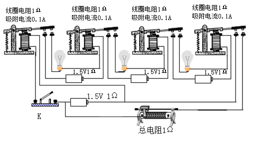

# Physics - 题目 514

**ID**: c8306d221ac4434a821e5c295a752350
**年级**: Grade 9
**难度**: Hard
**题型**: Multiple-choice

## 题目
在如图所示的电路中，有四个电磁继电器，相关参数标注在图上，其中电源电压1.​​​​​​​‌5V且和一个1Ω的电阻串在一起（图中把它们画在一起），灯泡电阻8Ω，刚闭合开关后，下列说法错误的是（      ）

## 解答

1. 如图，当开关K闭合时。
2. ①甲的控制电路电压是1.5V，电池电阻是1Ω，甲线圈的电阻是1Ω，所以总电阻为
3. $R{{}_{{\rm{甲}}}}=1{\rm{Ω}}+1{\rm{Ω}}=2{\rm{Ω}}$
4. 所以甲控制电路电流
5. $I{{}_{{\rm{甲}}}}=\frac {U{{}_{{\rm{甲}}}}}{R{{}_{{\rm{甲}}}}}=\frac {{\rm{1}}{\rm{.}}{\rm{5}}{\rm{V}}}{{\rm{1}}{\rm{Ω}}+{\rm{1}}{\rm{Ω}}}=0.75{\rm{A}}\mathrm{>}0.1{\rm{A}}$
6. 所以甲的工作电路即乙的控制电路接通，乙电路中有电流，左边第一个灯发光。
7. ②在乙控制电路中，乙控制电路电压是1.5V，电池电阻是1Ω，乙线圈的电阻是1Ω，左端第一个灯的电阻是8Ω，所以总电阻为
8. $R{{}_{{\rm{乙}}}}=1{\rm{Ω}}+1{\rm{Ω}}+8{\rm{Ω}}=10{\rm{Ω}}$
9. 所以乙控制电路电流
10. $I{{}_{{\rm{乙}}}}=\frac {U{{}_{{\rm{乙}}}}}{R{{}_{{\rm{乙}}}}}=\frac {{\rm{1}}{\rm{.}}{\rm{5}}{\rm{V}}}{{\rm{1}}{\rm{0}}{\rm{Ω}}}=0.{\rm{1}}5{\rm{A}}\mathrm{>}0.1{\rm{A}}$
11. 所以乙的工作电路即丙的控制电路接通，丙电路中有电流，中间灯发光。
12. ③在丙控制电路中，丙控制电路电压是1.5V，电池电阻是1Ω，丙线圈的电阻是1Ω，中间灯的电阻是8Ω，所以总电阻为
13. $R{{}_{{\rm{丙}}}}=1{\rm{Ω}}+1{\rm{Ω}}+8{\rm{Ω}}=10{\rm{Ω}}$
14. 所以丙控制电路电流
15. $I{{}_{{\rm{丙}}}}=\frac {U{{}_{{\rm{丙}}}}}{R{{}_{{\rm{丙}}}}}=\frac {{\rm{1}}{\rm{.}}{\rm{5}}{\rm{V}}}{{\rm{1}}{\rm{0}}{\rm{Ω}}}=0.{\rm{1}}5{\rm{A}}\mathrm{>}0.1{\rm{A}}$
16. 所以丙的工作电路即丁的控制电路接通，丁电路中有电流，最右边灯发光。
17. ④在丁控制电路中，丁控制电路电压是1.5V，电池电阻是1Ω，丁线圈的电阻是1Ω，最右面灯的电阻是8Ω，所以总电阻为
18. $R{{}_{{\rm{丁}}}}=1{\rm{Ω}}+1{\rm{Ω}}+8{\rm{Ω}}=10{\rm{Ω}}$
19. 所以丁控制电路电流
20. $I{{}_{{\rm{丁}}}}=\frac {U{{}_{{\rm{丁}}}}}{R{{}_{{\rm{丁}}}}}=\frac {{\rm{1}}{\rm{.}}{\rm{5}}{\rm{V}}}{{\rm{1}}{\rm{0}}{\rm{Ω}}}=0.{\rm{1}}5{\rm{A}}\mathrm{>}0.1{\rm{A}}$
21. 所以丁的工作电路即戊电路接通，戊电路中有电流，戊电路和甲电路是并联的，当滑动变阻器的滑片在最右端时，滑动变阻器的电阻是1Ω，戊电路和甲电路并联，此时整个电路三个灯都能工作。当滑动变阻器的滑片在最左端时，滑动变阻器的电阻是0Ω，戊电路和甲电路并联，此时把甲电路短路，甲电路中无电流，灯泡从左到右依次熄灭。
22. 综合分析后，当滑动变阻器无论滑片在什么位置，灯泡都是从左到右依次点亮的，但是当滑动变阻器在最左端时，当最后一个继电器闭合时，点亮的灯又从左到右依次熄灭，当滑动变阻器在最右端时，当最后一个继电器闭合时，所有的灯依然发光。故ABC正确，不符合题意，D错误，符合题意。
23. 
24. 故选D。

## 知识点

**中文**:
  - 欧姆定律的应用
  - 电磁继电器的常见应用

**English**:
  - Applications of Ohm's Law
  - Common Applications of Electromagnetic Relays

---
