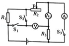

# Physics - 题目 1953

**ID**: d207b03802f14818a2367c37325d5143
**年级**: Grade 9
**难度**: Hard
**题型**: Multiple-choice

## 题目
如图所示，电路总电压不变．当只闭合开关S_{1}、S_{3}，滑动变阻器的滑片P滑至最左端时，电路消耗的总功率为10W，电流表A的示数为I_{1}，电压表的示数为U_{1}；​​​​​​​‌当只断开开关S_{1}，滑片P滑至最右端时，电流表A的示数为I_{2}，电压表的示数为U_{2}：当只闭合开关S_{1}，滑片P仍在最右端时，电流表A_{1}的示数为I_{3}，电压表的示数为U_{3}．若I_{1}：I_{2}=5：3，U_{2}：U_{3}=3：5．则下列结论错误的是（      ）

## 解答

1. 由电路图可知：只闭合开关S_{1}、S_{3}，滑动变阻器的滑片P在最左端时，只有R_{1}接入电路，等效电路图如图1所示；
2. 
3. 则  ${\rm I_{1}=}\frac {U}{R{{}_{1}}}$     U_{1}=U
4. 只断开开关S_{1}，滑片P移至最右端时，R_{1}和R_{2}串联接入电路，等效电路图如图2所示；
5. 
6. 则 ${\rm I_{2}=}\frac {U}{R{{}_{1}}+R{{}_{2}}}$       ${\rm U_{2}=}\frac {R{{}_{2}}}{R{{}_{1}}+R{{}_{2}}}\times U$
7. 只闭合开关S_{1}，滑片P仍在最右端时，R_{1}、R_{2}和R_{3}串联接入电路，等效电路图如图3所示；
8. 
9. 则 ${\rm I_{3}=}\frac {U}{R{{}_{1}}+R{{}_{2}}+R{{}_{3}}}$     ${\rm U_{3}=}\frac {R{{}_{1}}+R{{}_{2}}}{R{{}_{1}}+R{{}_{2}}+R{{}_{3}}}\times U$     I_{1}：I_{2}=5：3   即  $\frac {\frac {U}{R{{}_{1}}}}{\frac {U}{R{{}_{1}}+R{{}_{2}}}}=\frac {5}{3}$  解得 ${\rm R_{2}=}\frac {2}{3}{\rm R_{1}}$  ----①
10. U_{2}：U_{3}=3：5 即 $\frac {\frac {R{{}_{2}}}{R{{}_{1}}+R{{}_{2}}}\times U}{\frac {R{{}_{1}}+R{{}_{2}}}{R{{}_{1}}+R{{}_{2}}+R{{}_{3}}}\times U}=\frac {3}{5}$ ————②    由①②得， ${\rm R_{3}=}\frac {5}{6}{\rm R_{1}}$ ;
11. A. $\frac {I{{}_{2}}}{I{{}_{3}}}=\frac {\frac {U}{R{{}_{1}}+R{{}_{2}}}}{\frac {U}{R{{}_{1}}+R{{}_{2}}+R{{}_{3}}}}=\frac {R{{}_{1}}+R{{}_{2}}+R{{}_{3}}}{R{{}_{1}}+R{{}_{2}}}=\frac {\frac {15R{{}_{1}}}{6}}{\frac {5}{3}R{{}_{1}}}=\frac {3}{2}$   故A 正确；B. $\frac {U{{}_{1}}}{U{{}_{3}}}=\frac {U}{\frac {R{{}_{1}}+R{{}_{2}}}{R{{}_{1}}+R{{}_{2}}+R{{}_{3}}}\times U}=\frac {R{{}_{1}}+R{{}_{2}}+R{{}_{3}}}{R{{}_{1}}+R{{}_{2}}}=\frac {\frac {15R{{}_{1}}}{6}}{\frac {5}{3}R{{}_{1}}}=\frac {3}{2}$  , 故B错误；C.电路的最大功率为 ${\rm P_{1}=}\frac {U{^{2}}}{R{{}_{1}}}$ 电路的最小功率为 ${\rm P_{3}=}\frac {U{^{2}}}{R{{}_{1}}+R{{}_{2}}+R{{}_{3}}}$      $\frac {P{{}_{1}}}{P{{}_{3}}}=\frac {\frac {U{^{2}}}{R{{}_{1}}}}{\frac {U{^{2}}}{R{{}_{1}}+R{{}_{2}}+R{{}_{3}}}}=\frac {R{{}_{1}}+R{{}_{2}}+R{{}_{3}}}{R{{}_{1}}}=\frac {\frac {15R{{}_{1}}}{6}}{R{{}_{1}}}=\frac {5}{2}$   , 故C 正确；D.P_{1}=10W 由C可知 ${\rm P_{3}=}\frac {2}{5}{\rm P_{1}=4W}$  即该电路的最小功率为4W ，故D 正确。

## 知识点

**中文**:

**English**:

---
