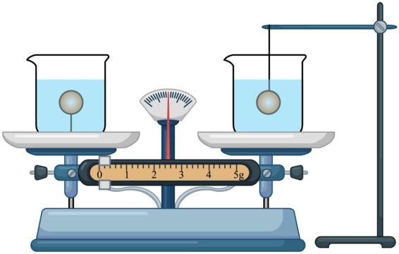

# Physics - 题目 1308

**ID**: f79f5b23c3dc428d9c73e533e6050865
**年级**: Grade 9
**难度**: Hard
**题型**: Multiple-choice

## 题目
水平桌面上放置了已调平的天平，在天平左右两盘各放一个完全相同的烧杯，装入适量的水，分别用细线拉住体积相同的两球（细线对两球均有拉力）使其浸没在水中，天平再次平衡（      ）​​​​​​​‌

## 解答

1. 根据图示可知，左侧烧杯中小球受到竖直向下的拉力，此时的浮力大于重力，根据物体浮沉条件可知，左侧烧杯中小球的密度小于水的密度；右侧烧杯中小球受到竖直向上的拉力，浮力小于重力，所以右侧烧杯中小球的密度大于水的密度，由此可知，两球的密度是不同的，右侧烧杯中小球的密度大，故A不符合题意；天平左盘受到的压力等于烧杯和小球、左侧烧杯内水的重力，即 $F{{}_{左}}=G{{}_{烧杯}}+G{{}_{左水}}+G{{}_{球}}$ ，因物体受到的浮力和物体对液体的压力是一对相互作用力，二力大小相等，所以天平右盘受到的压力等于右侧烧杯和水的重力之和加上小球受到的浮力，即 $F{{}_{右}}=G{{}_{烧杯}}+G{{}_{右水}}+F{{}_{浮}}$ ，又因两烧杯完全相同，天平水平平衡，所以由 $G{{}_{球}}＜F{{}_{浮}}$ 可知 $G{{}_{左水}}＞G{{}_{右水}}$ ，由 $G=mg$ 可知 $m{{}_{左水}}＞m{{}_{右水}}$ ，故B不符合题意；因两球的体积相等，又知 $m{{}_{左水}}＞m{{}_{右水}}$ ，所以左右两侧水的深度关系为 $h{{}_{左水}}＞h{{}_{右水}}$ ，由 $p=ρ{{}_{液}}gh$ 可知，左右两烧杯底部受到水的压强大小关系为 $p{{}_{左水}}＞p{{}_{右水}}$ ，故C符合题意；剪断细线前天平水平平衡，同时剪断细线后，左盘的烧杯和水、左侧烧杯中小球的总重力不变，左盘受到的压力不变；由右侧烧杯中小球的重力大于自身受到的浮力可知，天平右盘受到的压力变大，受力面积相同，根据 $p=\frac {F}{S}$ 可知，右侧烧杯对托盘的压强变化量大，故D不符合题意。

## 知识点

**中文**:
  - 密度、压强和浮力的综合

**English**:
  - Integrated Density, Pressure, and Buoyancy

---
