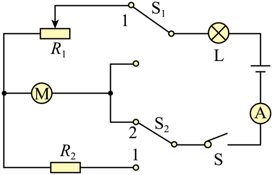

# Physics - 题目 2503

**ID**: 4dbca46f44b644f9844492a67942c3f7
**年级**: Grade 9
**难度**: Hard
**题型**: Multiple-select

## 题目
在学校举行的劳动技术成果汇报展示活动中，小强同学展示了一辆自己组装的玩具车，它具有“原地灯光秀”“调速前进”和“定速后退”三种工作模式。​​​​​​​‌通过控制开关S_{1}、S_{2}和滑动变阻器R_{1}来改变灯L的亮度，实现“原地灯光秀”；通过改变直流电动机的转动方向及转速，实现“调速前进”或“定速后退”，如图所示。已知电源电压不变，标有“0.6A”灯L的电阻不变且R_{L}=10Ω，定值电阻R_{2}=5Ω，当玩具车工作在“原地灯光秀”模式时，电流表A的最大示数为0.4A。关于下列结论，其中正确的是（      ）

## 解答

1. 根据题意，通过控制开关S_{1}、S_{2}和滑动变阻器R_{1}来改变灯L的亮度，实现“原地灯光秀”，因此S闭合，S_{1}接1，S_{2}接2时，电动机工作，因此玩具车不处于“原地灯光秀”模式，故D错误；当玩具车工作在“原地灯光秀”模式时，电流表A的最大示数为0.4A，电源电压不变，根据 $I=\frac {U}{R}$ 可知，电路中总电阻最小时电流最大，因此此时滑动变阻器R_{1}连入电路的电阻为零，电路为灯L与R_{2}的串联电路，电源电压为U=I（R_{L}+R_{2}）=0.4A×（10Ω+5Ω）=6V，A错误；根据题意，通过改变直流电动机的转动方向及转速，实现“调速前进”或“定速后退”，说明玩具车前进时需要用滑动变阻器R_{1}来实现“调速”，但后退时电路中没有滑动变阻器R_{1}，以实现“定速”，因此S闭合，S_{1}接1，S_{2}接2时，玩具车处于“调速前进”模式；S闭合，S_{1}接2，S_{2}接1时，玩具车处于“定速后退”模式；玩具车“调速前进”时，电源电压不变，根据 $I=\frac {U}{R}$ 可知，电路中总电阻最小时电流最大，因此此时滑动变阻器R_{1}连入电路的电阻为零，电路为灯L与直流电动机的串联电路，此时电路电流为 $I^{′}=\frac {U}{R{{}_{{\rm{L}}}}+R{{}_{{\rm{M}}}}}=\frac {6{\rm{V}}}{10{\rm{Ω}}+R{{}_{{\rm{M}}}}}$ ，因为R_{M}不为零，因此电路电流I'小于0.6A，电流表A的最大示数小于0.6A，B正确；玩具车“定速后退”时，电路消耗的总功率为 $P=\frac {U{^{2}}}{R{{}_{总}}}=\frac {U{^{2}}}{R{{}_{{\rm{L}}}}+R{{}_{2}}+R{{}_{{\rm{M}}}}}=\frac {(6{\rm{V}}){^{2}}}{10{\rm{Ω}}{{+}}{{5}}{\rm{Ω}}{{+}}R{{}_{{\rm{M}}}}}=\frac {36{\rm{V}}{^{2}}}{1{{5}}{\rm{Ω}}{{+}}R{{}_{{\rm{M}}}}}$ ，因为R_{M}不为零，电路为灯L与直流电动机、定值电阻R_{2}的串联电路，因此电路消耗的总功率小于2.4W，故C正确。

## 知识点

**中文**:
  - 与欧姆定律有关的动态电路计算
  - 电功率的计算及应用

**English**:
  - Calculations in Dynamic Circuits using Ohm's Law
  - Calculation and Application of Electric Power

---
