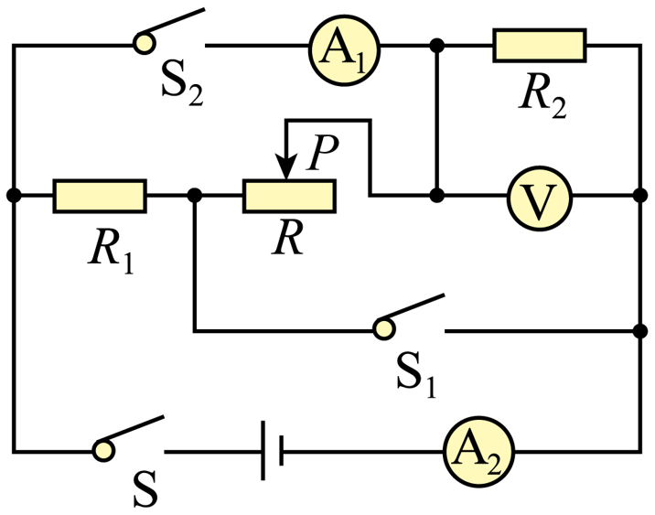

# Physics - 题目 722

**ID**: cf6c6a280ab1493b97d4872f6102ce85
**年级**: Grade 9
**难度**: Hard
**题型**: Multiple-select

## 题目
如图所示的电路图，电源电压U恒定，两个阻值相等的电阻R_{1}、R_{2}，滑片P在中间位置，此时变阻器接入电路的阻值R＝2R_{1}。​​​​​​​‌下列说法正确的是（      ）

## 解答

1. A．开关全闭合， $R{{}_{1}}$ 、变阻器R、 $R{{}_{2}}$ 并联，电流表 ${\rm{A}}{{}_{1}}$ 测变阻器R和 $R{{}_{2}}$ 的总电流，电流表 ${\rm{A}}{{}_{2}}$ 测 $R{{}_{1}}$ 、变阻器R、 $R{{}_{2}}$ 的总电流。变阻器接入电路的阻值R＝2R_{1}， $R{{}_{1}}=R{{}_{2}}$ ，所以 $R{{}_{1}}$ 、变阻器R、 $R{{}_{2}}$ 的电阻之比为 $R{{}_{1}}∶R∶R{{}_{2}}=1∶2∶1$ ，根据并联分流规律，则 $R{{}_{1}}$ 、变阻器R、 $R{{}_{2}}$ 的电流之比为 $I{{}_{1}}∶I{{}_{R}}∶I{{}_{2}}=2∶1∶2$ ，所以A_{1}与A_{2}的示数之比为3∶5，故A错误；
2. B．开关全闭合， $R{{}_{1}}$ 、变阻器R、 $R{{}_{2}}$ 并联，滑片P向右移动时，变阻器 $R$ 阻值变大，则电流变小，根据并联电路特点可知 $R{{}_{1}}$ 、 $R{{}_{2}}$ 电流不变，根据并联电流规律可知，两个电流表示数均变小，电压表测电源电压，示数不变，所以电压表示数与电流表A_{1}示数之比变大，故B正确；
3. C．滑片P在中间位置，此时变阻器接入电路的阻值R＝2R_{1}，则当开关全闭合，滑片P移动到右端时，变阻器接入电路的阻值为 $4R{{}_{1}}$ ，则此时电路总功率最小为 $P{{}_{{\rm \min }}}=P{{}_{1}}+P{{}_{2}}+P{{}_{R}}=\frac {U{^{2}}}{R{{}_{1}}}+\frac {U{^{2}}}{R{{}_{2}}}+\frac {U{^{2}}}{4R{{}_{1}}}=\frac {U{^{2}}}{R{{}_{1}}}+\frac {U{^{2}}}{R{{}_{1}}}+\frac {U{^{2}}}{4R{{}_{1}}}=\frac {9U{^{2}}}{4R{{}_{1}}}$ ，故C正确；
4. D．若将电流表A_{1}换成电压表V_{1}，只闭合开关S和S_{2}，此时 $R{{}_{1}}$ 、变阻器R、 $R{{}_{2}}$ 串联，电压表 ${\rm{V}}{{}_{1}}$ 测 $R{{}_{1}}$ 和变阻器R的总电压，电压表V测 $R{{}_{2}}$ 电压，电流表 ${\rm{A}}{{}_{2}}$ 测电路电流。根据串联分压规律可知，电压表V_{1}变化量等于电压表V变化量。对于定值电阻 $R{{}_{2}}$ ，设某时刻下电压为 $U{{}_{1}}$ ，电流为 $I{{}_{1}}$ ，根据欧姆定律则有 $U{{}_{1}}=I{{}_{1}}R{{}_{2}}$ …①，设另一时刻下电压为 $U{{}_{2}}$ ，电流为 $I{{}_{2}}$ ，根据欧姆定律则有 $U{{}_{2}}=I{{}_{2}}R{{}_{2}}$ …②，②-①则有 $U{{}_{2}}-U{{}_{1}}=\left ({I{{}_{2}}-I{{}_{1}}}\right )R{{}_{2}}$ ，则有 $R{{}_{2}}=\frac {U{{}_{2}}-U{{}_{1}}}{I{{}_{2}}-I{{}_{1}}}=\frac {\Delta U}{\Delta I}$ ，所以滑片P向左移过程中，电压表V的示数变化量与电流表 ${\rm{A}}{{}_{2}}$ 的示数变化量的比值即为 $R{{}_{2}}$ ，则电压表V_{1}变化量和电流表A_{2}变化量的比值等于R_{2}。故D错误。

## 知识点

**中文**:
  - 与欧姆定律有关的动态电路计算
  - 电功率的计算及应用

**English**:
  - Calculations in Dynamic Circuits using Ohm's Law
  - Calculation and Application of Electric Power

---
