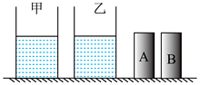

# Physics - 题目 944

**ID**: d774ddd3b02a44258c2ee1cf617cfce0
**年级**: Grade 9
**难度**: Hard
**题型**: Multiple-select

## 题目
两个完全相同的圆柱形容器甲、乙放置在水平桌面上，容器的底面积均为0.01m^{2}，容器内盛有相同高度的水，如图所示。​​​​​​​‌将两个密度不同、体积均为10^{-3}m^{3}的实心柱体A、B分别竖直放入甲、乙容器中（水未溢出），水对容器底部的压强p_{水}和容器对桌面的压强p_{容}如表所示，g取10N/kg。下列说法中正确的是（      ）压强放入A柱体放入B柱体p_{水}/Pa15002000p_{容}/Pa20003000

## 解答

1. A．由题知，实心柱体A、B的体积相等，密度不同，假若两者同时浸没时，排开水的体积相等，则水面的高度相同。但由p_{水}_{A}<p_{水}_{B}可知，两者不可能同时浸没，由 $p=ρgh$  可知， $Δh{{}_{水{\rm{A}}}}<Δh{{}_{水{\rm{B}}}}$  ，由 $V=Sh$ 可知， $V{{}_{排A}}<V{{}_{排{\rm{B}}}}$ ，所以，A一定漂浮，无水溢出，因水平面上物体的压力和自身的重力相等，所以，水对容器底部的压力
2. $F{{}_{水甲}}=G{{}_{水}}+G{{}_{{\rm{A}}}}=p{{}_{水甲}}S$
3. 容器对地面的压力
4. $F{{}_{容甲}}=G{{}_{容}}+G{{}_{水}}+G{{}_{{\rm{A}}}}=p{{}_{容甲}}S$
5. 则
6. $F{{}_{容甲}}-F{{}_{水甲}}=(G{{}_{容}}+G{{}_{水}}+G{{}_{{\rm{A}}}})-(G{{}_{水}}+G{{}_{{\rm{A}}}})=G{{}_{容}}=p{{}_{容甲}}S-p{{}_{水甲}}S$
7. 所以容器的重力
8. $G{{}_{容}}=(p{{}_{容甲}}-p{{}_{水甲}})S=\left ({2000{\rm{P}}{\rm{a}}-1500{\rm{P}}{\rm{a}}}\right )\times 0.01{\rm{m}}{^{{\rm{2}}}}=5{\rm{N}}$
9. 故A错误；
10. B．若B在水中漂浮或悬浮，则
11. $F{{}_{容乙}}-F{{}_{水乙}}=(G{{}_{容}}+G{{}_{水}}+G{{}_{{\rm{B}}}})-(G{{}_{水}}+G{{}_{{\rm{B}}}})=G{{}_{容}}=p{{}_{容乙}}S-p{{}_{水乙}}S$
12. 有B求出的容器重力为
13. $G{{}_{容}}=(p{{}_{容乙}}-p{{}_{水乙}})S=\left ({3000{\rm{P}}{\rm{a}}-2000{\rm{P}}{\rm{a}}}\right )\times 0.01{\rm{m}}{^{{\rm{2}}}}=10{\rm{N}}\ne 5{\rm{N}}$  ,
14. 因A漂浮，且 $G{{}_{容}}\ne 5{\rm{N}}$ ，故B在水中不可能悬浮，只能是沉底，则B受到的浮力小于B受到的重力，故B正确；
15. C． 已知，A漂浮，B沉底，由 $p=ρgh$ 可分别求出甲、乙容器中水的高度
16. $Δh{{}_{{\rm{A}}}}=\frac {p{{}_{水甲}}}{ρ{{}_{水}}g}=\frac {1500{\rm{P}}{\rm{a}}}{1\times 10{^{3}}{\rm{k}}{\rm{g}}{\rm{/}}{\rm{m}}\times 10{\rm{N}}{\rm{/}}{\rm{k}}{\rm{g}}}=0.15{\rm{m}}$
17. $Δh{{}_{{\rm{B}}}}=\frac {p{{}_{水乙}}}{ρ{{}_{水}}g}=\frac {{\rm{2}}{\rm{0}}{\rm{0}}{\rm{0}}{\rm{P}}{\rm{a}}}{1\times 10{^{3}}{\rm{k}}{\rm{g}}{\rm{/}}{\rm{m}}\times 10{\rm{N}}{\rm{/}}{\rm{k}}{\rm{g}}}=0.2{\rm{m}}$
18. $Δh{{}_{{\rm{A}}}}$ 与 $Δh{{}_{{\rm{B}}}}$ 的高度差之间水的体积，即是A柱体未浸入水中的体积，则A排开水的体积为
19. $V{{}_{排{\rm{A}}}}{\rm{=}}V{{}_{{\rm{A}}}}-(Δh{{}_{{\rm{B}}}}-Δh{{}_{{\rm{A}}}})S=10{^{-3}}{\rm{m}}{^{{\rm{3}}}}-(0.2{\rm{m}}-0.15{\rm{m}})\times 0.01{\rm{m}}{^{2}}=0.5\times 10{^{-3}}{\rm{m}}{^{{\rm{3}}}}$
20. A受到的浮力
21. $F{{}_{浮}}{\rm{=}}ρ{{}_{水}}gV{{}_{排{\rm{A}}}}{\rm{=}}1\times 10{^{3}}{\rm{k}}{\rm{g}}{\rm{/}}{\rm{m}}\times 10{\rm{N}}{\rm{/}}{\rm{k}}{\rm{g}}\times 0.5\times 10{^{-3}}{\rm{m}}{^{{\rm{3}}}}{\rm{=}}5{\rm{N}}$
22. 故C错误；
23. D．因为A漂浮，所以A所受浮力等于A的重力，即G_{A}=5N。当A放入甲容器后，容器对地面的压力为
24. $F{{}_{容甲}}=G{{}_{容}}+G{{}_{水}}+G{{}_{{\rm{A}}}}=p{{}_{容甲}}S$
25. 则
26. $G{{}_{水}}=F{{}_{容甲}}-G{{}_{容}}-G{{}_{{\rm{A}}}}=p{{}_{容甲}}S-G{{}_{容}}-G{{}_{{\rm{A}}}}=2000{\rm{P}}{\rm{a}}\times 0.01{\rm{m}}{^{{\rm{2}}}}-5{\rm{N}}-5{\rm{N}}=10{\rm{N}}$
27. B柱体放入水中后，有
28. $F{{}_{容乙}}=G{{}_{容}}+G{{}_{水}}+G{{}_{{\rm{B}}}}=p{{}_{容乙}}S$
29. 则B受到的重力为
30. $G{{}_{{\rm{B}}}}=F{{}_{容乙}}-G{{}_{容}}-G{{}_{水}}=p{{}_{容乙}}S-G{{}_{容}}-G{{}_{水}}=3000{\rm{P}}{\rm{a}}\times 0.01{\rm{m}}{^{{\rm{2}}}}-5{\rm{N}}-10{\rm{N}}=15{\rm{N}}$
31. 故D正确。
32. 故选BD。

## 知识点

**中文**:
  - 密度、压强和浮力的综合

**English**:
  - Integrated Density, Pressure, and Buoyancy

---
