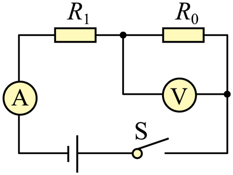

# Physics - 题目 2186

**ID**: 190b0c6760ec45b6960442af0d1a31b4
**年级**: Grade 9
**难度**: Medium
**题型**: Calculation

## 题目
如图所示为兴趣小组设计的一个电子温度计的原理图，R_{1}是定值电阻，阻值为20Ω，R_{0}是热敏电阻，其阻值随温度变化关系如表所示。​​​​​​​‌电源电压保持不变，电压表量程为0~3V，当环境温度为40℃时，此时电压表的示数为2V。求：R_{0}/Ω252015105t/℃1020304050（1）此时通过R_{0}的电流；（2）电源电压；（3）为保证电路安全，此电路能反映环境的最低温度是多少℃。

## 解答

1. （1）分析电路可知， $R{{}_{1}}$ 、 $R{{}_{0}}$ 串联，电流表测电路电流，电压表测 $R{{}_{0}}$ 电压。由表可知，当环境温度为40℃时， $R{{}_{0}}$ 阻值为 $10Ω$ ，此时电压表的示数为2V，则通过R_{0}的电流 $I=\frac {U{{}_{0}}}{R{{}_{0}}}=\frac {2{\rm{V}}}{10Ω}=0.2{\rm{A}}$ 。
2. （2）电源电压 $U=I\left ({R{{}_{1}}+R{{}_{0}}}\right )=0.2{\rm{A}}\times \left ({20Ω+10Ω}\right )=6{\rm{V}}$ 。
3. （3）电压表量程为0~3V，则当电压表示数最大为3V时，根据串联电路分压原理可知，此时 $R{{}_{0}}$ 阻值最大，则有 $\frac {20Ω}{R{{}_{0大}}}=\frac {6{\rm{V}}-3{\rm{V}}}{3{\rm{V}}}$ ，解得 $R{{}_{0}}$ 的最大阻值 $R{{}_{0大}}=20Ω$ ，由表可知，此时对应的环境最低温度为20℃。

## 知识点

**中文**:
  - 欧姆定律的应用
  - 电路的动态分析

**English**:
  - Applications of Ohm's Law
  - Dynamic Circuit Analysis

---
