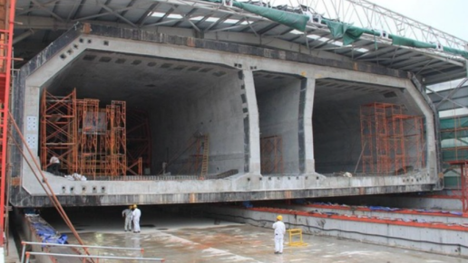

# Physics - 题目 2531

**ID**: 1965c45ef5eb470eaa5cf766c9a4af90
**年级**: Grade 9
**难度**: Medium
**题型**: Calculation

## 题目
2023年11月28日，深中通道海底隧道贯通。​​​​​​​‌深中通道是我国广东省境内连接深圳市和中山市的交通枢纽，由桥梁和海底沉管隧道组成，沉管隧道为世界首例双向八车道海底沉管隧道，由32个如图所示的巨型钢壳沉管组成。（海水密度取 $1.0\times 10{^{3}}{\rm{k}}{\rm{g}}{\rm{/}}{\rm{m}}{^{{{3}}}}$ ）（1）海底沉管隧道建设最大水深达40m，则沉管至少要能承受多大的海水压强？（2）在沉管隧道建设中，先将沉管两端密封，让它漂浮在海面上，再在钢缆的牵引下，缓缓由浅水坞区进入深水坞区。若钢缆将沉管匀速拖行时沉管受到的阻力为 $6\times 10{^{5}}{\rm{N}}$ ，钢缆将沉管匀速拖行30m用时10min，求此过程中钢缆对沉管拉力的功率；（3）将漂浮的沉管牵引到预定海面后，向其内部灌水使之沉入海底。假设某一节密封的沉管的总体积为 $8\times 10{^{4}}{\rm{m}}{^{3}}$ ，漂浮时浸入水中的体积为 $6\times 10{^{4}}{\rm{m}}{^{3}}$ ，要使其沉入海底，至少要灌入多少吨的海水？

## 解答

1. 解：（1）沉管至少要能承受的海水压强为   $p=ρgh={\rm{\;}}1.0\times 10{^{3}}{\rm{k}}{\rm{g}}{\rm{/}}{\rm{m}}{^{{{3}}}}\times 10{\rm{N}}{\rm{/}}{\rm{k}}{\rm{g}}\times 40{\rm{m}}=4\times 10{^{5}}{\rm{P}}{\rm{a}}$ 。
2. （2）匀速拖行时钢缆对沉管拉力做的功为 $W=Fs=fs=6\times 10{^{5}}{\rm{N}}\times 30{\rm{m}}=1.8\times 10{^{7}}{\rm{J}}$ ，钢缆对沉管拉力的功率为 $P=\frac {W}{t}=\frac {1.8\times 10{^{7}}{\rm{J}}}{10\times 60{\rm{s}}}=3\times 10{^{4}}{\rm{W}}$ 。
3. （3）漂浮的沉管受到的浮力等于重力 $G=F{{}_{浮}}=ρ{{}_{水}}V{{}_{排}}g=1.0\times 10{^{3}}{\rm{k}}{\rm{g}}{\rm{/}}{\rm{m}}{^{{{3}}}}\times 6\times 10{^{4}}{\rm{m}}{^{3}}\times 10{\rm{N}}{\rm{/}}{\rm{k}}{\rm{g}}=6\times 10{^{8}}{\rm{N}}$ ，沉入水底的沉管受到的浮力为 $F^{′}{{{}_{浮}}}=ρ{{}_{水}}V^{′}{{{}_{排}}}g=1.0\times 10{^{3}}{\rm{k}}{\rm{g}}{\rm{/}}{\rm{m}}{^{{{3}}}}\times 8\times 10{^{4}}{\rm{m}}{^{3}}\times 10{\rm{N}}{\rm{/}}{\rm{k}}{\rm{g}}=8\times 10{^{8}}{\rm{N}}$ ，至少要灌入的海水质量为 $m=\frac {G{{}_{水}}}{g}=\frac {F^{′}{{{}_{浮}}}-G}{g}=\frac {8\times 10{^{8}}{\rm{N}}-6\times 10{^{8}}{\rm{N}}}{10{\rm{N}}{\rm{/}}{\rm{k}}{\rm{g}}}=2\times 10{^{7}}{\rm{k}}{\rm{g}}=2\times 10{^{4}}{\rm{t}}$ 。
4. 答：（1）沉管至少要能承受的海水压强为4×10^{5}Pa；
5. （2）钢缆对沉管拉力的功率为3×10^{4}W；
6. （3）要使其沉入海底，至少要灌入2×10^{4}t的海水。

## 知识点

**中文**:
  - 功率的计算和估算
  - 液体压强的大小及其计算
  - 阿基米德原理的应用
  - 功的计算和估算

**English**:
  - Calculation and Estimation of Power
  - Magnitude and Calculation of Liquid Pressure
  - Applications of Archimedes' Principle
  - Calculation and Estimation of Work

---
