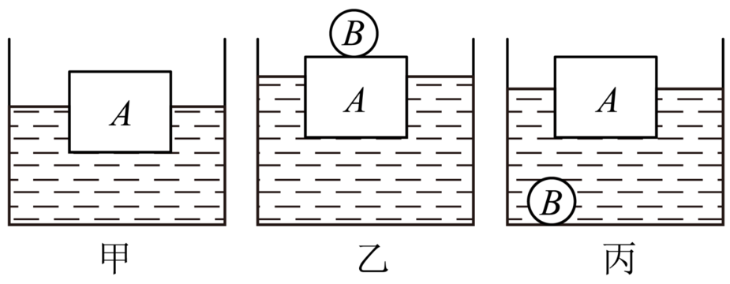

# Physics - 题目 1865

**ID**: 2afa5b35d3f94459b842a936c18dd6df
**年级**: Grade 9
**难度**: Medium
**题型**: Calculation

## 题目
底面积为100cm^{2}薄壁圆柱形容器盛有适量的水，木块A重为12N，体积为2×10^{-3}m^{3}，漂浮在水面上，如图甲所示；现将一体积为250cm^{3}的合金球B放在木块A上方，木块A恰好有五分之四的体积浸入水中，如图乙所示。​​​​​​​‌求：（1）图甲中木块A受到浮力的大小；（2）合金球B的密度；（3）将合金球B从木块A上取下来，放入容器的水中，当A、B都静止时。水对容器底部的压强比取下合金球B前减小了多少帕？

## 解答

1. 解：（1）木块A放在水中，漂浮在水面，则所受的浮力等于其重力，所以
2. F_{浮}_{A}=G_{A}=12N
3. （2）B放在A上方，依然漂浮，排开水的体积
4. V_{排}= $\frac {4}{5}$V_{A}= $\frac {4}{5}$ ×2×10^{-3}m^{3}=1.6×10^{-3}m^{3}
5. 此时，所受的浮力等于A、B的总重力，即
6. G_{A}+G_{B}=F_{浮}_{AB}=ρ_{水}gV_{排}=1.0×10^{3}kg/m^{3}×10N/kg×1.6×10^{-3}m^{3}=16N
7. 那么合金球B的重力
8. G_{B}=16N-12N=4N
9. B的质量
10. $m=\frac {G{{}_{{\rm{B}}}}}{g}=\frac {{\rm{4}}{\rm{N}}}{{\rm{1}}{\rm{0}}{\rm{N}}{\rm{/}}{\rm{k}}{\rm{g}}}=0.4{\rm{k}}{\rm{g}}$
11. B的密度
12. $ρ=\frac {m}{V{{}_{{\rm{B}}}}}=\frac {0.4{\rm{k}}{\rm{g}}}{250\times 10{{}^{-6}}{\rm{m}}{{}^{3}}}=1.6\times 10{{}^{3}}{\rm{k}}{\rm{g}}{\rm{/}}{\rm{m}}{{}^{3}}$
13. （3）B取下并放入水中，因为B的密度大于水的密度，所以B沉于水底，而此B所受的浮力
14. F_{浮}_{B}=ρ_{水}gV_{排}_{1}=ρ_{水}gV_{B}=1.0×10^{3}kg/m^{3}×10N/kg×250×10^{-6}m^{3}=2.5N
15. 则此时A、B所受的浮力与未取下B 时比较，浮力减小量
16. ∆F=F_{浮}_{AB}-(F_{浮}_{A}+F_{浮}_{B})=16N-(12N+2.5N)=1.5N
17. 排开水的体积减少量
18. $ΔV{{}_{排}}=\frac {ΔF}{ρ{{}_{水}}g}=\frac {1.5{\rm{N}}}{1.0\times 10{{}^{3}}{\rm{k}}{\rm{g}}{\rm{/}}{\rm{m}}{{}^{3}}\times 10{\rm{N}}{\rm{/}}{\rm{k}}{\rm{g}}}=1.5\times 10{{}^{-4}}{\rm{m}}{{}^{3}}$
19. 水的深度变化量
20. $Δh=\frac {ΔV{{}_{排}}}{S}=\frac {1.5\times 10{{}^{-4}}{\rm{m}}{{}^{3}}}{100\times 10{{}^{-4}}{\rm{m}}{{}^{2}}}=0.015{\rm{m}}$
21. 水对容器底部的压强比取下合金球B前的减小量
22. ∆p=ρ_{水}g∆h=1.0×10^{3}kg/m^{3}×10N/kg×0.015m=150Pa
23. 答：（1）图甲中木块A受到浮力的大小为12N；
24. （2）合金球B的密度为1.6×10^{3}kg/m^{3}；
25. （3）水对容器底部的压强比取下合金球B前减小了150Pa。

## 知识点

**中文**:
  - 密度、压强和浮力的综合

**English**:
  - Integrated Density, Pressure, and Buoyancy

---
