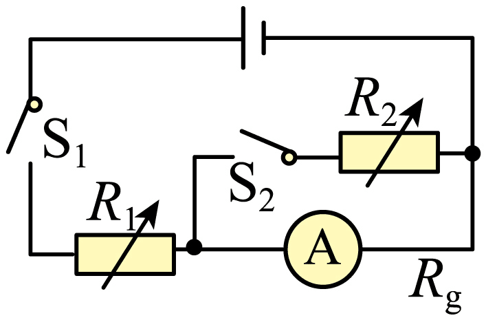

# Physics - 题目 650

**ID**: 2f06dd8bbef042af92fc58ec342b54e1
**年级**: Grade 9
**难度**: Medium
**题型**: Calculation

## 题目
某同学利用如图所示的电路测量一个数值未知的电源，电源的电压保持不变。​​​​​​​‌电流表的内电阻为Rg，但是电流表上只有0刻度和最大刻度，最大刻度为50μA。第一步将开关S1闭合、S2断开时，调节电阻箱R1的阻值，让电流表的指针指在最大刻度的位置，记下此时电阻箱R1的示数为8000Ω。第二步将开关S1、S2都闭合时，将电阻箱R1的阻值减为4000Ω，再调节电阻箱R2的阻值，使电流表的指针又指在最大刻度的位置，记下此时电阻箱R2的示数为2000Ω。根据以上测得值，计算出电流表的内电阻Rg和电源电压。

## 解答

1. 解：将开关S1闭合、S2断开时，调节电阻箱R1的阻值，让电流表的指针指在最大刻度的位置，记下此时电阻箱R1的示数为
2. $R{{}_{1}}=8000{\rm{Ω}}$
3. 根据串联电路的特点和欧姆定律可知，电源电压
4. $U=I{{}_{{\rm{g}}}}（R{{}_{{\rm{1}}}}+R{{}_{{\rm{g}}}})=5\times 10{^{﹣5}}{\rm{A}}\times （8000{\rm{Ω}}+R{{}_{{\rm{g}}}})=0.4{\rm{V}}+5\times 10{^{﹣5}}{\rm{A}}\times R{{}_{{\rm{g}}}}$ ①
5. 将开关S1、S2都闭合时，R2与Rg并联后再与R1串联，将电阻箱R1的阻值减为
6. $R{{}_{1}}\prime =4000{\rm{Ω}}$
7. 再调节电阻箱R2的阻值，使电流表的指针又指在最大刻度
8. $I{{}_{{\rm{g}}}}=50{\rm{μ}}{\rm{A}}=5\times 10{^{﹣}}{^{5}}{\rm{A}}$
9. 电流表两端的电压
10. $U{{}_{{\rm{g}}}}=I{{}_{{\rm{g}}}}R{{}_{{\rm{g}}}}=5\times 10{^{﹣}}{^{5}}{\rm{A}}\times R{{}_{{\rm{g}}}}$
11. 根据并联电路的特点可知，R2两端的电压
12. $U{{}_{2}}=U{{}_{{\rm{g}}}}=5\times 10{^{﹣}}{^{5}}{\rm{A}}\times R{{}_{{\rm{g}}}}$
13. 根据欧姆定律可知，通过R2的电流
14. $I{{}_{2}}=\frac {U{{}_{2}}}{R{{}_{2}}}=\frac {5\times 10{^{﹣5}}{\rm{A}}\times R{{}_{{\rm{g}}}}}{2000{\rm{Ω}}}$
15. 跟串联电路的电流特点可知，通过电阻箱R1的电流
16. $I{{}_{1}}\prime =I{{}_{2}}+I{{}_{{\rm{g}}}}$
17. 根据欧姆定律可知，电源电压
18. $U=I{{}_{1}}\prime R{{}_{1}}\prime +I{{}_{{\rm{g}}}}R{{}_{{\rm{g}}}}=(\frac {5\times 10{^{﹣5}}{\rm{A}}\times R{{}_{{\rm{g}}}}}{2000{\rm{Ω}}}+5\times 10{^{﹣5}}{\rm{A}}）\times 4000{\rm{Ω}}+5\times 10{^{﹣5}}{\rm{A}}\times R{{}_{{\rm{g}}}}=1.5\times 10{^{﹣4}}{\rm{A}}\times R{{}_{{\rm{g}}}}+0.2{\rm{V}}$ ②
19. 联立①②解得：电流表的内阻
20. $R{{}_{{\rm{g}}}}=2000{\rm{Ω}}$
21. 电源电压
22. $U=0.5{\rm{V}}$
23. 答：电流表的内电阻Rg为2000Ω，电源电压为0.5V。

## 知识点

**中文**:
  - 串联电路的电流规律
  - 并联电路的电压规律
  - 欧姆定律的应用

**English**:
  - Current Law in Series Circuits
  - Voltage Law in Parallel Circuits
  - Applications of Ohm's Law

---
