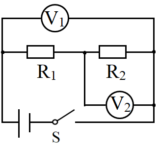

# Physics - 题目 1093

**ID**: 3040e73a62754cb7b2d8730436803c94
**年级**: Grade 9
**难度**: Medium
**题型**: Calculation

## 题目
如图所示的电路，电阻 $R{{}_{1}}$ 的阻值为40Ω，当闭合开关S后，两个电压表的示数分别为10V和2V。​​​​​​​‌求：(1)通过 $R{{}_{1}}$ 的电流是多少安？(2)电阻 $R{{}_{2}}$ 的阻值是多少欧？(3)通电 $1{\rm \min }$ ，电流通过整个电路消耗的电能是多少焦？

## 解答

1. 解：(1)由电路图可知： $R{{}_{1}}$ 、 $R{{}_{2}}$ 串联， ${\rm{V}}{{}_{1}}$ 测电源的电压 $U$ ， ${\rm{V}}{{}_{2}}$ 测 $R{{}_{2}}$ 两端的电压 $U{{}_{2}}$ ，即
2. $U=10{\rm V}$ ， $U{{}_{2}}=2{\rm V}$
3. 因此，由串联电路电压的特点知
4. $U{{}_{1}}=U-U{{}_{2}}=10{\rm V}-2{\rm V}=8{\rm V}$
5. 通过 $R{{}_{1}}$ 的电流是
6. $I{{}_{1}}=\frac {U{{}_{1}}}{R{{}_{1}}}=\frac {8{\rm{V}}}{40\,{\rm{Ω}}}=0.2{\rm{A}}$
7. (2)因为 $R{{}_{1}}$ 、 $R{{}_{2}}$ 串联，所以
8. $I=I{{}_{1}}=I{{}_{2}}=0.2{\rm A}$
9. 电阻 $R{{}_{2}}$ 的阻值是
10. $R{{}_{2}}=\frac {U{{}_{2}}}{I{{}_{2}}}=\frac {2{\rm{V}}}{0.2{\rm{A}}}=10\,{\rm{Ω}}$
11. (3)电流通过整个电路消耗的电能是
12. $W=UIt=10{\rm V}\times 0.2{\rm A}\times 60{\rm{s}}=120{\rm J}$
13. 答：(1)通过 $R{{}_{1}}$ 的电流是0.2A；
14. (2)电阻 $R{{}_{2}}$ 的阻值是10Ω；
15. (3)通电 $1{\rm \min }$ ，电流通过整个电路消耗的电能是120J。

## 知识点

**中文**:
  - 欧姆定律的应用
  - 电功与电能的计算

**English**:
  - Applications of Ohm's Law
  - Calculation of Electric Work and Energy

---
