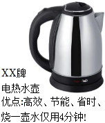

# Physics - 题目 2845

**ID**: 314b6ecd90574f6d9dacfc77ff49d5ee
**年级**: Grade 9
**难度**: Medium
**题型**: 计算题：本大题共2小题，共12分。

## 题目
李红去商店购买电热水壶，售货员给了她一份推销 $××$ 牌电热水壶的宣传广告，其内容如下： ${\rho }_{水}=1.0×{10}^{3}kg/{m}^{3}$ ， ${c}_{水}=4.2×{10}^{3}J/（kg\cdot ℃）$ ，请你根据宣传广告中提供的信息回答、计算：$××$ 牌电热水壶铭牌：额定电压$220V$额定功率$2000W$容积$2.5L$超温保护器熔断温度 $110℃$$（1）$ 电热水壶正常工作时的电阻是多少？$（2）$ 电热水壶正常工作 $4\min $ 消耗多少电能？$（3）$ 夏季自来水的温度为 $12℃$ ，若将一壶水烧开需要吸收多少热量？ $（$ 标准大气压 $）$$（4）$ 此电热水壶正常工作时的热效率为 $92.4\%$ ，根据计算结果，请你对上述宣传广告中电热水壶“优点”的有关内容作出评价。​​​​​​​‌

## 解答

1. $（1）$ 由表格数据可知，电热水壶的额定功率为 $P=2000W$ ，
2. 由 $P=\frac{{U}^{2}}{R}$ 可知，电热水壶正常工作时的电阻： $R=\frac{{U}^{2}}{P}=\frac{（220V{）}^{2}}{2000W}=24.2\Omega $ ；
3. $（2）$ 由 $P=\frac{W}{t}$ 可知。电热水壶正常工作 $4\min $ 消耗的电能： $W=Pt\text{'}=2000W×4×60s=4.8×{10}^{5}J$ ；
4. $（3）$ 电热水壶内水的体积 $V=2.5L=2.5d{m}^{3}=2.5×{10}^{-3}{m}^{3}$ ，
5. 由 $\rho =\frac{m}{V}$ 可知，水的质量： $m={\rho }_{水}V=1.0×{10}^{3}kg/{m}^{3}×2.5×{10}^{-3}{m}^{3}=2.5kg$ ，
6. 一个标准大气压下，水的沸点是 $100℃$ ，
7. 水吸收的热量： ${Q}_{吸}={c}_{水}m（t-{t}_{0}）=4.2×{10}^{3}J/（kg\cdot ℃）×2.5kg×（100℃-12℃）=9.24×{10}^{5}J$ ，
8. $（4）$ 由 $\eta =\frac{{Q}_{\mathrm{吸}}}{W}$ 可知，烧开一壶水消耗的总电能： ${W}_{总}=\frac{{Q}_{\mathrm{吸}}}{\eta }=\frac{9.24×{10}^{5}J}{92.4\%}=1×{10}^{6}J$ ，
9. 由 $P=\frac{W}{t}$ 可知，烧开一壶水的时间： $t=\frac{{W}_{\mathrm{总}}}{P}=\frac{1×{10}^{6}J}{2000W}=500\approx 8.3\min >4\min $ 。
10. 所以 $4$ 分钟不可能将水烧开，此宣传广告不可信。

## 知识点

**中文**:
  - 电与热综合计算

**English**:
  - Comprehensive Calculation of Electricity and Heat

---
