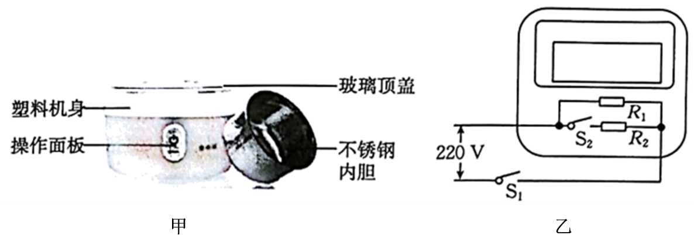

# Physics - 题目 572

**ID**: 4780cdec272c42c5bfabc49a3a4ed490
**年级**: Grade 9
**难度**: Medium
**题型**: Calculation

## 题目
某品牌酸奶机的部件如图甲所示，工作电路如图乙所示，其中 $R{{}_{1}}$ 与 $R{{}_{2}}$ 为电热丝。​​​​​​​‌接入电路，闭合开关 ${\rm{S}}{{}_{{\rm{1}}}}$ 、 ${\rm{S}}{{}_{2}}$ ，此时酸奶机的功率为20W；当温度达到42℃时，温控开关 ${\rm{S}}{{}_{2}}$ 自动断开，功率减小到4W，此后设备达到热平衡，温度保持42℃不变（不考虑温度对电热丝阻值的影响）。（1）求该酸奶机电热丝 $R{{}_{2}}$ 的阻值；（2）若加热时的效率为75%，求将240g的混合牛奶（鲜奶和酸奶的混合物）从22℃加热到42℃需要的时间；［混合牛奶的比热容为 $2.5\times 10{^{3}}{\rm{J}}{\rm{/}}\left ({{\rm{k}}{\rm{g}}\cdot ℃}\right )$ ］（3）超导体是电阻为零的导体，超导体未来能用来制作电热器吗？为什么？

## 解答

1. 解：（1）由电路图可知， ${\rm{S}}{{}_{{\rm{1}}}}$ 、 ${\rm{S}}{{}_{2}}$ 均闭合时为并联电路，电路总电阻较小，由 $P=\frac {U{^{2}}}{R}$ 可知，电功率较大，为加热挡； ${\rm{S}}{{}_{{\rm{1}}}}$ 闭合、 ${\rm{S}}{{}_{2}}$ 断开时，电路总电阻较大，由 $P=\frac {U{^{2}}}{R}$ 可知，电功率较小，为保温挡；由并联电路的特点可知， $R{{}_{2}}$ 的功率 $P{{}_{2}}=P{{}_{加热}}-P{{}_{保温}}=20{\rm{W}}-4{\rm{W}}=16{\rm{W}}$ ，由 $P=\frac {U{^{2}}}{R}$ 可知， $R{{}_{2}}$ 的阻值 $R{{}_{2}}=\frac {U{^{2}}}{P{{}_{2}}}=\frac {{\left({220{\rm{V}}}\right)^{2}}}{16{\rm{W}}}=3025{\rm{Ω}}$
2. （2）酸奶吸收的热量 $Q{{}_{吸}}=cm\left ({t-t{{}_{0}}}\right )=2.5\times 10{^{3}}{\rm{J}}/\left ({{\rm{k}}{\rm{g}}\cdot ℃}\right )\times 240\times 10{^{-3}}{\rm{k}}{\rm{g}}\times \left ({42℃-22℃}\right )=12000{\rm{J}}$ ，由 $η=\frac {Q{{}_{吸}}}{W}\times 100{\rm{\%}}$ 可知，酸奶机消耗的电能 $W=\frac {Q{{}_{吸}}}{η}=\frac {12000{\rm{J}}}{75{\rm{\%}}}=16000{\rm{J}}$ ，由 $P=\frac {W}{t}$ 可知，加热时间 $t=\frac {W}{P{{}_{高}}}=\frac {16000{\rm{J}}}{20{\rm{W}}}=800{\rm{s}}$
3. （3）不能；根据焦耳定律公式 $Q=I{^{2}}Rt$ 分析可知，由于超导体的电阻为零，所以电流通过超导体时不会发热，故超导体不能用来制作电热器。
4. 答：（1）该酸奶机电热丝 $R{{}_{2}}$ 的阻值3025Ω；
5. （2）将240g的混合牛奶（鲜奶和酸奶的混合物）从22℃加热到42℃需要的时间为800s；
6. （3）不能；根据焦耳定律公式 $Q=I{^{2}}Rt$ 分析可知，由于超导体的电阻为零，所以电流通过超导体时不会发热，故超导体不能用来制作电热器。

## 知识点

**中文**:
  - 比热容的概念及其计算
  - 电与热综合计算

**English**:
  - Concept and Calculation of Specific Heat Capacity
  - Comprehensive Calculation of Electricity and Heat

---
