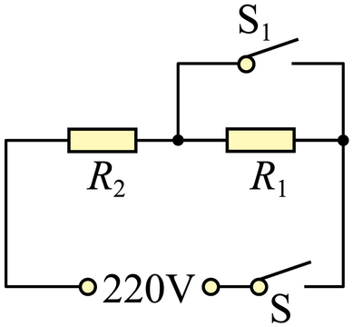

# Physics - 题目 2121

**ID**: 47d5d69e7efd426aa2d9f3038dbdd805
**年级**: Grade 9
**难度**: Medium
**题型**: Calculation

## 题目
如表为某饮水机铭牌的部分参数，其内部简化电路如图所示。​​​​​​​‌当S闭合，S_{1}断开时，饮水机处于保温状态，当S、S_{1}同时闭合时，饮水机处于加热状态。[c_{水}=4.2×10^{3}J/（kg·℃）]求：额定电压220V额定功率加热1000W保温44W热水器的容量2L（1）饮水机保温状态下正常工作时的电流；（2）饮水机保温状态下正常工作5min消耗的电能；（3）若不计热损耗，该饮水机正常工作时，将2kg的水从30℃加热至90℃，需要多长时间？

## 解答

1. 解：（1）根据P=UI可知，饮水机保温状态下正常工作时的电流
2. $I=\frac {P{{}_{保温}}}{U}=\frac {44{\rm{W}}}{220{\rm{V}}}=0.2{\rm{A}}$
3. （2）根据W=Pt可知，饮水机保温状态下正常工作5min消耗的电能
4. W=P_{保温}t=44W×5×60s=1.32×10^{4}J
5. （3）水吸收的热量为
6. Q_{吸}=c_{水}m（t-t_{0}）=4.2×10^{3}J/（kg·℃）×2kg×（90℃-30℃）=5.04×10^{5}J
7. 不计热损耗，饮水机需要加热的时间为
8. $t=\frac {W}{P{{}_{加热}}}=\frac {Q{{}_{吸}}}{P{{}_{加热}}}=\frac {5.04\times 10{^{5}}{\rm{J}}}{1000{\rm{W}}}=504{\rm{s}}$
9. 答：（1）饮水机保温状态下正常工作时的电流为0.2A；
10. （2）饮水机保温状态下正常工作5min消耗的电能为1.32×10^{4}J；
11. （3）需要加热504s。

## 知识点

**中文**:
  - 电与热综合计算

**English**:
  - Comprehensive Calculation of Electricity and Heat

---
